# 人才发展1127期迭代明细

## 1127 期功能明细

更新日期：2026-11-16。本文依据本轮明确需求、附件五份 Excel 模板及已确认的旧版页面整理。本文区分产品规则与原型展示；截图来自本地原型，示例人员、分数和统计人数不代表真实业务结果。

本轮确认：标准编号默认时间戳文本、允许自定义、最多20字符；标准导入只新增，已有编号拒绝；导入统一使用.xlsx；最新项目结束日期相同，采用最后导入的一条结果；系统设置页面统一命名为“能力指标维度自定义”。

| 编号 | 位置 | 本期调整 |
| --- | --- | --- |
| F01 | 人才标准／新建及编辑 | 增加标准编号，默认时间戳文本，可自定义，最多20字符。 |
| F02 | 人才标准／两个列表视角 | 增加人才标准导入；六张工作表按标准编号关联，只允许新增。 |
| F03 | 指标库／能力 | 复用旧版两步导入；一行一项能力，包含最多十级描述，同名称与类别更新。 |
| F04 | 系统设置 | 增加能力指标维度自定义，修改技能、素养、知识三个维度名称。 |
| F05 | 宫格盘点／能力数据 | 导入外部测评结果，模板自动带入本次盘点人员。 |
| F06 | 盘点项目清单 | 外部测评提供导入明细监控；平台360评估提供对应项目监控，均新页打开。 |
| F07 | 盘点／绩效数据 | 模板只保留工号、姓名、绩效得分，移除原始绩效等级。 |
| F08 | 宫格规则与结果 | 能力、绩效各支持2–5档，最多5×5共25格。 |
| F09 | 人才中心／人才库 | 按人员和能力导入等级、可选得分；模板为六列，不含来源列。 |
| F10 | 五类导入模板 | 统一字体、表头、示例与填写区样式；说明放同一行的单元格内换行。 |

### 一、人才标准

#### 1. 标准编号

- 基本信息增加必填字段“标准编号”，使用文本输入；新建时默认填入当前时间戳文本，允许用户自定义，长度不超过20字符。
- 标准编号应唯一。保存时编号为空、超长或与其他标准重复，均阻止保存并给出对应提示；编号保留前导零。
- 编辑标准回显已有编号；复制标准生成新的默认编号。已有无编号标准补充唯一编号并保持稳定；补号不代表恢复了原始创建时间。
- 本轮要求替代旧文档“编号不可修改”的描述。导入使用文件内填写的编号，不因遇到重复编号自动改号或覆盖。

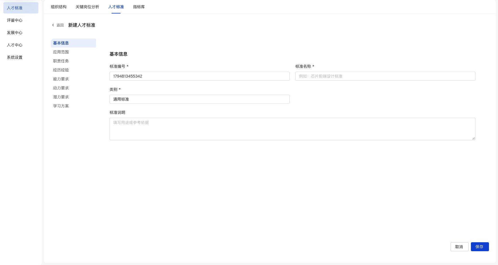

#### 2. 导入入口和交互

“按标准查看”和“按岗位查看”列表共用“导入人才标准”入口；岗位详情不再另设入口。点击后打开右侧抽屉，第一步下载模板并填写，第二步上传人才标准，校验通过后预览，确认后保存。取消或校验失败不新增标准。

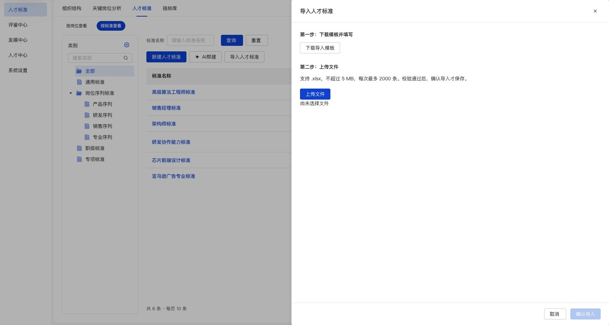

#### 3. 六张工作表及关联关系

| 工作表 | 字段 | 填写与关联规则 |
| --- | --- | --- |
| 基本信息和岗位 | 标准编号、标准名称、标准类别、标准说明、应用方式、岗位编号、岗位类别、岗位名称 | 一个岗位一行；同一标准关联多个岗位时重复基本信息。应用方式为指定岗位或暂不关联。 |
| 职责任务 | 标准编号、标准名称、标准类别、职责、任务 | 一行一项职责及其下的一项任务；职责有多任务时重复职责；任务可以不填。 |
| 经历经验 | 标准编号、标准名称、标准类别、经历经验 | 一行一条经历经验；没有此类要求时填写区留空。 |
| 能力要求 | 标准编号、标准名称、标准类别、能力组名称、能力名称、要求等级 | 一行一项能力要求；能力组名称按本轮附件保留，用于标准内雷达图归组；要求等级L1–L10。 |
| 动力要求 | 标准编号、标准名称、标准类别、动力名称 | 名称引用已有动力指标；没有要求时留空。 |
| 潜力要求 | 标准编号、标准名称、标准类别、潜力名称 | 名称引用已有潜力指标；没有要求时留空。 |

- 六表以标准编号关联，名称、类别必须与基本信息表一致；不能只凭同名标准猜测归属。
- 标准编号已存在时拒绝导入，只新增整套标准；文件中同一编号可多行关联不同岗位，但基本信息必须一致。一个编号不能代表两套不同名称或类别的标准。
- 指定岗位时，岗位编号、名称和完整类别路径必须匹配已有岗位；不通过导入创建岗位。当前原型岗位类别为单层，模板中的“研发”即该示例岗位的完整路径。正式多层岗位数据应使用实际完整路径。
- 暂不关联时岗位编号、类别和名称留空；应用范围只支持这两种方式，不在导入中增加条件组。
- 能力、动力、潜力均引用现有指标；不存在或名称不能唯一匹配时提示处理，不自动创建或任选一个指标。每套标准最多20项能力，重复能力拒绝。
- 能力组名称属于当前标准的展示分组，与指标库类别是不同字段；同一标准中名称相同的能力组归为一组，不同标准的组相互独立。

### 二、指标库：能力指标导入

在能力列表“新建能力”旁增加“导入能力”。参考旧版人才发展指标库的两步抽屉：先下载模板，再上传文件。本期统一为.xlsx，旧.xls须另存后上传。动力、潜力不增加导入入口。

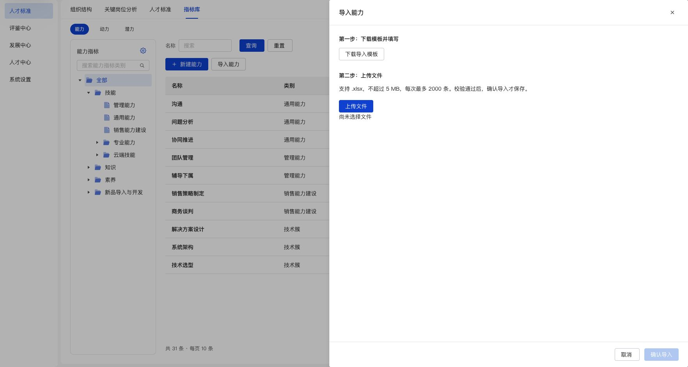

| 字段 | 规则 |
| --- | --- |
| 名称 | 必填，最多20字符；同一类别下作为匹配能力的名称。 |
| 类别 | 必填，引用已存在类别；从根节点写到实际类别，用英文句号连接，例如技能.管理能力。 |
| 维度 | 必填，填写“能力指标维度自定义”中当前已保存的名称。 |
| 定义 | 选填，最多1000字符。 |
| 一级至十级的分级描述、行为表现 | 最多十级，每级两列；各单元格最多2000字符，按实际内容填写。模板一行一项能力，不拆成每等级一行。 |

- 按照名称＋完整类别路径匹配。未匹配到已有能力时新增；唯一匹配时更新该能力的维度、定义及本行等级描述，保留其已有身份标识。
- 未出现在文件中的其他能力保留；不因文件缺行删除能力，也不修改其他类别下同名能力。
- 同一文件中名称＋类别重复、类别不存在、维度不存在、名称匹配不唯一或内容超长，均提示具体行号并阻止整批确认。
- 旧版导入说明中的覆盖操作只适用于能力指标。人才标准导入仍按只新增规则处理，二者不能混用。

### 三、系统设置：能力指标维度自定义

将胜任力管理“胜任力分类设置”的对应能力名称配置移到新版人才发展，页面和导航统一命名为“能力指标维度自定义”。保留技能、素养、知识三个位置，允许修改名称，每个名称必填、最多20字符，三个名称不能重复；本期不新增维度数量、排序或删除功能。

保存后，能力编辑器的维度选项和能力指标导入的维度校验使用新名称；取消恢复上次保存值。重命名应保持原维度与能力的对应关系，不能使原能力丢失维度。现有“人才标准维度”仍控制职责任务、经历经验、能力要求、动力要求、潜力要求的启用，两处配置各自独立。

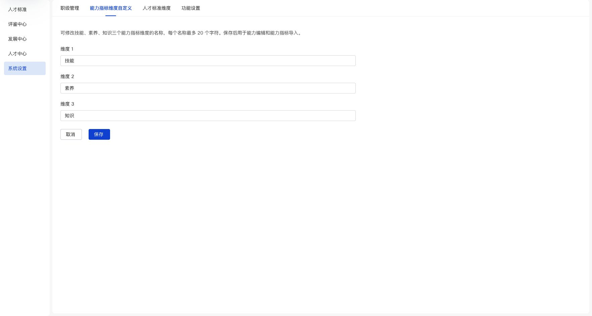

### 四、评鉴中心：人才盘点

#### 1. 导入外部测评结果

创建宫格盘点的盘点活动中，“能力数据”同时容纳平台测评项目和外部测评结果。“添加测评项目”与“导入测评结果”并排；两类来源可同时存在。外部数据独立保存，不需要在平台创建或关联同名测评项目。

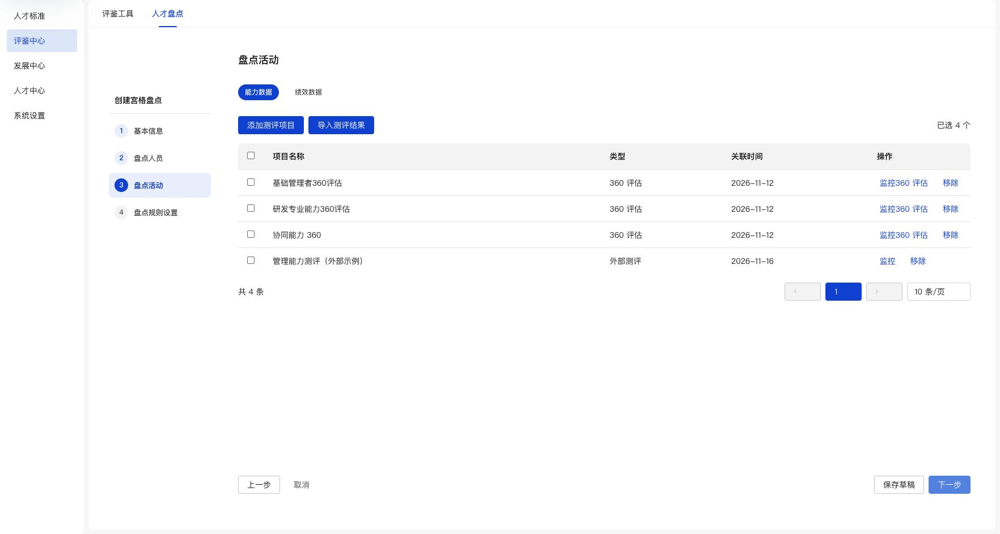

| 模板字段 | 规则 |
| --- | --- |
| 工号 | 必填，文本类型，必须属于本次盘点人员，保留前导零。 |
| 姓名 | 必填，须与工号匹配。 |
| 测评项目名称 | 必填，填写第三方项目名称；不是平台项目选择或匹配条件。 |
| 项目开始日期 | 必填，YYYY-MM-DD。 |
| 项目结束日期 | 必填，YYYY-MM-DD，不能早于开始日期。 |
| 测评得分 | 必填，0–999，最多两位小数；0有效，空白不视为0，不填单位或百分号。 |

- 下载模板自动带入本次盘点人员的工号和姓名，测评项目、日期和得分由用户填写；同一人员可复制为多行，分别填写不同项目。仅预填工号姓名且未填结果的行忽略。
- 按测评项目名称＋开始日期＋结束日期组织外部项目；同一人员在同一项目及起止日期下重复填写，视为重复行并报错。
- 同一人员有多个项目结果时，先按项目结束日期取最近的一条；最新结束日期相同时，按最后导入的一条结果取分，不取最高分。单次文件内同日的不同项目，按后出现的有效记录确定先后。
- 外部总分用于盘点的能力轴，与人才库逐项能力等级是不同数据，不把一条测评总分拆写成多项能力等级。

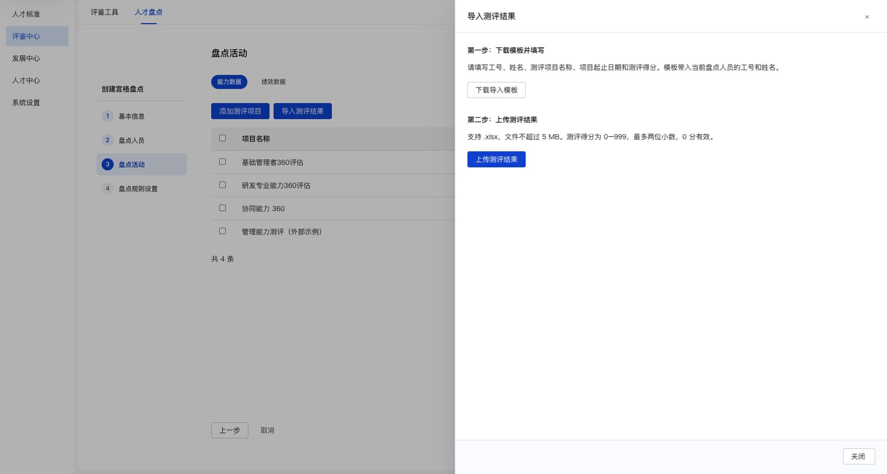

#### 2. 外部测评和360评估监控

| 来源 | 列表类型 | 操作与目标页面 |
| --- | --- | --- |
| 导入第三方结果 | 外部测评 | 点击监控，在新标签页打开该外部项目的导入数据明细。 |
| 选择平台测评项目 | 360 评估 | 增加“监控360 评估”，在新标签页进入该项目现有监控页面。 |

外部监控页包含项目名称，按姓名、部门、岗位查询和重置；表格展示勾选框、姓名、工号、部门、岗位、总分，支持分页。姓名、工号和总分来自导入，部门、岗位来自盘点人员资料；缺失时不编造。平台监控沿用现有项目页面，不能把外部明细和360评估页面混为同一种页面。

创建时可监控或移除所选项目；移除只影响本次盘点选择。盘点结束后的活动项目列表只保留监控。本地原型的平台监控为参考页面的复刻与示例数据，其他页签、导出和查看详情未接入；正式系统应跳到所选项目真实的现有监控页。

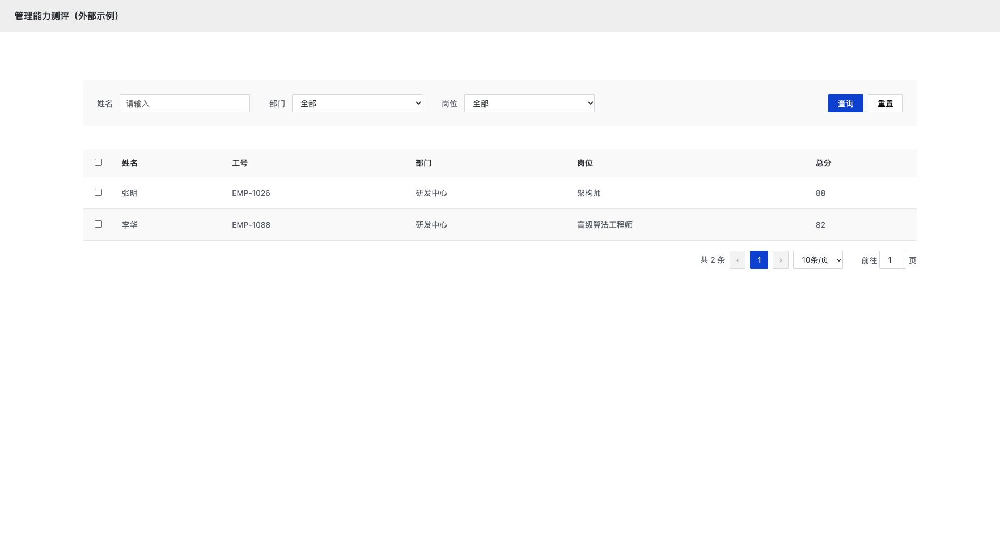

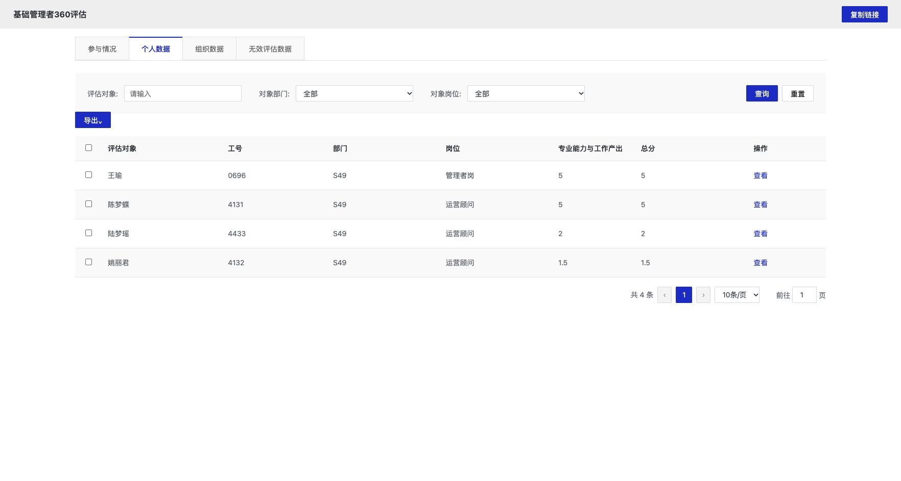

#### 3. 绩效数据导入与历史兼容

绩效数据支持导入，模板固定为工号、姓名、绩效得分三列，删除原始绩效等级。得分必填，范围0–999，支持最多两位小数。工号必须属于本次盘点人员，姓名匹配，同一工号只允许一条有效绩效数据。

历史仅有低、中、高等级的数据，由技术分别转换为1、2、3分；已有合法数值分数保持原值，不再强制转换为低、中、高。宫格盘点和人才图谱的绩效输入使用同一分数口径。原始输入得分与宫格低、中、高等排名档位分别表达，不能把0–999的合法范围误当作固定三段分数区间。

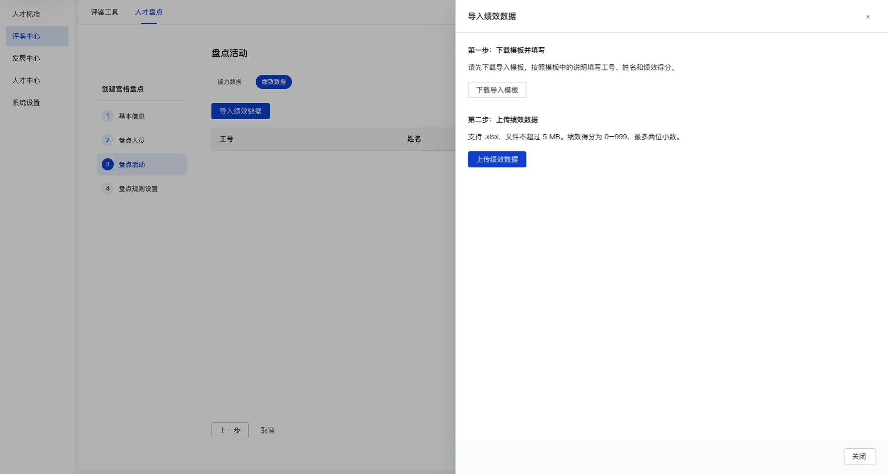

#### 4. 五档与最多25宫格

##### 分档默认值、名称编辑与结果联动

| 档数 | 档名（低→高） | 默认占比（低→高） |
| --- | --- | --- |
| 2 | 低、高 | 50%、50% |
| 3 | 低、中、高 | 60%、20%、20% |
| 4 | 低、较低、较高、高 | 40%、20%、20%、20% |
| 5 | 低、较低、中、较高、高 | 20%、20%、20%、20%、20% |

两轴按各自分数从高到低排名分档，占比是人数比例，不是原始分数区间。占比支持整数输入和加减，每档最低5%，修改一档时其他档自动平衡，单轴合计100%；恢复默认只作用当前维度，预估人数随本次盘点人数变化。

所有格子支持编辑名称，最多20字，长名称换行完整展示。2/3/4/5档分别从五档表取低/高、低/中/高、低/较低/较高/高及全部行列；两轴独立取值，交换轴只改变方向，不改变名称、解读和建议。

结果页矩阵显示名称及人数；点击某格同步选中名称、人数、占总人数比例、说明、发展建议和人员清单。5×5采用全宽矩阵，解读放在矩阵下方；较高与较低绩效分别使用各自文案。人数和名单当前仍为原型示例，正式计算待接入。

- 能力与绩效两轴独立选择2–5档，默认各3档；两轴分别配置各档排名人数占比，每档至少5%，每轴合计100%。
- 5档名称为低、较低、中、较高、高；4档为低、较低、较高、高。横纵轴交换只改变展示方向，不交换能力与绩效的业务含义或各自配置。
- 行列数由两轴档数组合产生：例如2×5为10格，5×5为25格；25格上限不是新增一个独立的盘点方法。
- 宫格展示人才画像名称、人数和对应解读、发展建议，如明星员工、核心骨干、中坚员工。名称以同一能力与绩效组合对应，不用潜力或任用结论替代。

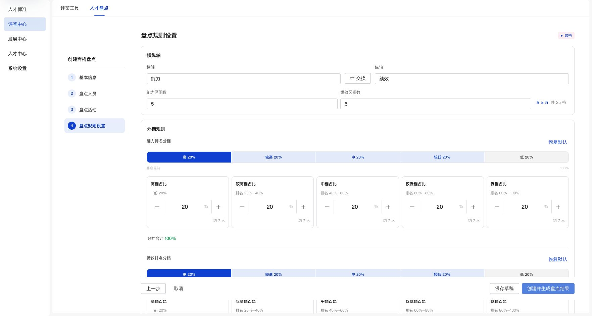

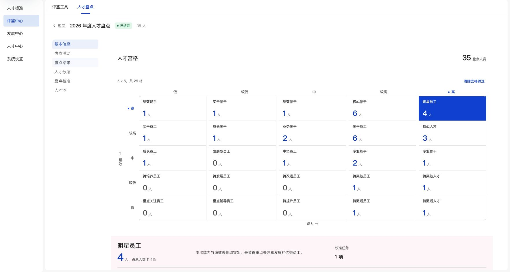

##### 25宫格默认名称总览

横轴能力由低到高，表格从高绩效向下排列。名称、说明和发展建议沿用此前确认的人才画像版文案，与原型共享内容一致。

| 绩效／能力 | 低 | 较低 | 中 | 较高 | 高 |
| --- | --- | --- | --- | --- | --- |
| 高 | 绩效能手 | 实干骨干 | 绩效骨干 | 核心骨干 | 明星员工 |
| 较高 | 实干员工 | 成长骨干 | 业务骨干 | 骨干员工 | 核心人才 |
| 中 | 成长员工 | 发展型员工 | 中坚员工 | 专业能手 | 专业骨干 |
| 较低 | 待培养员工 | 待发展员工 | 待改进员工 | 待突破员工 | 待突破人才 |
| 低 | 重点关注员工 | 重点辅导员工 | 待提升员工 | 待激活员工 | 待激活人才 |

##### 高绩效：名称、说明与发展建议

| 能力 | 名称 | 说明 | 发展建议 |
| --- | --- | --- | --- |
| 低 | 绩效能手 | 本次业绩表现突出，能力评估结果与工作成果存在较大差异，需要结合实际任务理解。 | 复盘关键成果，核对能力评估依据，围绕岗位必需能力提供针对性支持。 |
| 较低 | 实干骨干 | 本次取得了突出业绩，能力评估结果相对靠后，值得进一步梳理有效的工作经验。 | 总结成功做法，补齐关键能力，并在后续任务中验证经验的适用范围。 |
| 中 | 绩效骨干 | 本次业绩表现突出，具备一定能力基础，是当前业务成果的重要贡献者。 | 沉淀可复用的方法，围绕下一阶段任务提升关键能力。 |
| 较高 | 核心骨干 | 本次业绩突出，能力表现较好，能够为重要任务提供较强支撑。 | 安排关键项目，拓展协作范围，持续关注任务负荷与发展诉求。 |
| 高 | 明星员工 | 本次能力与绩效表现均突出，是值得重点关注和发展的优秀员工。 | 给予适当认可，提供关键任务与发展机会，并结合本人意愿做好保留。 |

##### 较高绩效：名称、说明与发展建议

| 能力 | 名称 | 说明 | 发展建议 |
| --- | --- | --- | --- |
| 低 | 实干员工 | 本次取得了较好业绩，能力评估结果相对靠后，需结合工作方式和任务特点进一步分析。 | 核对评估与工作实例，识别关键能力短板，安排任务中的辅导与反馈。 |
| 较低 | 成长骨干 | 本次交付了较好成果，能力表现仍有提升空间，可围绕现有任务继续发展。 | 提炼有效经验，针对高频任务开展训练，跟进能力与成果的共同提升。 |
| 中 | 业务骨干 | 本次业绩表现较好，具备相应能力基础，是业务交付的重要力量。 | 明确下一阶段成果目标，增加适当挑战，并及时复盘反馈。 |
| 较高 | 骨干员工 | 本次能力与绩效均处于较高档，具备承担重要任务的良好基础。 | 给予更完整的任务责任，在实际项目中检验持续交付和协作表现。 |
| 高 | 核心人才 | 本次展现了突出的能力和较好的业绩，具备进一步扩大业务贡献的基础。 | 结合业务需要安排复杂任务或专业攻关，明确成果要求并提供必要资源。 |

##### 中绩效：名称、说明与发展建议

| 能力 | 名称 | 说明 | 发展建议 |
| --- | --- | --- | --- |
| 低 | 成长员工 | 本次已有一定业务产出，能力评估结果相对靠后，需要进一步夯实岗位所需能力。 | 从具体任务入手安排辅导，帮助掌握关键方法，并跟踪实际应用效果。 |
| 较低 | 发展型员工 | 本次具备一定业务产出，能力表现仍有提升空间，需要把工作经验转化为可复用的方法。 | 聚焦一至两项关键能力，通过任务练习和及时反馈逐步提升。 |
| 中 | 中坚员工 | 本次能力与绩效均处于中间档，是团队当前业务运行的基础力量。 | 明确下一阶段提升重点，在保持现有交付的基础上增加适当挑战。 |
| 较高 | 专业能手 | 本次能力表现较好，已形成一定业务贡献，能力优势还有进一步发挥的空间。 | 选择能够发挥优势的任务，明确交付目标，定期复盘成果转化情况。 |
| 高 | 专业骨干 | 本次展现了突出的能力，当前业绩尚有提升空间，可进一步发挥能力优势。 | 核查任务匹配与资源条件，安排合适的专业任务，并跟进实际成果。 |

##### 较低绩效：名称、说明与发展建议

| 能力 | 名称 | 说明 | 发展建议 |
| --- | --- | --- | --- |
| 低 | 待培养员工 | 本次能力评估结果相对靠后，业绩表现也需改善，需要先明确岗位任务和支持重点。 | 核对岗位要求与评估依据，提供基础辅导，设置可检验的短期任务。 |
| 较低 | 待发展员工 | 本次能力与绩效均处于较低档，需要围绕当前岗位要求开展有重点的发展支持。 | 选取关键任务开展训练与辅导，约定阶段目标并持续反馈。 |
| 中 | 待改进员工 | 本次具备一定能力基础，但业绩表现偏低，需要进一步明确影响交付的具体因素。 | 梳理目标、执行过程和协作障碍，制定有明确期限的改进计划。 |
| 较高 | 待突破员工 | 本次能力表现较好，业绩尚未充分体现，需要找到能力转化为成果的具体突破点。 | 优先解决关键交付障碍，明确责任与成果要求，跟进阶段性进展。 |
| 高 | 待突破人才 | 本次能力表现突出，业绩相对靠后，需要结合任务匹配与工作条件分析原因。 | 沟通影响成果的主要因素，调整任务或资源安排，并以实际成果验证改善。 |

##### 低绩效：名称、说明与发展建议

| 能力 | 名称 | 说明 | 发展建议 |
| --- | --- | --- | --- |
| 低 | 重点关注员工 | 本次能力与绩效均处于低档，需要优先了解实际困难并明确改善方向。 | 开展一对一沟通，核对任务与评估依据，制定具体目标和支持安排。 |
| 较低 | 重点辅导员工 | 本次业绩处于低档，能力表现也需加强，需要更有针对性的辅导和过程反馈。 | 聚焦关键工作方法，安排辅导或带教，并定期检查短期任务完成情况。 |
| 中 | 待提升员工 | 本次具备一定能力基础，但业绩表现处于低档，需要找到影响工作成果的主要原因。 | 对齐目标与交付标准，识别执行障碍，约定阶段性改善结果。 |
| 较高 | 待激活员工 | 本次能力表现较好，当前业绩与能力结果存在差异，需要进一步分析成果转化的障碍。 | 核查任务安排、协作和资源支持，明确重点成果并持续反馈。 |
| 高 | 待激活人才 | 本次能力表现突出，当前绩效尚未充分体现，需结合岗位匹配与工作条件进一步分析。 | 与本人沟通主要障碍和发展意愿，优化任务与资源安排，跟踪后续成果。 |

### 五、人才中心：人才库导入能力数据

人才库表格工具栏增加“导入能力数据”，右侧抽屉先下载模板，再上传校验，预览通过后确认导入。模板为六列，不再要求用户填写来源。

| 字段 | 规则 |
| --- | --- |
| 工号、姓名 | 必填，匹配系统已有人员，工号按文本保存。 |
| 能力类别、能力名称 | 必填，类别填写完整路径，用英文句号连接，与现有能力词典名称唯一匹配。 |
| 能力等级 | 必填，1–10整数，对应L1–L10。 |
| 能力得分 | 选填，填写时为0–999、最多两位小数；0有效，空白保留为空。 |

- 一行是一名人员的一项能力；同一文件中同人同能力重复时阻止确认。
- 确认后追加能力记录，保留历史及未导入的其他能力；同一能力采用最新有效记录，同日按导入时间取最新，沿用已有能力记录口径。
- 档案和人才对比按能力等级比较人才标准。原始得分单独保留，不擅自换算成等级或五分制总分。
- 来源由系统记录为人才库导入，不增加第七列要求；模板没有实际测评日期、有效期，不假装还原这些信息。

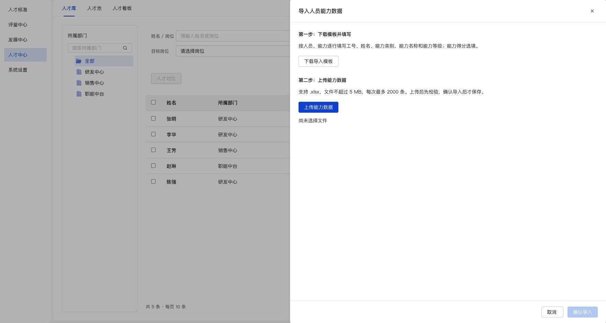

### 六、导入报错与处理范围

保留影响正常使用的主要校验，不在本期扩展低频、过细的特殊情况。通用原则：先校验整份文件，错误按工作表及行号展示；有错误时不部分写入。标准、能力指标和人才库能力导入在校验通过后确认保存；盘点导入在校验通过后展示本次数据，失败不替换已有有效预览。

| 报错类别 | 典型情况 | 处理 |
| --- | --- | --- |
| 文件不符合要求 | 不是.xlsx、文件损坏或无法读取、超过5MB | 提示更换文件或另存为.xlsx；不进入确认。 |
| 模板结构不匹配 | 必需工作表缺失、表头缺列或改名 | 提示使用对应入口下载的模板；不得按相近字段猜测。 |
| 没有有效数据或数量超限 | 只有说明与示例、超过2000条；标准按六表合计行数 | 忽略示例和空白行；无数据时提示填写，超限时提示拆分文件。 |
| 必填或格式不合法 | 标准编号为空、超20字符；内容超长；公式代替实际值 | 定位字段与行号，修改后重新校验。 |
| 标准编号或表间冲突 | 已有编号、同编号基本信息不同、内容表未能对应基本信息 | 拒绝整批确认；不覆盖、不自动改号。 |
| 人员或岗位匹配失败 | 工号不属于盘点名单、姓名不匹配、岗位编号及类别名称不一致 | 明确匹配问题，不创建人员、岗位或猜测同名对象。 |
| 指标、类别或维度匹配失败 | 类别不存在、指标不存在或同名歧义、维度不是当前配置 | 提示使用已有数据或先到相应位置维护。 |
| 文件内重复 | 同人同能力、同人同项目及日期、同工号绩效、同名称类别能力 | 报出重复行，用户删除或调整后再导入。 |
| 日期、等级或分数不合法 | 日期倒置、等级不在1–10、分数越界、超过两位小数 | 展示有效范围；0分不报缺失，空值不自动补0。 |

### 七、统一后的Excel模板

五份模板统一字体和字号、深蓝表头、浅灰示例及白色填写区。导入说明合并到第一行的一个单元格内换行，不再占用多行Excel；第二行为字段表头。人才标准第3–5行为示例、第6行起填写；其他四类第3行为示例、第4行起填写。示例不导入，说明同步更新行号。

人才标准保留六工作表结构；能力指标保留一行一项、最多十级的横向结构；人员能力使用当前单表版，不包含填写参考工作表。工号和标准编号为文本；分数填写区按数值格式展示。宫格模板在页面下载时预填本次盘点人员，附件底板本身不冒充动态人员名单。

[人才标准导入模板](../../outputs/1127-update/人才标准导入模板.xlsx)

[能力指标导入模板](../../outputs/1127-update/能力指标导入模板.xlsx)

[能力测评结果导入模板](../../outputs/1127-update/能力测评结果导入模板.xlsx)

[绩效数据导入模板](../../outputs/1127-update/绩效数据导入模板.xlsx)

[人员能力数据导入模板](../../outputs/1127-update/人员能力数据导入模板.xlsx)

### 八、原型边界与开发验收

当前项目是静态前端原型。本轮交付页面入口、字段、模板和交互展示，业务校验与解析口径以本文供开发实现；本地预览中存在的解析、浏览器存储及示例快照，不等于正式导入服务、租户权限、业务数据库或上线功能。

盘点项目选择、外部监控和25宫格已可在原型查看。外部最新结束日期及同日最后导入的选分逻辑用于本地活动快照；盘点结果仍使用既有示例汇总，未接入正式人员排名、同分边界、结果落位和跨来源数据计算。人才图谱图表同样为原型示例。不得据截图宣称导入已改变35人盘点结果。

| 验收项目 | 开发目标 |
| --- | --- |
| 标准编号 | 新建生成文本编号，可改且最多20字符；编辑、复制、历史补号及唯一性校验正确。 |
| 人才标准导入 | 六表按编号关联；只新增；重复编号、错误引用和文件内冲突阻止写入；确认前不保存。 |
| 能力指标导入 | 横向十级字段正确映射；名称＋类别唯一匹配更新，未匹配新增；其他能力保留。 |
| 能力指标维度自定义 | 三个名称保存、取消、长度和重名校验正确；编辑与导入读取当前名称。 |
| 外部测评 | 模板带入盘点人员；多项目和日期可读取；按结束日期、最后导入规则取分，分数保留原值。 |
| 监控 | 两类项目分别进入正确页面且新页打开；外部只显示对应项目导入记录；结束后不再移除。 |
| 绩效 | 只接收三列新模板，0–999和两位小数生效；旧低中高转换1、2、3；原分数保持。 |
| 25宫格 | 两轴2–5档、比例合计100%；交换轴后含义一致；格数、人数与名单在正式计算链路中一致。 |
| 人才库 | 六列数据追加并保留历史；等级与得分独立；取消和失败不写入，档案使用最新有效等级。 |

### 九、此前已记录的本期事项与边界

以下事项在重写前文档已有记录，本轮恢复说明以免丢项；不将其标为本次已实现，也不擅自扩大到已接后端。

| 事项 | 此前记录及本轮状态 |
| --- | --- |
| 人才标准导出 | 按标准查看、按岗位查看两个列表视角增加导出；导出当前筛选还是已选数据仍须明确。正式导出未实现，不因已有导入模板视为完成。 |
| 人才图谱逐项能力导入 | 选择能力项目之外可下载人员模板、导入逐项能力数据，预填本次人员；原型已有下载及本地校验，尚未写入档案或正式盘点结果。它不是宫格外部测评总分模板；当前五份附件不包含这份模板，具体字段及统一口径仍须核对。 |
| 发展序列导入、导出 | 发展中心／岗位地图，覆盖序列、职级、通道及岗位挂载；校验引用与重复节点，文件缺行不删除已有节点。岗位地图与设置需统一数据来源，模板和正式功能待设计与核对。 |
| 岗位标识展示 | 此前要求岗位信息补充岗位编号与类别完整路径，识别大量同名岗位时用稳定编号；本轮导入规则已写明，页面各入口的展示适配仍须按实际逐处核对，不将单层示例冒充多层验证。 |

宫格选择平台项目：搜索并勾选后移入已选列表，可移出；确定后追加，取消不生效，已关联项目不重复添加。清单保留项目名称、类型、关联时间及操作，关联时间是加入本次盘点日期；主表不增加查询。至少一个有效平台项目或有效外部结果后才能继续规则设置。

宫格导入校验通过时展示有效记录和覆盖人数；空白不按0，不合规小数不自动四舍五入；失败保留上次有效预览。导入抽屉的步骤、宽度、按钮及状态反馈保持一致，解析及业务校验逻辑以本文供开发实现。
