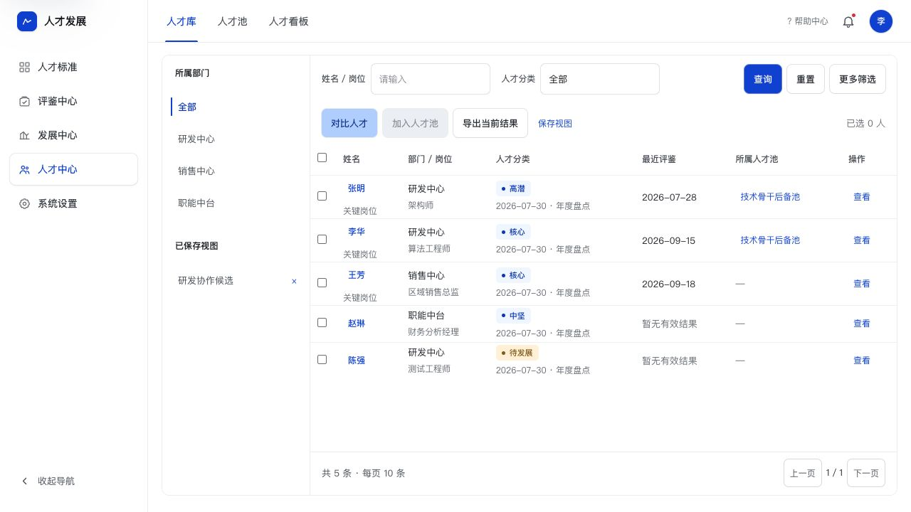
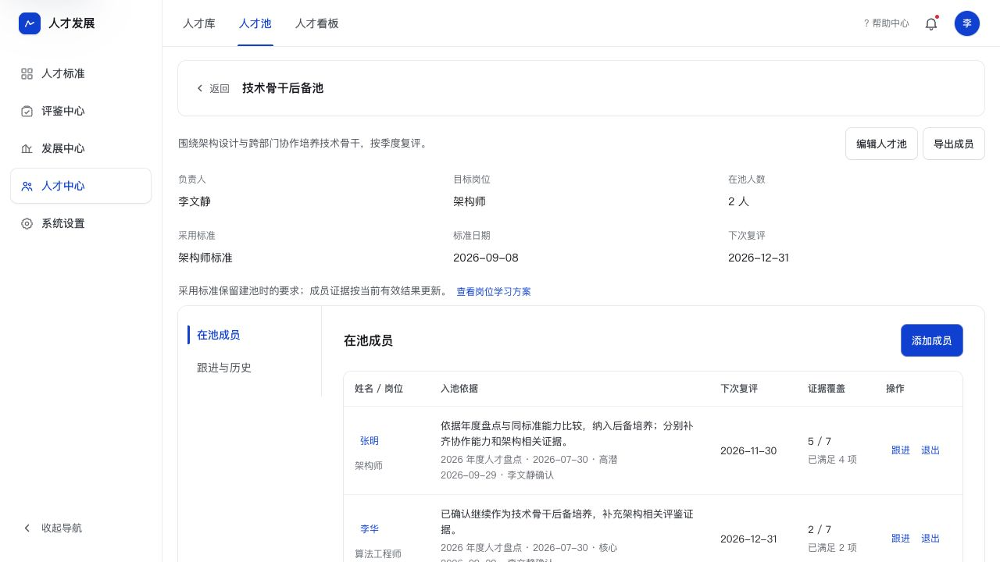

# 人才中心实施与验证记录

> 本文保留首次实施记录；后续用户明确否定“已保存视图”，该功能已移除。以同目录 refinement-review.md 与 PRD V1.30 为当前结果。

日期：2026-09-29。范围：桌面管理端静态原型。

## 本轮实现

- 人才库：部门、分类、标签、能力与评鉴日期等联合筛选；保存视图；批量入池；2–5 人对比；CSV 导出。
- 人才档案：概览、标准与差距、评鉴与盘点、发展记录；按人员 ID 展示，保留实际能力雷达和有效证据来源。
- 人才对比：采用同一岗位标准，区分已满足、待发展、待补证据；支持入池及 CSV。
- 独立人才池：创建、编辑、选人、入池理由与来源、成员复评、跟进、退出历史、再次入池、成员导出。
- 基础看板：人员、评鉴覆盖、跨池去重人数、待补评鉴；部门筛选与名单下钻。
- 共用原有样式、顶部导航、列表工作台、弹窗和搜索多选器。标准与岗位继续使用 Standards，共享标准数据没有重建或重置。

需求基线同步至 PRD V1.29 第 9 节和 PROJECT_HANDOFF.md。

## 浏览器实测

环境：本地 `http://127.0.0.1:8766/`，Codex 内置浏览器，1280 × 720 桌面视口。

| 流程 | 结果 |
| --- | --- |
| 初始人才库显示 5 人、三项顶部入口 | 通过 |
| 跨部门沟通最低 L3 筛选仅命中李华 | 通过，张明 2.8 不计为达标 |
| 保存“研发协作候选”并刷新后加载 | 通过，恢复筛选条件 |
| 张明、李华统一采用架构师标准对比 | 通过，使用浏览器既有标准；张明已知 5 项、李华已知 2 项 |
| 新建技术骨干后备池、加入两人 | 通过，保存目标、负责人、标准、理由和来源 |
| 张明池内发展沟通、调整复评至 2026-11-30 | 通过，档案发展记录可查看对应跟进 |
| 李华退出后刷新、再次加入 | 通过，保留退出记录，当前在池人数为 2 |
| 已有成员时编辑人才池 | 通过，目标岗位和采用标准禁用，复评日期作用说明明确 |
| 张明档案四分区、切换标准、证据详情 | 通过，雷达实际值不变，要求线按所选标准显示 |
| 赵琳档案无有效评鉴，选择目标架构师标准 | 通过，全部要求为待补充证据，不产生虚构分数 |
| 看板全部范围与职能中台筛选、待补评鉴下钻 | 通过，全部 5 人/3 人有效，职能中台 1 人/0 人有效，下钻为赵琳 |
| 人才库与人才池表格视觉检查 | 通过，修正原最小表宽影响；可见操作列，长入池依据换行 |
| 控制台错误与警告 | 检查时未发现 |

浏览器测试留下“研发协作候选”视图、“技术骨干后备池”及跟进/退出示例，仅存在当前浏览器存储中；其他浏览器首次进入人才池为空态。

## 自动检查

执行：`node deliverables/frontend-review/2026-09-29-talent-center/check-data.cjs`。

7 组业务规则检查通过：人员身份、未知证据、待发展与未评估区分、过期与未来记录过滤、最高有效值、同条记录的日期与等级联合约束、非标准等级不生成结论、同池去重、退出重入、采用标准内容留存、跨池人员去重、存储重读。

`node --check` 检查 `app.js`、`talent-center.js`、`talent-data.js` 通过；6 个页面的静态资源引用检查通过。

## 验证边界

- CSV 按钮已触发，但内置浏览器的下载事件等待超时，未取得输出文件，不标记端到端文件下载验收通过。浏览器打印保存 PDF 的最终输出未验证。
- 没有后端、权限、真实评鉴/盘点结果接入和发展计划发布；只验证当前原型范围。新增李华、王芳评鉴均为演示数据。
- 不进行移动端及无关业务页面的全面回归。本轮修改公共 app.js 仅涉及人才导航与人才分区排除通用页签处理。
- 工作区原有未提交修改保持，不提交或推送 Git。

## 视觉证据

### 人才库

### 人才池

## 同日切页修复

- 六个人才页面脚本移到 head 并使用 defer，解除底部串行下载阻塞；未完成公共壳层转换的旧骨架不绘制。
- 跳转主内容链接取消滑入动画，默认裁切隐藏，仅键盘 focus-visible 显示。CSS 版本 20260929d。
- 浏览器验证：人才库与人才池可通过鼠标导航切换；新样式为 inset(50%)、transition none；Tab 可聚焦并显示辅助入口。未做量化性能基准，不承诺加载耗时数值。
- 本次浏览器语义点击存在坐标偏移，改用截图中的实际坐标后导航正常；未将工具点击偏移作为产品导航缺陷。
