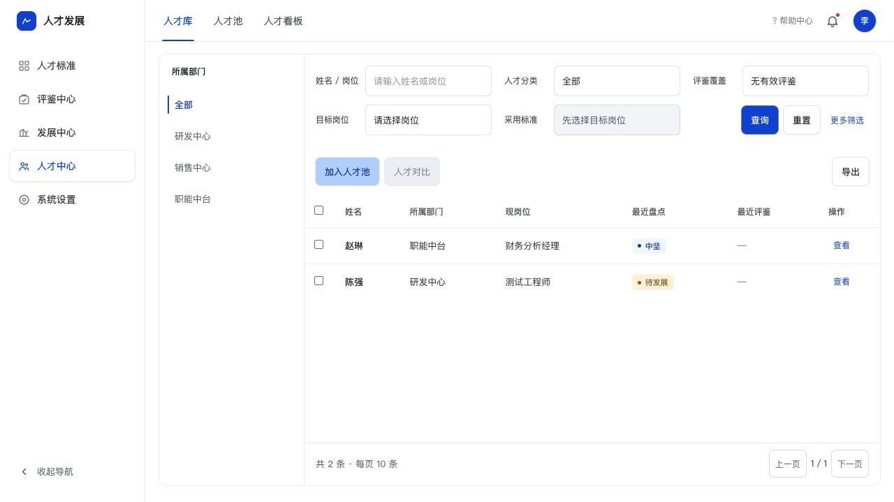

# 人才库筛选区修正

2026-09-30，PRD V1.34。依据用户标注的独立岗位灰条及悬空“暂无有效评鉴”文字。

- 移除 `tc-search-target` 与 `tc-filter-note`；姓名/岗位、人才分类、评鉴覆盖、目标岗位、采用标准均在同一白底筛选表单，复用公共字段、输入框、选择框与按钮。
- 评鉴覆盖下钻直接显示为选中条件，不冒充提示。可直接切回全部；更多筛选只计尚在弹窗内的条件。
- 查询、变更条件与重置同步 URL，刷新不恢复已经清除的旧条件。
- 原有岗位要求状态移至更多筛选，已选标准时展示；是否入池条件也能在原有弹窗修改。

浏览器验证：

1. 无有效评鉴为 2 人；切回全部为 5 人，URL 清除 coverage，刷新仍为 5 人。
2. 重置后刷新为 5 人，目标、标准及旧下钻条件均清除。
3. 架构师标准 + 待发展筛选为张明 1 人，URL 保留标准和状态。
4. 原用户页面 1269×1056 及后台 1280×720 均目视检查，标签和控件对齐，无独立灰条或悬空条件文字；后台页无控制台错误。
5. `node --check app/talent-center.js` 通过；未新增无关测试或改动其他中心。未验证手机端。

资源版本：20260930g。当前 PRD 和项目交接同轮更新。

