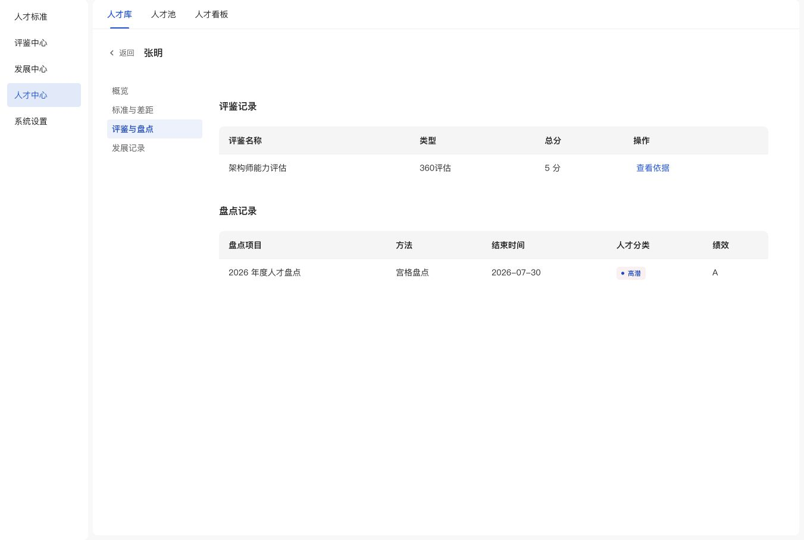

# 人才档案顶部操作

2026-11-05：按用户要求移除人才档案顶部“加入人才池”和“导出档案”按钮，仅保留返回、姓名。其他页面入池入口及已有成员数据不变。

已在 1351×909 浏览器视口核验张明档案的概览与评鉴及盘点分区：顶部无加入人才池或导出档案按钮，评鉴总分仍显示“5 分”，无可见布局异常；控制台无 error/warn。JS 语法、297 处资源指纹和 `git diff --check` 检查通过。本轮未执行打印或其他页面入池操作。

