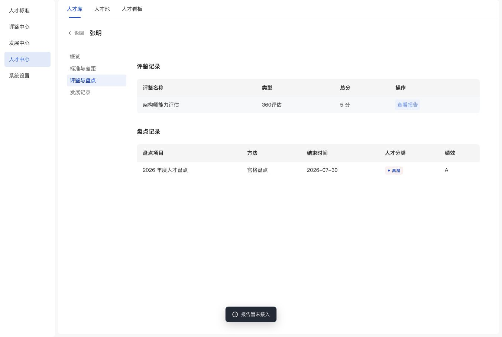

# 评鉴报告入口

2026-11-05：人才档案评鉴记录的“查看依据”改为“查看报告”，移除该入口原分项依据抽屉及调用。当前评鉴记录没有关联报告页面，点击使用已有提示组件显示“报告暂未接入”，不跳转到其他人员的示例报告。

已在 1351×909 浏览器视口验证文案及点击：档案列表保持可见，没有抽屉或遮罩，提示正常；总分仍为 5 分，顶部仅有返回、姓名。控制台无 error/warn。JS 语法、297 处资源指纹和 `git diff --check` 检查通过。真实报告展示尚未接入。

