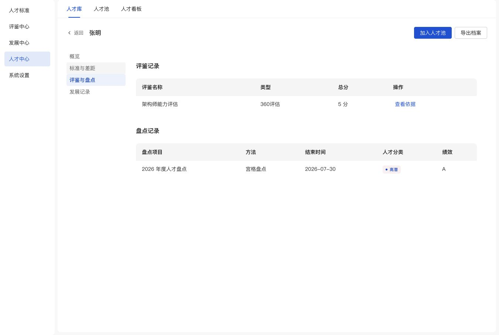

# 人才档案评鉴总分列

2026-11-05：按用户要求，将评鉴记录的“完成日期”“有效至”替换为“总分”一列。

- 新列表字段：评鉴名称、类型、总分、操作。
- 按用户后续要求，总分暂固定展示“5 分”，仅作原型示例，不写入记录或根据分项换算。
- 日期及有效期保留在记录与“查看依据”中，原有效性判断和盘点表不变。
- 已在 1351×909 浏览器视口验证张明档案：四列表格完整，无可见溢出；查看依据可打开和关闭，日期、有效期及五项分数完整；控制台无 error/warn。
- `node --check app/talent-center.js`、297 处资源指纹检查、`git diff --check` 通过。
- 未验证正式后端总分接入；当前原型没有该接口。

