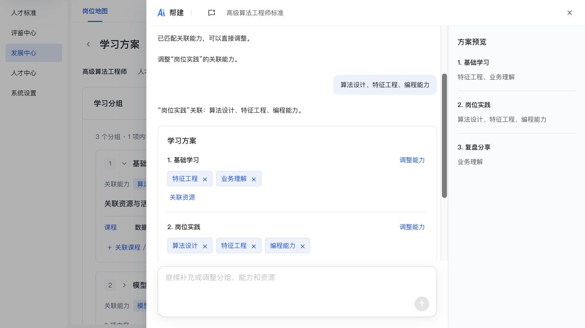
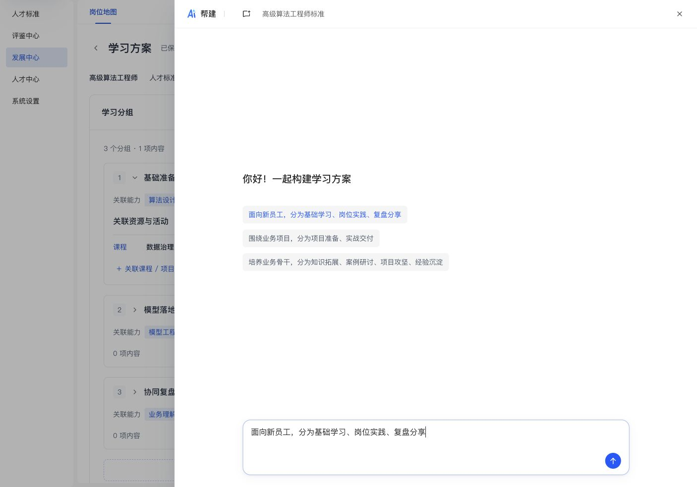
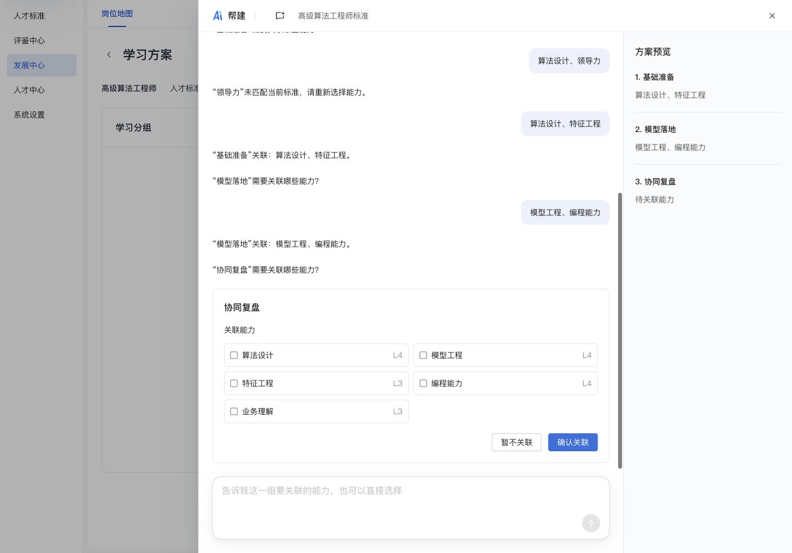
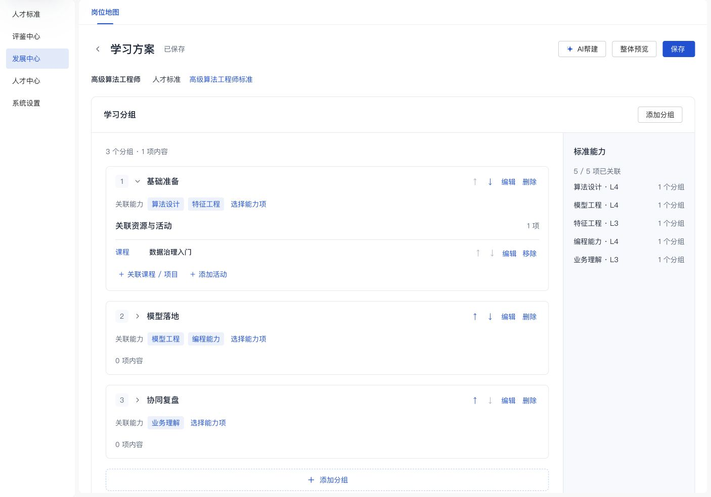
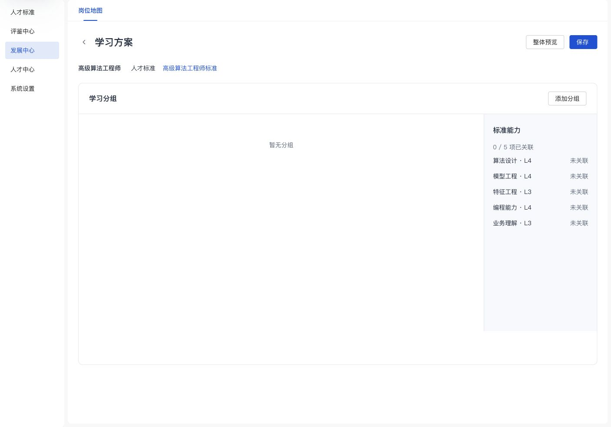
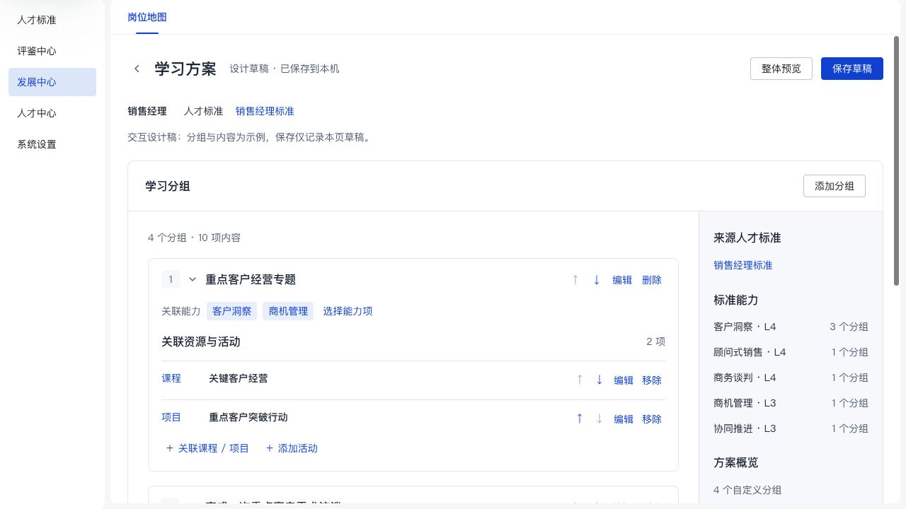

# 学习方案自定义分组设计预览

能力自动关联更新：确认分组后立即进入整体预览，全部分组已有本地规则匹配的来源能力，不再逐组追问。已在浏览器验证新员工三组直接出现关联标签，必经“确认关联”按钮数量为0，“添加到方案”可用；直接删除基础学习的算法设计后标签与预览同步更新。按需调整岗位实践，取消模型工程并确认后返回三组总览，不进入下一组。删除保持原滚动位置，焦点回到该组调整按钮。未应用本次测试到既有方案，控制台无warn/error。

新增2项测试覆盖批量匹配、未知名称留空、人工修改/清空保留及来源能力约束；本次共6项帮建定向测试通过。自动建议为关键词规则，未调用真实模型。最新截图：

欢迎区示例补充核验：以新员工、业务项目、业务骨干三条需求示例替换原单一按钮，展示3/2/4个自定义分组。逐条点击均只将原文填入输入框，欢迎区保持可见，不自动发送；第二条手动发送后正确整理为“项目准备、实战交付”两组。重置会话后保留三条示例，点击仍可编辑。未刷新用户原来有未保存修改的标签页，在新标签页核验；未应用测试对话到方案。控制台无warn/error，4项帮建解析测试、JS语法、310处资源指纹及diff检查通过。

最新AI帮建核验：顶部新增AI帮建，复用标准帮建样式和公共抽屉开关/焦点逻辑。当前使用本地规则与确认卡，未调用模型，不具备任意语义理解；未接收费服务。来源标准继承入口；不会为能力另建固定阶段。

已通过浏览器完整流程：只给阶段数量时追问名称；输入“基础准备、工程实践、协同复盘”并对话改名为“模型落地”；逐组以文本和多选框确认五项来源能力。“算法设计、领导力”被识别为包含未知词条，保持当前步骤，不静默部分采用。确认后选择数据治理入门课程，添加到页面产生3个分组和1项资源，页面显示未保存；保存后刷新仍为3组1项并显示已保存。重复打开已应用会话时应用按钮禁用。

另用“标准理解、项目实践”两组确认动态数量；完成后输入“全部能力”会要求指定分组，“第一组关联全部能力”能正确更新第一组。第二轮未应用，页面保存的3组1项不受影响。900×900时抽屉无横向溢出，窄窗口隐藏右侧预览但会话中的草稿仍可操作；默认视口已恢复。控制台无warn/error。4项新增解析测试＋48项现有回归共52项通过，JS语法、310处管理端资源指纹及diff检查通过。未测试正式后端、真实模型、跨端下发。

以下为前序页面核验记录。

最新文案精简核验：删除交互设计稿说明、实现性保存文案、空态长说明及重复侧栏；算法标准空态为“暂无分组”，只保留一个添加入口，未操作时不显示保存状态。已有销售方案保持4组10项，显示“已保存”。已刷新用户批注所在页面，核验弹窗取消、空态/有内容两种渲染、无横向溢出及控制台无warn/error；JS语法、资源指纹与diff检查通过，本轮未重复运行无关业务回归。最新页面截图如下，后文截图为此前版本。

2026-11-06，按用户本轮最新纠正更新。预览：<http://127.0.0.1:8766/learning-plan-design.html?position=SA-201&standard=std-sales>。

当前组织方式为自定义分组：创建分组、填写标题、选择关联能力、直接关联资源。名称、数量、顺序均可调整，不以能力作为阶段或页面导航；无需创建任务或填写培养目标、预期产出。能力可以跨分组关联，每组可选择多项。分组说明选填。课程/项目使用现有示例候选，已有实践/反馈等活动继续保留并可编辑。

来源标准由标准详情入口带入，只读展示名称与查看链接，不提供选择器。缺失来源时提示并禁用保存；旧资源方案从标准进入时同样只读展示来源，未改造其岗位单份存储。

本地设计草稿继续使用 talent-learning-plan-design-v1，按岗位和来源标准隔离。初版tasks在读取时一对一承接为groups，原标题、说明、关联能力、活动和其他既有字段保留，点击保存才写入新结构。原标准、原资源方案和学员端数据均未修改。不提供正式发布、资源执行、导师审核或模型调用。

已验证：

- 来源标准选择器和能力导航均为0个；固定“按能力构建”标题已删除。
- 初版已保存的3项任务和8项活动完整承接为3个分组，未重置内容。
- 空标题阻止创建；可先创建自定义分组，再多选客户洞察和商机管理，并直接关联关键客户经营课程、重点客户突破行动项目。
- 新建“重点客户经营专题”分组移动到第一位，保存并刷新后标题、两项能力、两项资源及顺序保留；页面示例现为4个分组、10项内容。
- 取消删除不改变分组；整体预览按自定义分组展示，没有按能力拆成多份。
- 之前已核验从不同标准入口读取相应草稿，缺失来源不自动套用销售标准；本轮继续保留该逻辑。
- 1280×720、900×900观察布局，900px时整页及主内容均无横向溢出；临时视口已恢复。控制台无warn/error。
- 48项现有Node回归、修改JS语法、307处管理端资源指纹及git diff --check通过。未验证正式后端或学员端执行。

当前截图：

同目录overview.jpg、tasks.jpg、preview.jpg为初版历史截图；standard-context.jpg记录移除标准选择器后的中间版本，均不作为当前页面设计基线。
