# 新版人才发展操作手册

## 功能导航

### 模块总览

| 一级菜单 | 核心用途 | 常用操作 |
| --- | --- | --- |
| 人才标准 | 梳理组织与关键岗位，维护岗位要求 | 组织结构分析、关键岗位分析、岗位管理、指标库 |
| 评鉴中心 | 开展能力评估和人才盘点 | 360评估、盘点人员与活动配置、结果查看、校准、项目人才池 |
| 发展中心 | 将岗位组织为可查看的发展通道 | 新增岗位地图、配置节点岗位、按序列查看地图 |
| 人才中心 | 集中查看人才信息与盘点结果 | 人才库、人才档案、人才对比、人才池 |
| 系统设置 | 维护职级基础和学员端显示项 | 职级管理、功能设置 |

### 通用操作

- **查询与重置**：输入名称、编号或其他筛选条件后点击「查询」；点击「重置」清除当前筛选条件。
- **类别与部门树**：选择左侧类别或部门缩小范围；出现「包含子类」时，可按需要设置是否同时查询下级。列表过窄时可收起左侧树。
- **选择内容**：在待选区勾选记录，点击「移入」加入已选区；在已选区勾选记录，点击「移出」取消选择。
- **保存配置**：在选择弹窗中点击「确定」带回选项，返回配置页面后点击「保存」提交。

## 一、人才标准

### 1.1 组织结构

查看组织中岗位的序列、层级、岗位族和人员分布，为关键岗位分析提供组织基础。

**操作入口**：「人才标准」→「组织结构」。

#### 查看当前分析

1. 进入组织结构页面，查看序列数、层级数、岗位族及覆盖岗位／人数。
2. 在分析矩阵中查看不同序列与层级的岗位和人数分布。「暂无岗位」表示该单元格当前没有岗位。
3. 按需要切换「综合视图」「岗位评价法视图」或「结构分析法视图」，从不同视角查看分析结果。
4. 在结果标题旁查看分析时间。

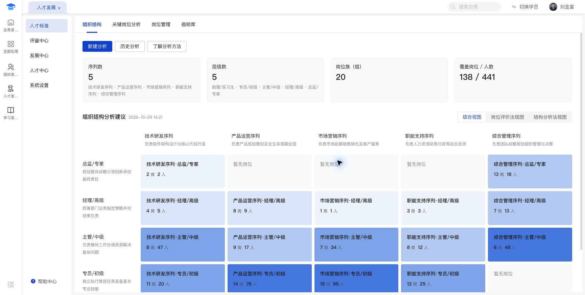

图 1.1-1　组织结构：查看当前分析汇总与岗位族分布

#### 新建组织结构分析

1. 点击「新建分析」，进入组织结构分析向导。
2. 在「组织范围」中选择部门，按需要使用「包含子类」和搜索；在待选区勾选岗位并移入已选区。
3. 核对右侧已选岗位，点击「下一步」，进入「说明材料」。

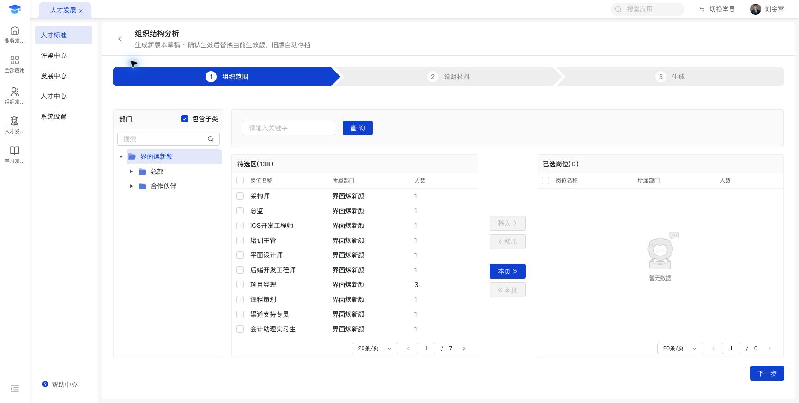

图 1.1-2　组织范围：筛选岗位并移入已选区

4. 点击上传区域或拖入职责说明书、组织文件，支持 doc、pdf、xls 格式，最多 10 个文件，单个不超过 100MB。
5. 完成说明材料后，点击「下一步」进入生成环节。

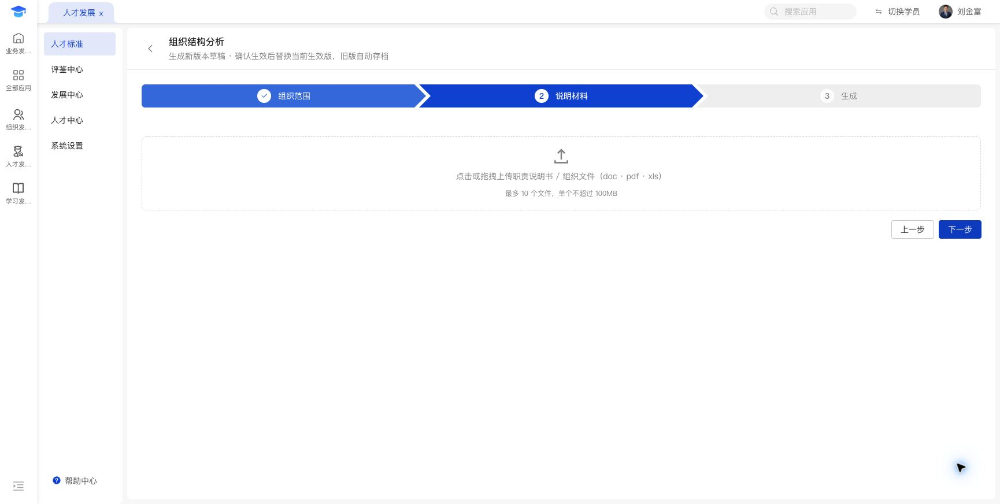

图 1.1-3　说明材料：查看文件上传入口与数量、大小要求

新分析生成后形成版本草稿，确认生效后替换当前生效版本，旧版本自动存档。

#### 查看历史分析

1. 在组织结构首页点击「历史分析」。
2. 在侧栏查看各版本的状态、操作人、创建时间和序列／层级规格。
3. 通过「生效中」「已存档」识别版本状态，点击「展示更多」查看其余记录。

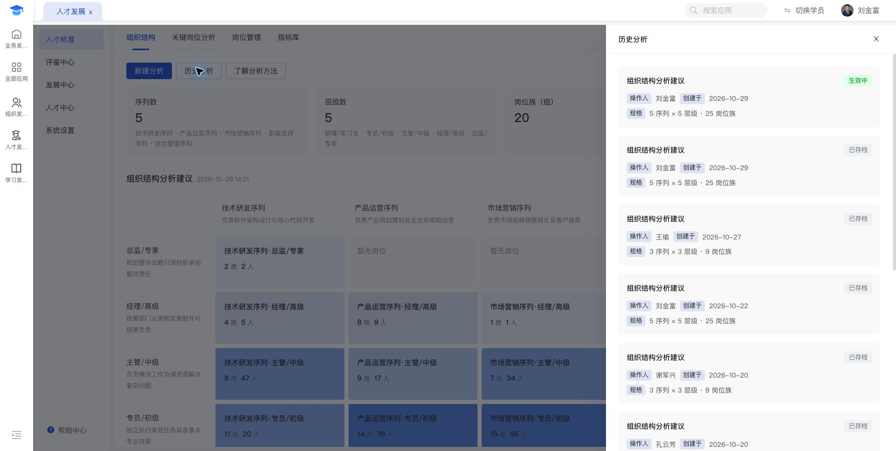

图 1.1-4　历史分析：区分当前生效版本与已存档记录

### 1.2 关键岗位分析

结合组织结构，从经济、能力等视角分析岗位的重要性与培养优先级，并查看分析依据。

**操作入口**：「人才标准」→「关键岗位分析」。

#### 查询与新建分析

1. 使用类别、项目名和状态筛选目标分析项目。
2. 查看列表中的引用组织结构、分析范围、所用视角、关键岗位数和完成时间。
3. 点击「新建分析」，填写项目名、类别、分析目标，并选择引用的组织结构版本。
4. 点击「开始 AI 分析」提交。

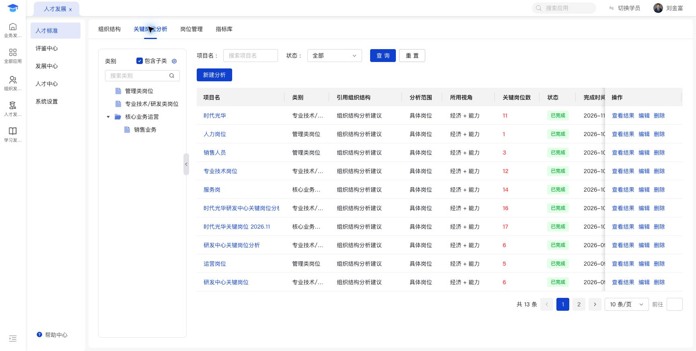

图 1.2-1　关键岗位分析：查询已有项目与完成状态

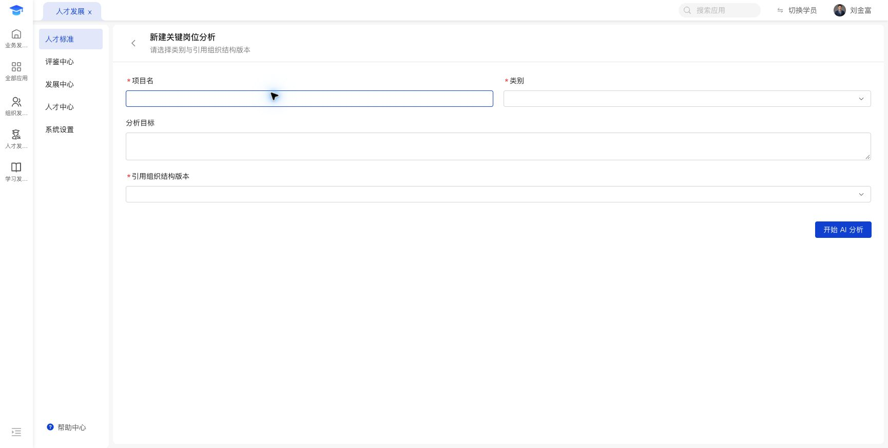

图 1.2-2　新建分析：填写项目资料并选择组织结构版本

#### 查看结果与判断依据

1. 在已完成项目的操作列点击「查看结果」。
2. 查看分析岗位族、覆盖范围、建议培养、已标记关键岗位和待校准数量。
3. 切换「经济视角 E」「能力视角 A」或「综合」；结合图表及岗位清单查看结果。图中气泡大小对应人数，可点气泡查看岗位族下岗位。
4. 在岗位清单中点击「查看依据」，查看需求、供给、ART 能力、时间成本、各视角结论和加权关键系数。

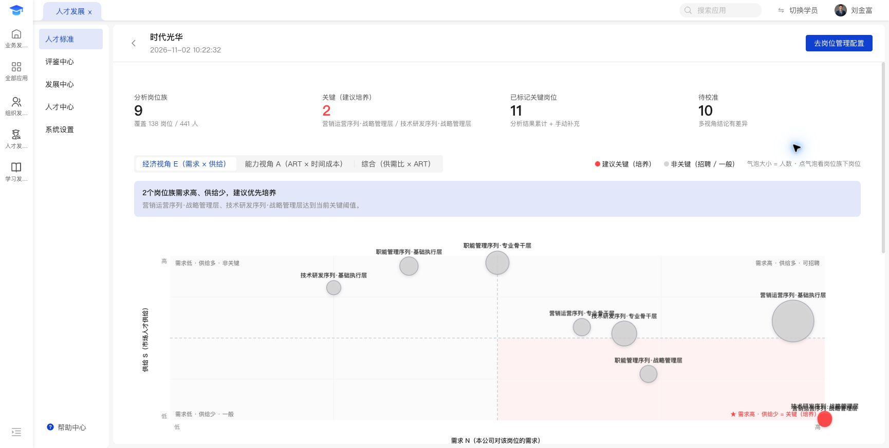

图 1.2-3　分析结果：切换视角并查看岗位清单

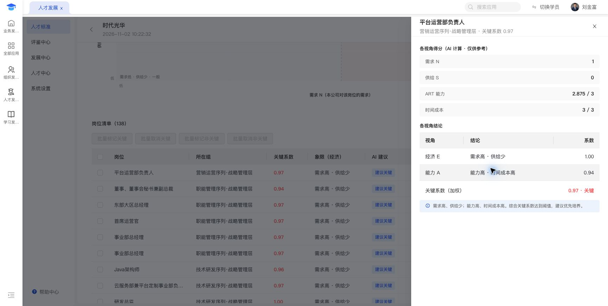

图 1.2-4　查看依据：核对各视角得分与关键岗位建议

#### 标记关键岗位

1. 在岗位清单中勾选需要调整的岗位。
2. 点击「批量标记关键」或「批量标记非关键」，设置人工标记。
3. 需要撤销标记时，点击「批量取消关键」或「批量取消非关键」。

AI 建议与人工标记分别显示在对应列。

### 1.3 岗位管理

管理具体岗位的基础信息、关键岗位标记、岗位标准和学习方案。

**操作入口**：「人才标准」→「岗位管理」。

#### 查询岗位与查看关键岗位

1. 切换「关键岗位」或「全部岗位」，选择需要查看的范围。
2. 通过左侧岗位类别和「岗位名／编号」搜索岗位。
3. 在列表中查看岗位编号、名称、类别和关键岗位标记。
4. 点击对应行的「编辑」「岗位标准」或「学习方案」，进入该岗位的相关配置。

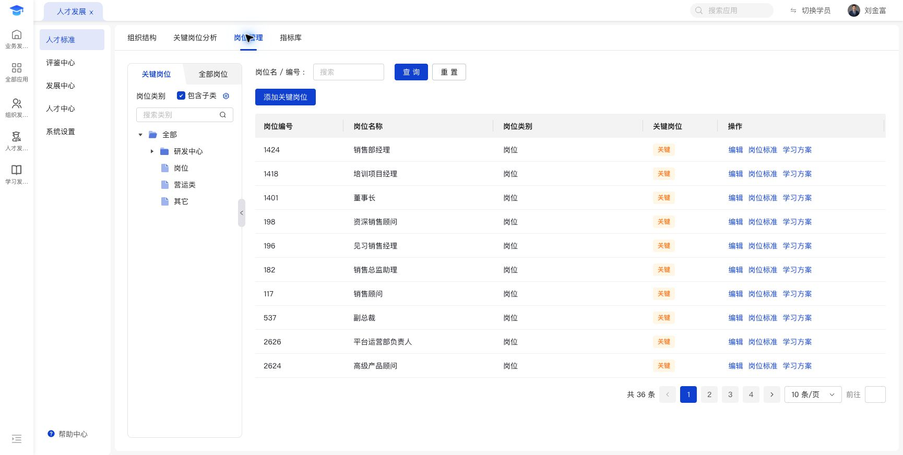

图 1.3-1　岗位管理：查询关键岗位并进入标准或学习方案

5. 点击「添加关键岗位」，选择需要补充的岗位并确认。

#### 编辑岗位信息

1. 点击目标岗位行的「编辑」，进入岗位详情。
2. 在「岗位信息」中维护岗位编号、岗位名称、岗位类别，并按需要设置「关键岗位」。
3. 点击「保存」提交修改，或点击「取消」退出编辑。

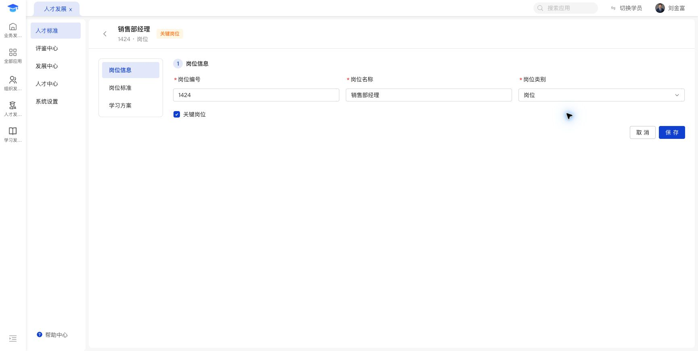

图 1.3-2　岗位信息：维护编号、名称、类别和关键岗位标记

### 1.4 岗位标准

明确岗位的职责任务、经历经验以及能力、动力、潜力要求，为评估与发展配置提供参考。

**操作入口**：「人才标准」→「岗位管理」→目标岗位的「岗位标准」。

#### 维护职责任务与经历经验

1. 点击「新增职责」，填写职责名称。
2. 在该职责下点击「新增任务」，逐条填写任务名称；不需要的条目可使用对应行「删除」。
3. 在「经历经验」中点击「添加经历」，逐条维护经历要求。

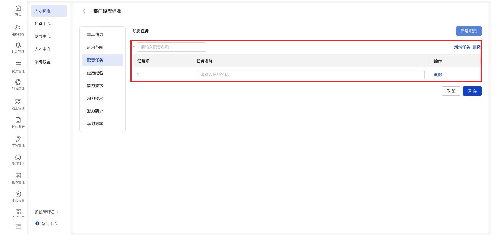

图 1.4-1　岗位标准：按职责组织任务，并逐条维护经历要求

#### 维护能力、动力和潜力要求

1. 在「能力要求」中创建或维护能力组，填写能力组名称。
2. 点击「选择能力」，按类别或能力名称搜索指标。
3. 根据能力名称、类别和等级选择所需指标。
4. 点击「确定」返回岗位标准。每组最多选择 20 项，同组能力项不可重复。
5. 在「动力要求」「潜力要求」中分别点击「选择动力」「选择潜力」，添加对应指标。
6. 完成岗位标准配置后，点击页面底部「保存」。

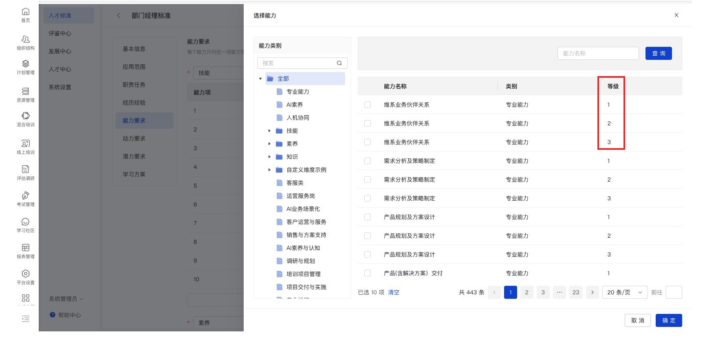

图 1.4-2　选择能力：按名称、类别和等级核对候选指标

### 1.5 学习方案

为岗位关联课程、任务和学习项目，使学习资源与岗位要求对应。

**操作入口**：「人才标准」→「岗位管理」→目标岗位的「学习方案」。

#### 配置课程

1. 在方案页面点击「添加课程」。
2. 在课程分类中选择范围，或输入课程名称／编号查询。
3. 勾选待选课程，按需要使用「必修」或「选修」加入已选区；在已选区检查课程、学时和学分。
4. 点击「确定」返回方案列表。

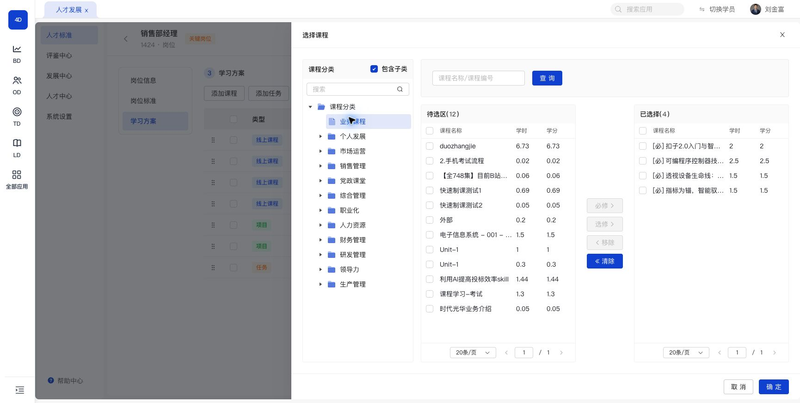

图 1.5-1　添加课程：查询课程并设置必修或选修

#### 配置任务与学习项目

1. 点击「添加任务」，填写任务名称，按需要补充行动计划和完成标准。
2. 任务名称最多 50 字，行动计划和完成标准各最多 2000 字；点击「确定」返回方案。
3. 需要关联项目时，使用「添加学习项目」入口选择相应学习项目。
4. 检查资源列表中的类型、名称、学习类型和状态；任务可通过行内「编辑」调整，不需要的资源可从当前方案移除。
5. 点击页面底部「保存」提交方案。

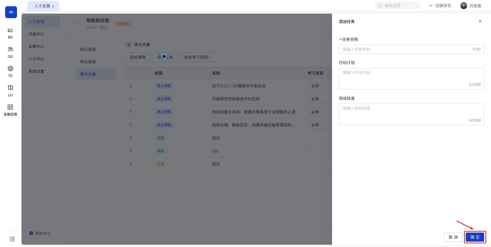

图 1.5-2　添加任务：说明行动计划与完成标准

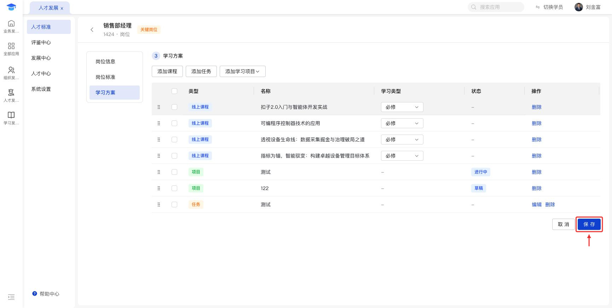

图 1.5-3　学习方案：检查课程、任务和项目后保存

### 1.6 指标库

统一查看和维护岗位标准使用的能力、动力和潜力指标。

**操作入口**：「人才标准」→「指标库」。

#### 能力指标

1. 在「能力」页按左侧类别或名称查询指标。
2. 查看指标名称、类别、等级、创建人和创建时间。
3. 点击「新建能力」，填写名称、维度、类别和定义。
4. 在等级表中从低到高填写「分级描述」和「行为表现」，各最多 1000 字。点击「添加等级」增加等级，最多可配置 10 级。
5. 点击「保存」完成创建。已有指标可通过操作列的「编辑」「复制」「删除」进行维护。

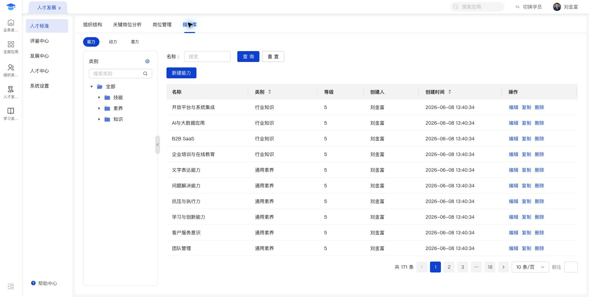

图 1.6-1　能力指标：查询名称、类别与等级

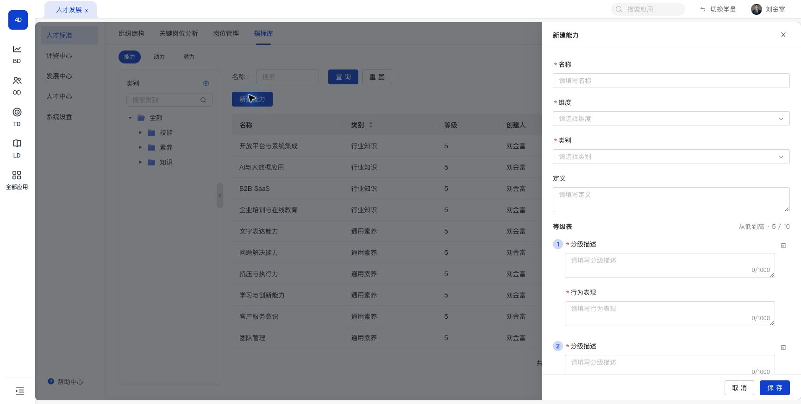

图 1.6-2　新建能力：维护定义、分级描述和行为表现

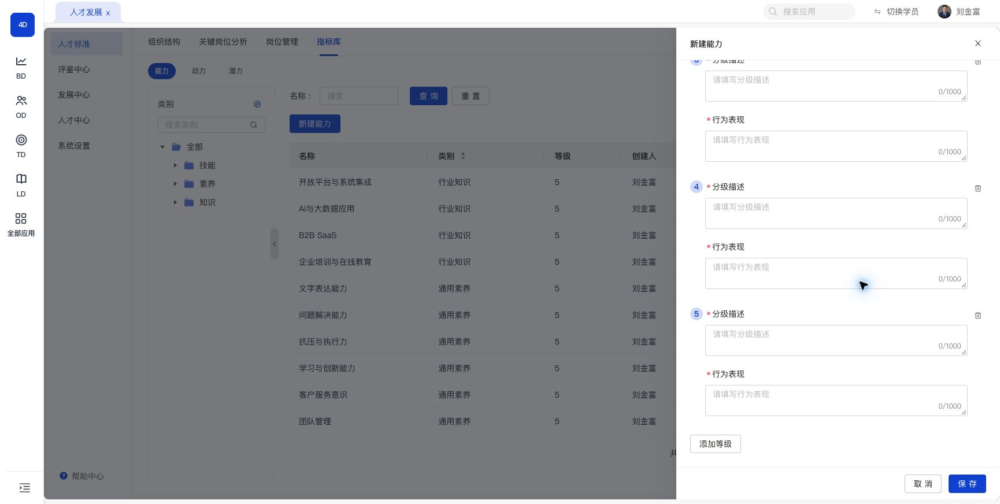

图 1.6-2（续）　等级配置：维护分级描述、行为表现并添加等级

#### 动力与潜力指标

1. 切换「动力」，按目标、过程、自我、他人等类别查询；点击行内「查看」阅读指标名称、类别和描述。
2. 切换「潜力」，按自我情绪、人际互动、思维方式等类别查询，同样可进入详情。
3. 需要为岗位配置要求时，返回岗位标准中的相应选择入口。

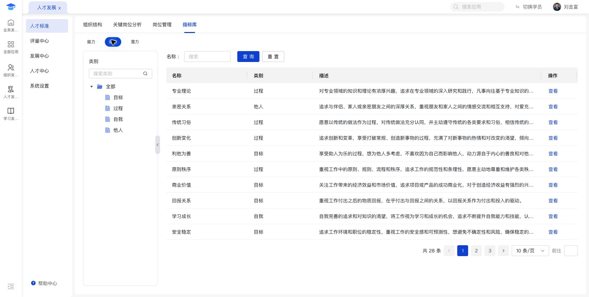

图 1.6-3　动力指标：按类别查看指标描述

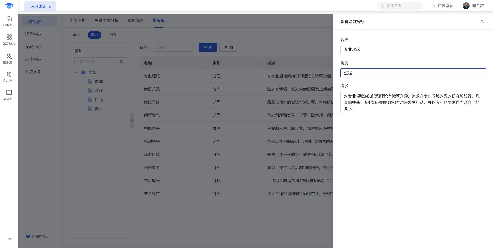

图 1.6-4　指标详情：核对名称、类别与具体含义

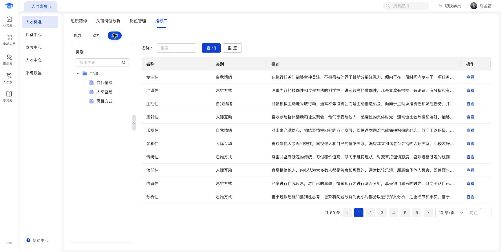

图 1.6-5　潜力指标：查看不同类别的潜力特征

动力、潜力指标支持查询和查看。

## 二、评鉴中心

### 2.1 360评估

配置评估问卷与项目，采集不同角色的评价，并查看参与情况、个人和组织统计及个人报告。

**操作入口**：「评鉴中心」→「评鉴工具」→「360评估」。

#### 查询评估项目

1. 输入项目编号或名称后点击「查询」。
2. 查看创建人、完成率和项目状态。
3. 点击项目名称编辑评估角色与关系；点击「项目设置」调整项目配置，点击「宣传设置」配置宣传内容，点击「统计」查看评估结果。
4. 点击「开启」开放评估，点击「关闭」停止评估。

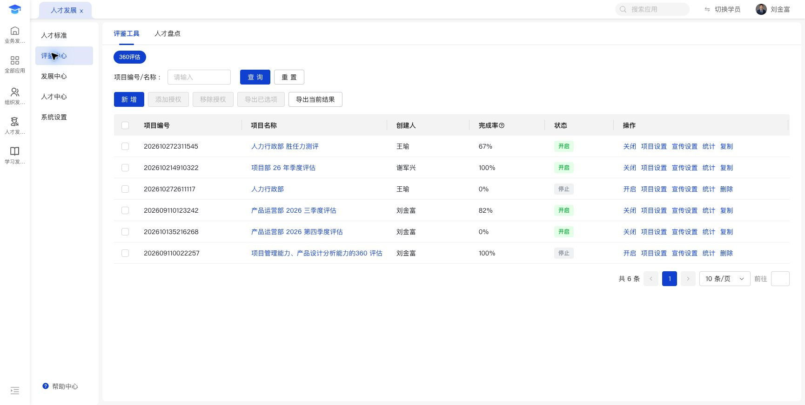

图 2.1-1　360评估：查看完成率、状态和项目操作入口

#### 编辑问卷

1. 从「新增」进入问卷编辑；修改已有项目问卷时，从「项目设置」的关联问卷进入「编辑」。
2. 设置问卷标题，按能力或评估主题组织维度；使用「新增维度」补充维度。
3. 选择单选题、多选题、打分题或问答题，编辑对应题目。
4. 以打分题为例，选择所属维度，填写题目信息和补充说明，设置最大值、最小值，并按需要设置必答及填写理由条件。
5. 点击题目中的「完成」返回问卷编辑页，点击「预览」查看问卷，点击「保存编辑」保存问卷。

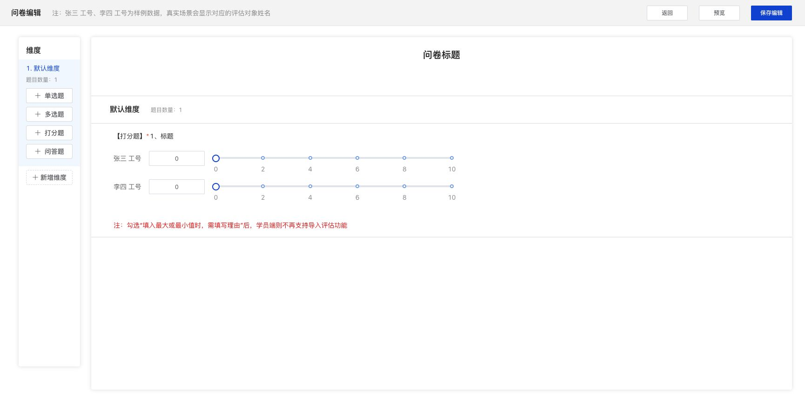

图 2.1-2　问卷编辑：按维度组织题目，并预览评估对象的填写形式

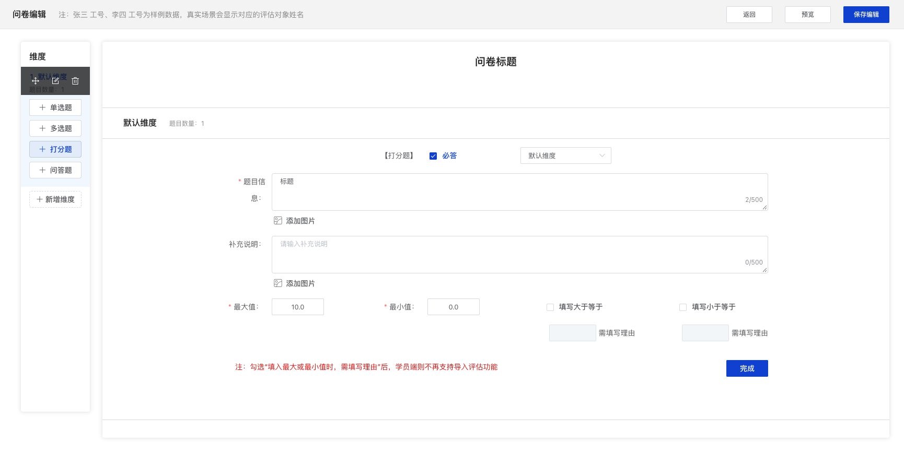

图 2.1-3　打分题：设置题目、分值范围与填写理由条件

启用“特定分值需填写理由”后，学员端不支持导入评估。

#### 设置评估角色与关系

1. 点击已有项目名称，进入「编辑项目」；先在「设置评估角色」中检查项目所用问卷。
2. 根据评估安排新增或编辑上级、下级、平级、自评等角色，核对角色默认权重、角色人员及备注。
3. 点击「下一步」进入「配置评估关系」，按评估对象姓名／工号、部门、岗位或角色查询。
4. 使用「新增」或「导入」补充评估对象与评估人关系；核对每个被评估人的角色、权重和对应评估人。需要调整时使用对应行「编辑」或「修改权重」。
5. 设置各角色权重，每个被评估人的评价权重之和必须为 100%。
6. 保存评估关系，返回项目列表后开启评估。

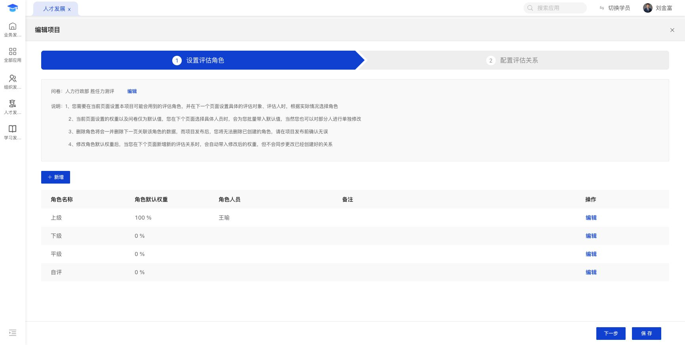

图 2.1-4　评估角色：核对默认权重、角色人员和角色说明

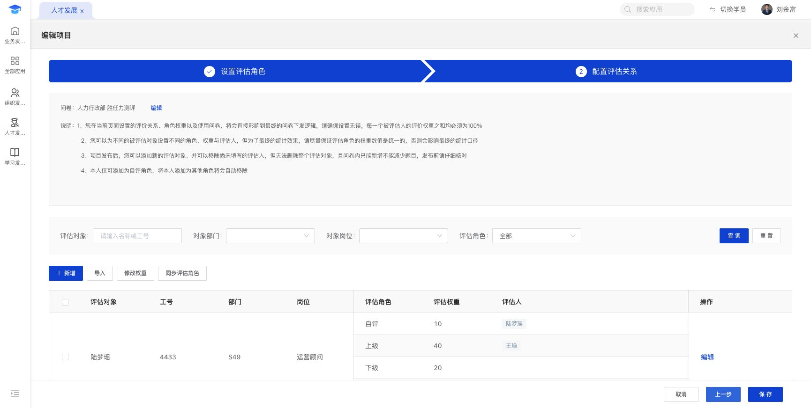

图 2.1-5　评估关系：核对每位对象的角色、权重与评估人

角色默认权重用于新建评估关系，修改默认权重不会同步更新已有关系。本人只能添加为自评角色。

删除角色会同时删除其关联数据。项目发布后，不能删除已创建角色或整个评估对象，问卷只能新增题目，不能减少题目。

#### 项目设置

1. 在列表点击目标项目的「项目设置」。
2. 填写项目名称；留空时使用关联问卷名称。
3. 按需要设置限时开放，控制可参与评估的时间。
4. 在关联问卷中点击「预览」查看问卷，点击「编辑」修改项目问卷。修改仅对本项目生效，问卷模板保持原内容。
5. 设置匿名答题、游客评估、允许学员查看报告及关联混合培训项目等选项。
6. 点击「授权设置」配置项目授权，完成后点击「确定」保存。

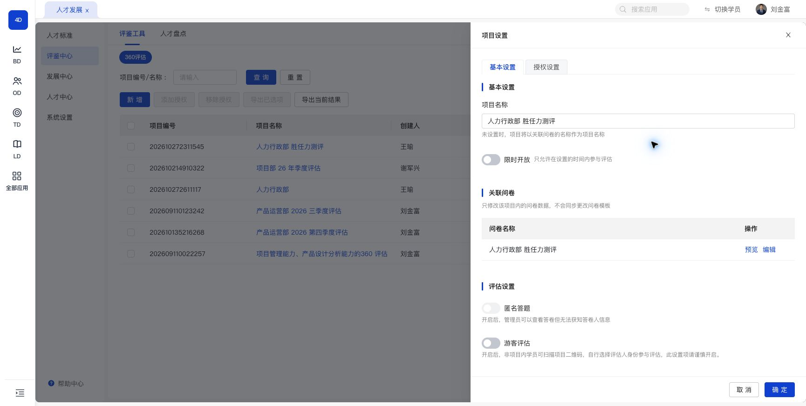

图 2.1-6　项目设置：核对开放方式、关联问卷和报告可见设置

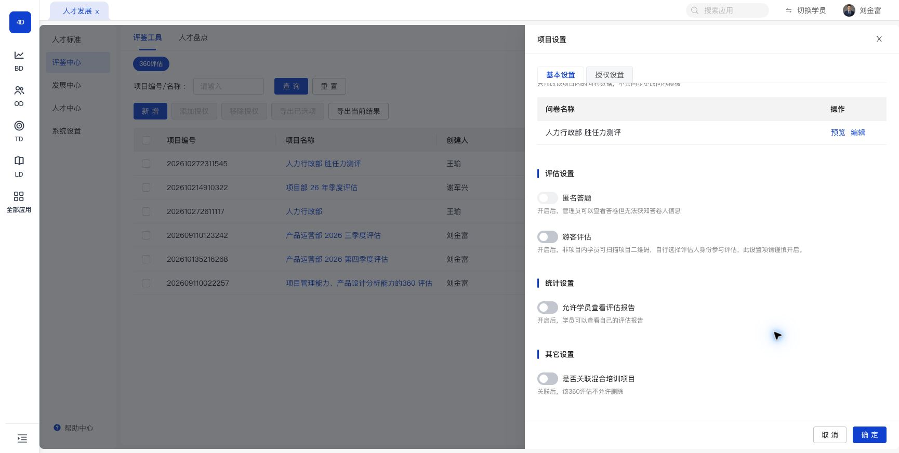

图 2.1-6（续）　统计与其它设置：设置报告可见及关联混合培训项目

开启游客评估后，非项目内学员可扫码参与。关联混合培训项目后，该 360 评估不允许删除。

#### 统计与报告

1. 在项目操作列点击「统计」，打开统计分析窗口。
2. 在「参与情况」查看各角色下发、已填、未填数量；使用评估对象、部门、岗位、角色、状态等条件查询明细。
3. 勾选评估记录，执行导出、提醒参加、重新下发或标记答卷等操作。

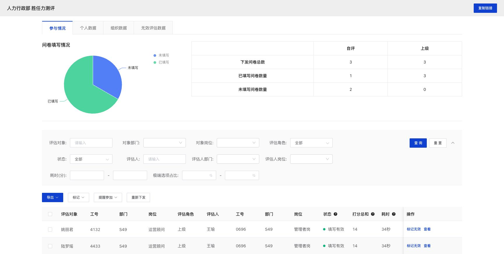

图 2.1-7　参与情况：查看问卷完成数量并筛选填写明细

4. 切换「个人数据」，查看各维度得分及总分；点击对应人员行的「查看」，进入个人测评报告。
5. 报告包含计算说明、综合结果、角色权重、维度分析、题目得分与自我认知差异，可使用「导出PDF」保存。

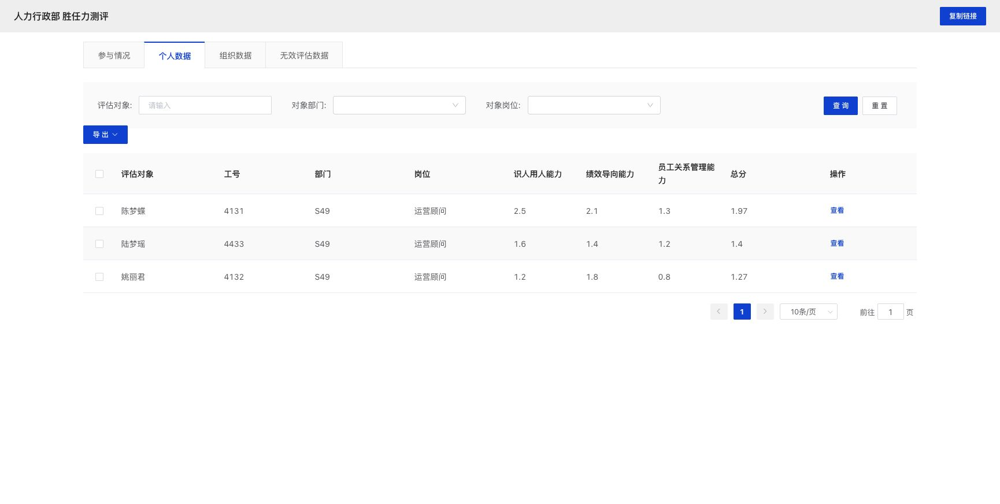

图 2.1-8　个人数据：查看维度结果并进入个人报告

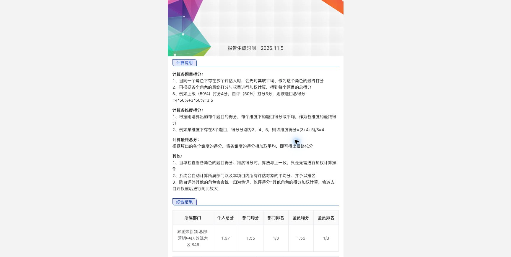

图 2.1-9　个人报告：查看得分说明、综合结果与后续分析

6. 切换「组织数据」，按部门层级和对象部门查询组织统计；切换「无效评估数据」查看无效记录。

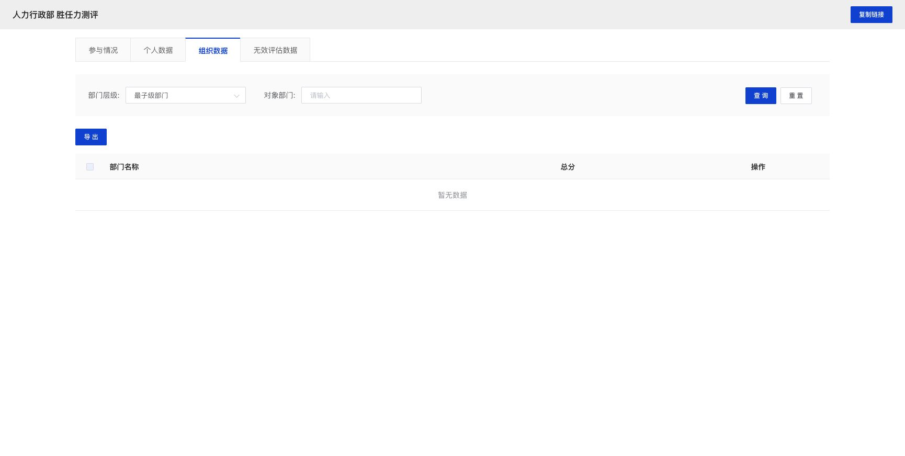

图 2.1-10　组织数据：按部门层级和对象部门查询

### 2.2 人才盘点

围绕选定人员，关联评估项目与绩效数据，配置宫格规则，查看落位并记录业务校准。

**操作入口**：「评鉴中心」→「人才盘点」。

#### 查询与创建项目

1. 按盘点类别、项目名和状态筛选项目。
2. 草稿项目可通过「编辑」继续配置；进行中项目可点击名称或「进入校准」查看详情。
3. 点击「创建盘点项目」，进入包含基本信息、盘点人员、盘点活动、盘点规则设置的配置流程。

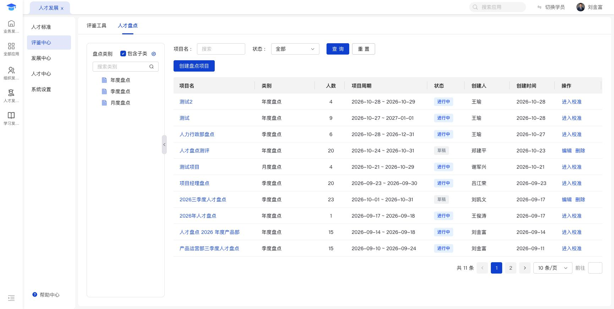

图 2.2-1　人才盘点：查询草稿和进行中的盘点项目

#### 配置基本信息

1. 填写项目名称、盘点类别、计划开始和结束时间，按需要填写盘点目标。
2. 设置「自动结束项目」。开启后，到达计划结束时间将自动锁定盘点结果和校准任务。
3. 点击「下一步」继续配置；暂不完成时使用「保存草稿」。

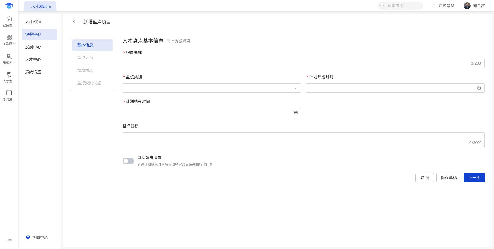

图 2.2-2　基本信息：设置盘点时间、目标与自动结束选项

#### 配置盘点人员

1. 在「盘点人员」点击「添加人员」，选择本次参与人员。
2. 按工号／姓名、部门查询，核对已选人数、部门和岗位。
3. 不参与本次盘点的人员可从列表移除，再继续配置。

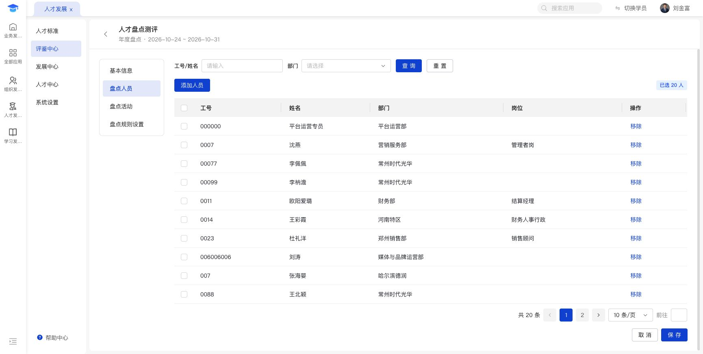

图 2.2-3　盘点人员：核对本项目纳入人员与所属岗位

#### 配置活动与绩效数据

1. 在「盘点活动」使用「添加测评项目」关联本次需要的项目数据。
2. 在绩效数据区域点击「下载模板」，按模板整理本次盘点人员的绩效等级。
3. 通过「上传绩效数据」入口上传整理后的文件，并在列表核对匹配结果。
4. 绩效等级支持低、中、高，系统按工号匹配盘点人员。

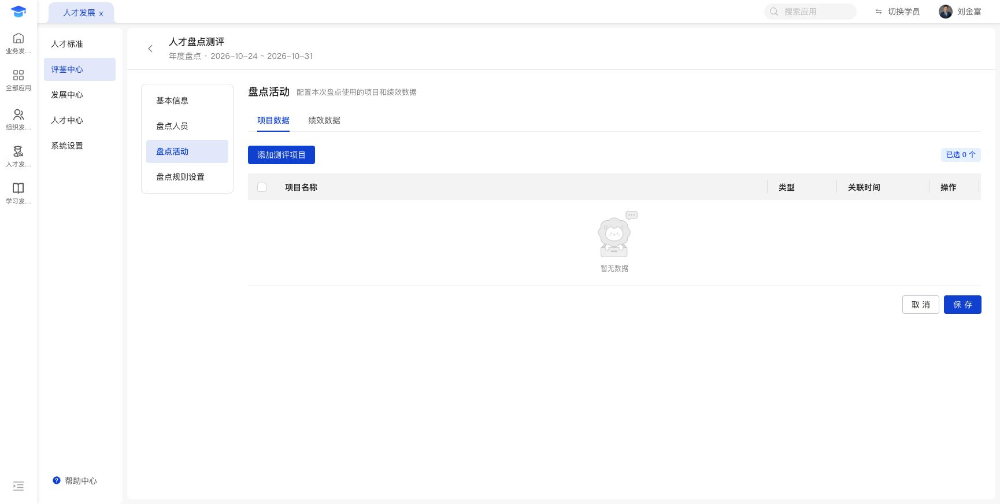

图 2.2-4　盘点活动：关联测评项目并查看绩效导入入口

#### 配置盘点规则

1. 在「盘点规则设置」检查能力与绩效的横纵轴；需要时点击「交换」。
2. 选择能力区间数，可设置为 2、3、4、5 档。绩效固定为低、中、高三档，宫格数量随能力档数变化。
3. 设置能力排名各档占比，合计须为 100%。系统按占比显示各档估算人数。
4. 绩效沿用导入数据中的等级，不需要设置占比。
5. 在宫格预览中编辑各格名称，核对后保存。

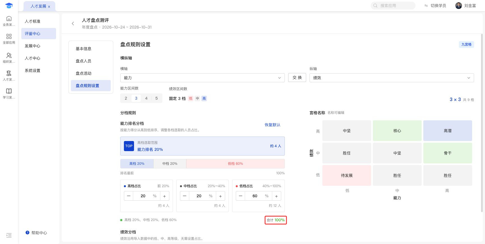

图 2.2-5　盘点规则：配置能力分档、绩效轴与宫格名称

#### 查看项目概览与结果

1. 打开进行中的盘点项目，在「概览」核对盘点人数、绩效人数、已校准数量和项目基本信息。
2. 切换「盘点结果」，结合能力区间、绩效方向和宫格名称阅读人员分布。
3. 点击宫格可按落位筛选下方人员；也可按工号／姓名查询人员。
4. 在人员清单查看能力得分、能力档、绩效和落位，点击「查看人才」进一步查看人员信息。

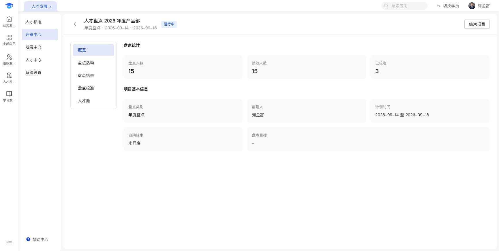

图 2.2-6　项目概览：核对人数、时间和自动结束配置

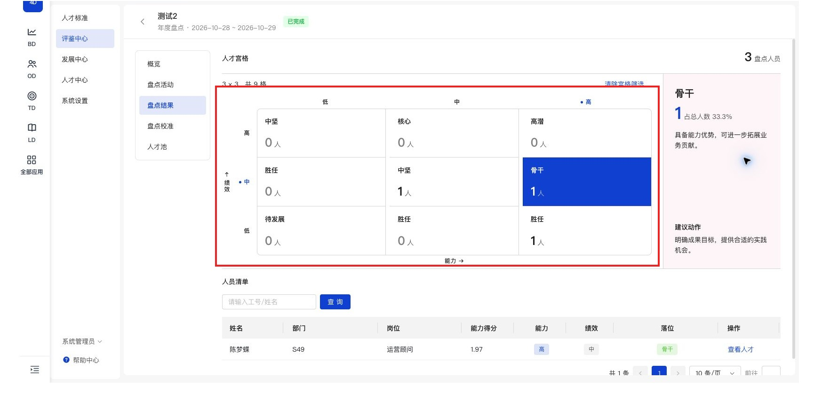

图 2.2-7　盘点结果：按宫格落位查看人员清单

#### 业务校准

1. 进入「盘点校准」，查看已有校准记录。
2. 点击「创建校准任务」，进入任务配置。
3. 校准完成后，回到记录列表查看校准任务、校准人员、前后落位、操作人和时间。
4. 完成盘点及校准后，点击顶部「结束项目」。

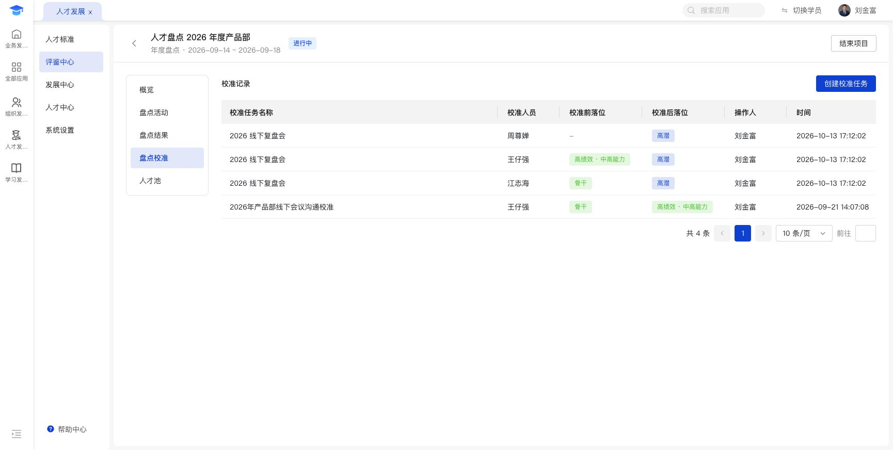

图 2.2-8　盘点校准：追溯校准前后落位及操作记录

#### 项目人才池

1. 在项目详情切换「人才池」，查看该项目的人才池。
2. 点击「新建人才池」，填写人才池名称、期望人数和备注。
3. 项目内新建人才池时，来源盘点项目自动带入且不可更改。
4. 点击「创建人才池」完成创建。

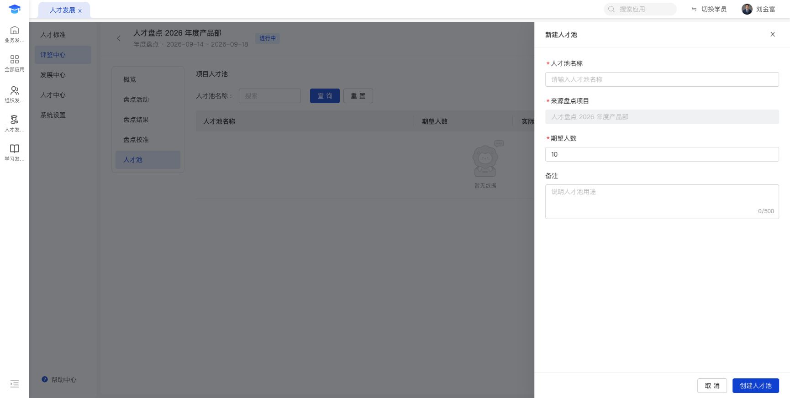

图 2.2-9　项目人才池：核对已带入的来源项目并设置期望人数

## 三、发展中心

### 3.1 查看岗位地图

将具体岗位配置在职级序列与发展通道中，便于查看岗位的层级和通道关系。

**操作入口**：「发展中心」。

1. 在左侧职级序列中选择研发、销售等序列，必要时输入关键字搜索。
2. 在右侧查看职级与通道矩阵。纵向为职级，横向为不同通道，通道名称及编辑操作位于矩阵底部。
3. 在岗位名称搜索框输入名称并点击「搜索」，定位相应岗位。
4. 查看各节点的岗位名称及岗位数量。

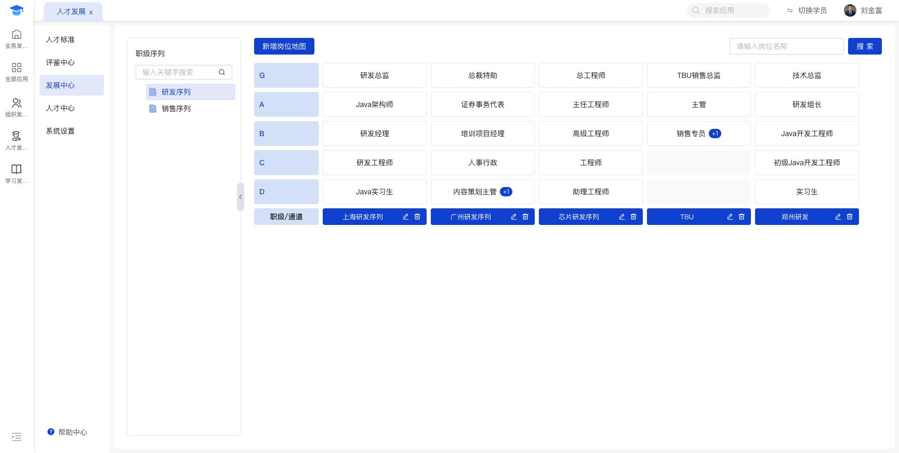

图 3.1-1　岗位地图：按职级序列查看岗位与发展通道

### 3.2 新增通道与配置岗位

1. 点击「新增岗位地图」，填写岗位通道名称及排序；名称最多 20 字。
2. 点击「确定」，在当前职级序列下创建岗位通道。

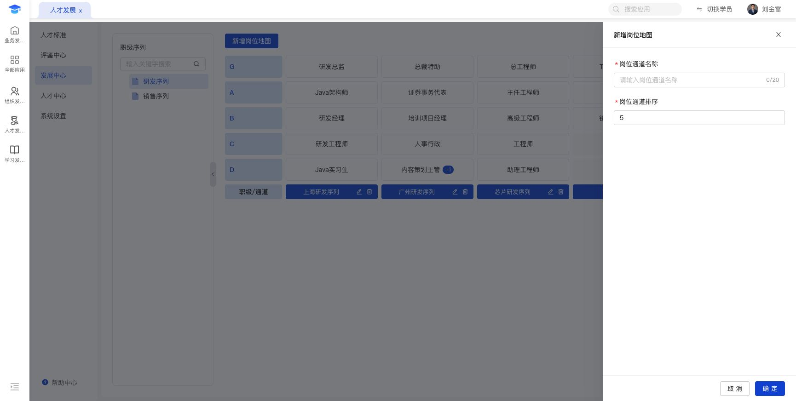

图 3.2-1　新增岗位地图：填写通道名称与排序

3. 在空节点点击「＋」，打开「选择岗位」。
4. 按岗位类别或名称查询，选择目标岗位并移入已选区。
5. 点击「确定」完成节点配置。点击通道名称旁的编辑按钮，可修改通道名称及排序。

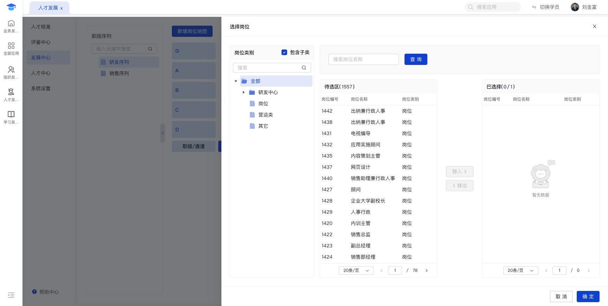

图 3.2-2　配置节点：选择岗位并核对已选数量

职级序列在「系统设置」→「职级管理」中维护；岗位标准和学习方案在「人才标准」→「岗位管理」中维护。

## 四、人才中心

### 4.1 人才库

汇总查看人员的岗位、部门、关键岗位标记、人才分类和绩效，并进入人才档案或进行对比。

**操作入口**：「人才中心」→「人才库」。

1. 在左侧选择所属部门，按需要设置「包含子类」。
2. 输入姓名／工号并点击「查询」。
3. 在列表核对现岗位、部门、人才分类、绩效等内容。
4. 点击姓名或操作列「查看」，进入人才档案。

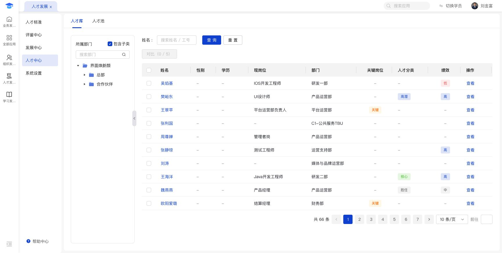

图 4.1-1　人才库：按部门和姓名查询人员

### 4.2 人才档案

1. 打开人才档案后，先核对姓名、部门和岗位。
2. 在「综合能力」查看人员的能力数据。
3. 切换「盘点九宫格」，查看最新盘点项目、落位、能力得分、能力档和绩效。
4. 查看结果对应的盘点项目名称及状态。

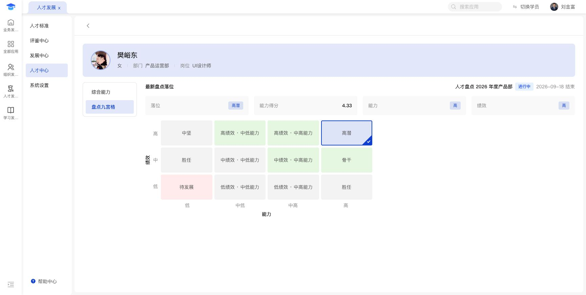

图 4.2-1　人才档案：查看最新盘点的能力、绩效和落位

### 4.3 人才对比

1. 返回人才库，勾选需要比较的人员；「对比」按钮显示当前选择数量，最多可选 5 人。
2. 点击「对比」，在对比窗口横向查看岗位、部门、人才分类、绩效、能力、关键岗位标记及综合能力得分。
3. 关闭对比窗口，调整已选人员后可继续比较。

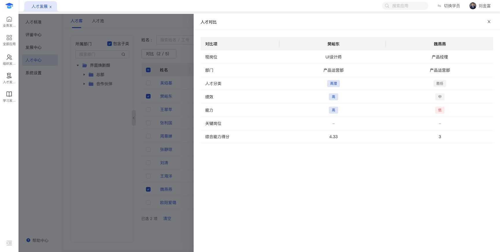

图 4.3-1　人才对比：横向核对人员的岗位与盘点信息

### 4.4 人才池

按用途管理人才池，记录来源盘点项目、期望人数和实际人数。

**操作入口**：「人才中心」→「人才池」。

1. 使用名称／负责人查询框查找人才池，查看来源项目、创建人和人数。
2. 点击「新建人才池」，填写人才池名称，选择来源盘点项目，设置期望人数并按需要填写备注。
3. 点击「创建人才池」完成创建。备注最多 500 字。

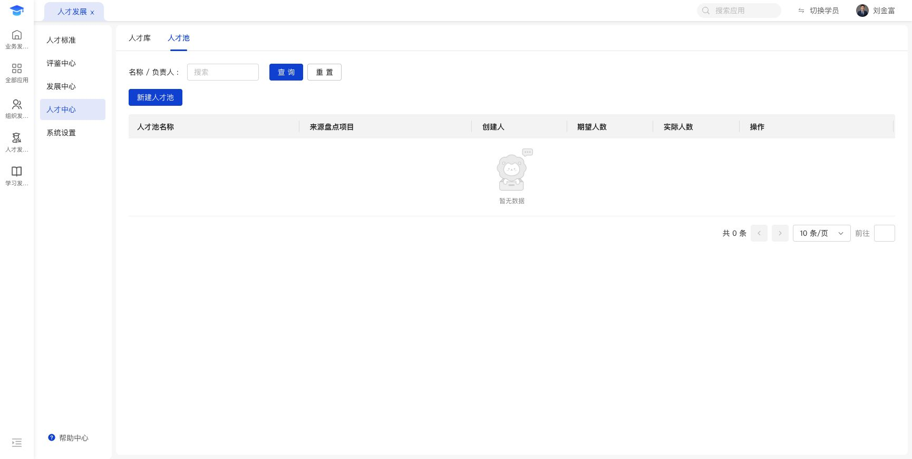

图 4.4-1　人才池：查看来源项目、创建人和人数

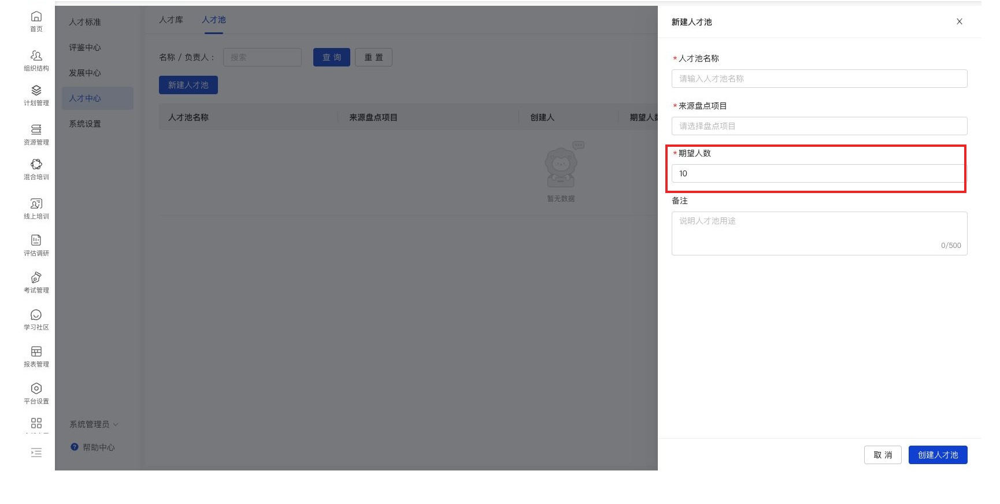

图 4.4-2　新建人才池：明确选择来源盘点项目

从人才中心新建人才池时，需选择来源盘点项目；从盘点项目内新建时，来源自动带入。期望人数为组建目标，实际人数为已加入成员数量。

## 五、系统设置

### 5.1 职级管理

维护岗位地图所用职级序列与各等级职级，并配置职等和行列顺序。

**操作入口**：「系统设置」→「职级管理」。

1. 在职级表查看等级与各序列对应的职级名称。
2. 点击「新增职级序列」，填写序列名称后保存。
3. 点击「编辑」，修改职级名称、职等及行列顺序，完成后保存。
4. 进入发展中心，按职级序列配置岗位地图。

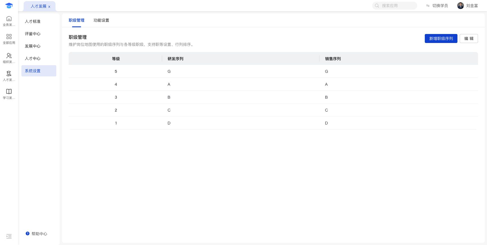

图 5.1-1　职级管理：查看序列与等级的对应关系

图 5.1-2　新增职级序列：填写序列名称

### 5.2 功能设置

控制学员端相关功能是否显示。

**操作入口**：「系统设置」→「功能设置」。

1. 在学员端设置中，选择人才画像、推荐、岗位发展通道、职级发展通道、业务价值链发展通道、个人发展计划、我的项目和我的技能树等显示项。
2. 勾选需要展示的功能，取消不需要展示的功能，点击「确认」提交。

图 5.2-1　功能设置：配置学员端相关功能的显示项
