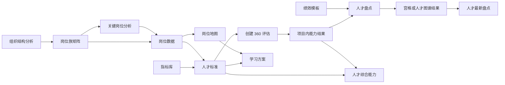

# 人才发展 · 当前版本 PRD

| 项目 | 内容 |
| --- | --- |
| 文档版本 | V1.62 |
| 原型基线 | `app/` 当前可运行版本 |
| 基线日期 | 2026-10-20 |
| 文档更新日期 | 2026-10-20（v2026.10.20 交付冻结） |
| 文档状态 | 当前原型冻结基线 |
| 适用端 | 管理端 Web + 学员端 Web；学员端参考包待按当前模型重构 |

> 本文是当前版本的统一产品需求基线。用户在对话中最新、明确的结论如与已有 PRD、原型或历史资料冲突，以最新对话结论为准，并须在同一轮修改中同步回本文与根目录 `PROJECT_HANDOFF.md`。同步后以本文作为完整需求基线；历史 PRD 仅作为设计过程资料。组织结构分析和关键岗位分析的服务端工作流及 Dify 对接细节，继续以 `10_组织与关键岗位分析_Dify工作流接口.md` 为准。
>
> PRD 中的业务规则、数据规则和验收说明不等同于页面文案。快照、数据基准、存储、回写、接口和算法等内部实现信息不得直接展示给业务用户。

---

## 1. 产品概述

### 1.1 产品定位

人才发展用于建立岗位和人才之间可复用的数据链：先明确组织结构与关键岗位，再建立可复用的人才标准，并通过动态应用范围覆盖岗位或人员条件；随后通过 360 评估和人才盘点形成能力与人才结果，在管理端形成发展方案并发布给适用人员，最终由学员端承接差距查看、发展任务执行、成果提交与结果反馈。

当前管理端原型继续聚焦核心配置流程；学员端纳入产品闭环，参考 `deliverables/student-client-package/` 中的旧系统还原包重新梳理，不直接复用其中与当前标准口径冲突或属于通用培训门户的页面。

### 1.2 当前需要解决的问题

1. 部门、岗位、人员、人才标准和人才结果分散，缺少统一关系。
2. 关键岗位识别依赖人工判断，过程缺少结构化依据与人工校准机制。
3. 360 评估的能力指标选择、过程监控和报告查看需要形成连续流程。
4. 人才盘点缺少统一的数据口径，现有宫格只能回答人员落位，难以支持多维人才识别和组织规律洞察。
5. 岗位发展通道、学习方案与人才实际能力没有共享同一岗位基础。
6. 管理端配置完成后缺少学员接收、执行、反馈和验证链路，标准与学习方案无法形成真实的发展闭环。

### 1.3 本期目标

- 跑通组织结构分析和关键岗位分析两条工作流。
- 标准作为独立业务记录配置适用对象；岗位关联标准，学习方案继续落在岗位。
- 复用能力指标，完成 360 评估创建、过程监控和报告查看。
- 支持宫格盘点和人才图谱盘点：宫格盘点形成人员落位与校准结果，人才图谱盘点形成组织规律分析与人才分层。
- 在人才列表和人才详情中呈现岗位要求、实际能力和最新盘点结果。
- 用岗位地图串联岗位、职级、发展通道和学习方案。
- 补齐学员端发展首页、个人画像、岗位发展通道和个人发展计划，使课程、项目、测评、实践和反馈能够围绕同一人才标准执行。

### 1.4 成功标准

- 当前导航中的所有业务入口均可进入对应页面，不出现延期功能入口。
- 组织分析、关键岗位分析、360 评估、人才盘点四条主流程均具备入口、配置、结果或详情页面。
- 人才标准、360 结果、盘点结果和人才详情使用一致的能力指标口径。
- 所有列表页均支持范围选择或筛选、主操作、列表和固定分页区域。
- 页面不暴露快照、接口、数据库、回写策略或内部算法实现说明。
- 管理端发布的发展方案可形成个人计划；学员可理解计划来源、查看差距、完成任务并回传进度与结果。

### 1.5 宣传材料口径（2026-10-13）

- 约 5 分钟人才发展宣传片按三个问题组织：需要什么样的人（组织与关键岗位分析、人才标准）；现在的人怎么样（360 评估、人才盘点、业务校准）；知道差距以后怎么办（岗位地图、目标岗位、学习方案），最后回到个人档案。
- 主张为“让岗位有标准，识人有依据，培养有方向”。4D 导航只引入人才发展模块，不增加无依据卖点；学习方案表达岗位要求与资源的连接，不宣称已自动下发课程或产生培养效果。
- 最新要求为纯音乐 BGM＋产品画面＋字幕，全片无人声；静音原片全部音轨，不保留口播或生成配音。以功能录屏的点击、切换、展开和操作后结果承担讲解，字幕只说明当前功能、操作或结果，不搬用讲解逐字稿或泛泛业务陈述。三个问题仅在对应章节开头出现，不在开场轮播。原SRT仅用于取材定位。原片按原始 SRT 定位并拆分重排，先完成粗剪，由用户审片后用 Screen Studio 补录。剪映指令每次不超过 3000 字，须直接包含必要文案与素材定位，不依赖上传字幕附件。当前文案和剪辑安排见 `deliverables/talent-development-promo/five-minute-v2/`。

---

## 2. 用户与角色

| 角色 | 当前版本职责 | 主要功能 |
| --- | --- | --- |
| 人才发展管理员 / HR | 组织与岗位分析、标准配置、评估与盘点、人才查看 | 除系统级设置外的全部管理端功能 |
| 系统管理员 | 维护职级和学员端功能开关 | 系统设置 |
| 业务负责人 | 作为项目负责人参与评估、盘点和校准 | 项目查看、催办、校准；具体权限待后端确定 |
| 学员 / 被评人员 | 参与评估，查看个人画像与发展通道，执行个人发展计划 | 发展首页、我的画像、发展通道、我的发展计划；具体课程、项目和考试跳转既有培训平台 |
| 直属上级 / 导师 | 辅导学员并确认实践成果 | 首期是否开放独立入口待权限设计确认；不与普通学员入口混用 |

权限矩阵、数据范围和字段级权限尚未在当前原型中表达，后端设计时须单独确认。

---

## 3. 本期范围

### 3.1 一级导航与业务入口

| 一级中心 | 顶部业务菜单 | 入口页面 |
| --- | --- | --- |
| 人才标准 | 组织结构 | `org-structure.html` |
| 人才标准 | 关键岗位分析 | `key-position.html` |
| 人才标准 | 人才标准 | `standards.html`、`standard-detail.html` |
| 人才标准 | 指标库 | `vocabulary.html` |
| 评鉴中心 | 评鉴工具 / 360评估 | `assess-projects.html` |
| 评鉴中心 | 评鉴工具 / 人才测评 | `talent-assessment-projects.html` |
| 评鉴中心 | 评鉴工具 / 考试 | `exam-projects.html` |
| 评鉴中心 | 人才盘点 | `review-projects.html` |
| 发展中心 | 岗位地图 | `position-map.html` |
| 人才中心 | 人才库 / 人才池 / 人才看板 | `talent-list.html`、`talent-pool.html`、`talent-dashboard.html` |
| 系统设置 | 职级管理 | `settings.html#level` |
| 系统设置 | 功能设置 | `settings.html#learner` |

`index.html` 不承载首页内容，进入系统后直接跳转到人才标准。

学员端采用独立入口，首期信息架构为“发展首页 / 我的画像 / 发展通道 / 我的发展计划”。桌面交付包中的推荐、我的项目、技能树等页面只作为参考素材，不自动成为当前导航。

### 3.2 延期或不在当前导航中的功能

| 功能 | 当前处理 |
| --- | --- |
| 模型库 / 岗位族独立模型 | 旧模型库延期；由人才标准承载标准与适用对象 |
| 考试题库、考试项目创建、详情、人才发展考试组卷 | 延期；当前仅开放考试列表与类别管理 |
| 测评结果独立页面 | 取消独立入口；结果跟随 360 项目查看 |
| 人才测评项目创建与详情 | 延期；当前仅开放人才测评列表与类别管理，动力、潜力专家问卷仍由专家维护 |
| 历次盘点对比 | 延期 |
| 职级地图 | 学员端后续增强；当前先建设岗位发展通道，待职级标准与职级发展方案口径确定后开放 |
| 管理端独立 IDP 列表 | 延期；学员端“我的发展计划”纳入核心闭环，由已发布方案和分配记录生成 |
| 继任地图、组织人才预测及正式任用审批 | 延期；当前已提供独立人才池与基于现有人才的基础看板 |
| 独立首页、独立 AI 对话 | 不建设 |

旧页面直接访问时统一回到当前范围内的对应入口：

- `assess-results.html` → 评鉴工具 / 360评估
- `assess-tools.html` → 评鉴工具 / 360评估
- `review-compare.html` → 人才盘点
- `level-map.html`、`idp-list.html` → 岗位地图
- `succession-map.html`、`org-dashboard.html` → 人才库；基础人才看板使用新的 `talent-dashboard.html` 入口

### 3.3 对外演示中的持续深化方向（2026-09-28）

以下为景旺电子方案介绍中的后续规划口径，不改变本期原型范围，也不将已有列表页、静态示例或项目内能力表述为完整生产功能：

1. **人才标准**：深化 AI 帮建与资料整理，辅助形成可审阅的标准草稿；职责、能力要求与适用范围由业务人员核对、修改并采用。当前原型已有 AI 帮建交互示例，真实资料处理和服务能力仍按实施范围确认。
2. **评鉴中心**：增加评鉴手段，支持 AI 辅助创建评估问卷，并逐步提供内置人才测评产品与考试能力。当前人才测评和考试主要是列表与类别管理，不能据此宣称完整项目创建和执行链路已具备。
3. **人才中心**：2026-09-29 已将人才库、四分区档案、同标准对比、独立人才池和基础人才看板纳入本期原型，具体范围见第 9 节。正式任职结论、自动选岗、继任任用、自主申报及个人发展计划发布仍待后续建设；独立人才池未自动接收项目内人才池。

---

## 4. 信息架构与全局流程

### 4.1 导航结构

- 左侧固定为一级中心：人才标准、评鉴中心、发展中心、人才中心、系统设置。
- 顶部显示当前一级中心下的业务菜单。
- 2026-10-20：按用户最新要求，公共品牌入口暂不展示“人才发展”左侧图标，仅保留文字名称及其导航入口；各一级中心菜单图标继续保留。共用样式版本 `styles.css?v=20261020r`。
- 详情页、向导页和结果页继承所属中心的导航，不新增孤立入口。
- 桌面端左侧一级导航支持收起和展开：展开宽度为 `184px`，显示图标与名称；收起宽度为 `72px`，只显示一级中心图标和展开按钮，品牌区保留原高度但不显示空入口。收起状态在同一浏览器中跨页面保留；所有图标入口必须保留可访问名称和悬停提示。移动端继续使用顶部横向一级导航，不显示侧栏收起按钮。
- 2026-10-20：桌面搜索与筛选区统一为 32px 高的输入框、下拉框、日期 / 数值区间及查询操作按钮，采用 13px 正常文字并对齐标签与控件；普通业务录入表单维持现有尺寸。覆盖列表筛选、人员搜索、盘点详情查询、岗位地图搜索、设置搜索及公共选择弹窗。人才测评筛选区标签置于上方，日期列保留足够宽度以完整显示日期；不通过压缩文字或裁切日期来强塞一行。展开导航收窄后，顶部栏和主体偏移同步，72px 收起态继续保留。共用样式版本 `styles.css?v=20261020q`。

- 2026-10-20：指标库与评鉴工具 / 人才盘点等页面级二级导航距离顶部业务导航的留白统一为 4px，补齐指标库原有的 18px 留白。横向二级导航使用大圆角胶囊分段控制器，替代文字下划线式页签；控件总高 40px、选项可见高 32px、页面级控件距内容 4px，按用户截图使用蓝底白字选中胶囊，整组不设灰色底槽。共用样式版本 `styles.css?v=20261020ac`。

#### 桌面按钮尺寸（2026-10-20）

用户要求全站复查按钮高度；操作按钮采用以下规格，替代此前通用的 40 / 44px 视觉高度。树节点、导航、页签等结构控件继续按其布局使用，不套用操作按钮的高度。

| 操作类型 | 可见高度 | 字号 | 其他规格 |
| --- | --- | --- | --- |
| 常规主 / 次按钮、查询重置 | 32px | 13px | 左右内边距 12px，圆角 6px，图文间距 6px |
| 小按钮、表格与行内文字操作 | 28px | 12px | 左右内边距 6px，最小宽 40px，圆角 5px |
| 保存、下一步、弹窗确认及明确的大按钮 | 36px | 13px | 左右内边距 16px；AI 帮建确认操作同规格 |
| 工具图标、关闭按钮 | 32×32px | — | 图标 16px |
| 分页按钮、每页条数、跳页输入 | 32px | 12px | 分页按钮圆角 6px、间隔 8px |

- 常规按钮内图标统一 14px；同组评鉴操作间隔 8px。主色、悬停、按下、禁用及键盘焦点沿用现有规则。
- 通过不重叠的伪元素扩展区保留至少 40px 的桌面点击高度；32px 的“新建分析”实测可在可见按钮上方 2px 点击进入创建页。表格文字按钮不横向扩展，避免相邻操作的点击范围重叠。
- 共用样式 `styles.css?v=20261020u`；本轮只调整桌面操作控件，普通录入框继续 44px，已确认的搜索控件继续 32px，保留帮建头部微型工具和菜单 / 树的独立布局。

### 4.2 核心业务流程



### 4.3 核心业务对象关系

```text
组织版本
  └─ 岗位族（序列 × 层级，仅展示、归类和分析聚合）
       └─ 岗位（当前业务承载对象）
            ├─ 关键岗位标记
            ├─ 关联独立标准（可多套）
            │    ├─ 任职：职责、任务
            │    └─ 资格：经历、能力、动力、潜力
            ├─ 学习方案：课程、项目、前测、后测
            └─ 岗位地图节点

员工 ──条件匹配 / 岗位关联──> 候选标准 ──选择一套──> 标准要求
员工 ──360/既有考试结果──> 实际能力
员工 ──人员数据 + 绩效数据 + 测评数据──> 宫格或人才图谱结果
```

---

## 5. 全局业务规则

### BR-01 业务颗粒度

- 岗位族由“序列 × 层级”组成，仅用于组织结构展示、岗位归类和关键岗位分析聚合。
- 标准独立维护，通过指定岗位、人员条件或暂不关联定义适用范围；岗位可关联多套标准。学习方案继续落在岗位并明确采用一套标准。360 评估保持当前隐藏关联岗位等配置的范围，不新增页面。

### BR-02 关键岗位标记

- 关键岗位分析结果需要落到具体岗位。
- 岗位也可在岗位管理中手动标记为关键。
- 某岗位被历史分析命中或被人工标记后，可持续作为关键岗位使用。
- 取消关键标记不得删除岗位已配置的标准和学习方案。

### BR-03 指标使用

- 能力指标可由企业创建、编辑、分类和分级，并可被人才标准、360 问卷和人才能力结果复用。
- 动力、潜力使用固定指标库，不提供企业新增入口。
- 动力、潜力与专家人才测评相关，不用于当前 360 项目。

### BR-04 能力结果

- 360 评估结果按能力指标输出分数和等级。
- 同一人员、同一能力存在多个有效考试或评估结果时，人才综合能力取最高等级。
- 人才详情中的标准要求来自选定的匹配标准，实际能力来自最新有效结果；多套标准不自动合并，未选择标准时仅显示实际能力。

### BR-05 人才盘点

- 人才盘点包含“宫格盘点”和“人才图谱盘点”两种方法，使用人才盘点页内二级页签分开管理项目。
- 盘点只能选择已结束的测评项目；盘点流程中不新建测评。
- 盘点活动由“项目数据”和“绩效数据”组成：项目数据提供能力结果，绩效数据由模板上传并固定为低、中、高三级。
- 同一能力存在多个被选项目结果时取最高分。
- 所选人员某项能力没有结果时，该能力按 0 分计入盘点。
- 绩效模板字段为工号、姓名、部门、岗位、绩效等级；绩效等级仅允许低、中、高。
- 宫格盘点当前使用能力与绩效两个维度，允许互换横轴和纵轴，不允许选择其他维度。
- 能力总分默认按百分制分档：`0%–60%` 为低、`60%–80%` 为中、`80%–100%` 为高；盘点规则仅支持设置能力轴区间数量，能力轴可选 `2–5` 档，绩效轴固定为上传数据中的低、中、高三档，不提供绩效分档数量修改。宫格总数上限仍为 `25` 格，当前配置实际最多为 `5×3=15` 格，首次默认 `3×3`。交换横纵轴时只交换两轴方向，不改变能力轴区间数量及绩效固定三档规则。
- 宫格展示文案可在盘点规则中逐格修改；区间数量变化时预览、文案编辑区和提交结果链接同步更新，项目创建后使用本次规则生成落位并锁定规格。
- 人才图谱盘点在页面中按人员、绩效、能力、动力、潜力五类业务数据配置，不增加人员或花名册导入入口；业务页面不展示 APP、People、Performance、Assessment 等方法论内部术语。
- 人员数据来自人才列表和组织岗位数据；绩效数据沿用固定上传模板且当前仅有低、中、高绩效等级；能力、动力、潜力数据均来自已结束且存在有效结果的测评项目，具体字段必须取自当前指标库词典。
- 人才图谱以两个盘点维度为一组形成规律分析，覆盖人员结构、绩效分布、评鉴指标关系、人员与绩效、绩效与评鉴指标、人员与评鉴指标六类维度组合。
- 人才图谱以统计图表呈现分布、差异和相关关系，不提供宫格视图，不以纯文本卡片替代规律图表。
- 人才图谱之后展示人才分层；人员属性只用于分组比较，不参与优劣评分。对绩效等级及有效的能力、动力、潜力评分字段统一标准化，先分别汇总四类评分，再形成综合分并按百分位划分 A/B/C/D。
- 人才图谱项目不提供盘点校准、人才池、结果导出和手工结束入口；人才详情仍可从分层名单进入。
- 宫格盘点创建后锁定盘点人员、项目数据、绩效数据和盘点规则；人才图谱盘点创建后锁定盘点人员、五类盘点数据和盘点维度。
- 校准以任务方式管理；校准只修改人员落位，不修改能力与绩效原始数据，并记录校准任务、操作人和调整前后落位。
- 盘点项目内人才池仍属于本次盘点结果应用，按本次人员、维度和分层组建。人才中心另设独立人才池，支持人工选人、持续跟进和退出历史；两者不自动同步，不改写已结束盘点结果。

### BR-06 数据变更与历史结果

- 组织结构分析和关键岗位分析运行时，服务端须固化本次使用的部门、岗位、人员及展示名称。
- 后续基础组织数据发生删除、改名或调动时，不得改变已经生成的历史分析结果。
- 该规则属于后台数据处理要求，不在业务页面展示实现说明。

### BR-07 AI 使用原则

- AI 入口嵌入具体业务任务，不提供独立 AI 对话。
- AI 负责读取材料、匹配、生成建议或解释；权重合成、阈值判断和数据校验由确定性规则完成。
- AI 输出均为建议，须允许用户查看依据、调整或确认后生效。

### BR-08 数据与筛选一致性（2026-08-26）

- 列表筛选条件只能引用该列表数据中真实存在的维度；选项值必须与列表值域一致，不得出现选中后永远无结果的"幽灵选项"。
- 示例数据必须取自本项目统一口径：岗位取岗位管理在册岗位，部门取组织范围（研发中心 / 销售中心 / 职能中台），不引入外部系统样例（如"时光易培"来源、"电商运营"岗位、"所在组"合成字段）。
- 全站类别树面板（360 评估、人才测评、考试、人才盘点、关键岗位分析、指标库）统一规格：管理类别齿轮 32×32、类别标题 13px/600；齿轮图标一律用 360 评估同款完整 SVG（feather settings path + 新建旁列表设置按钮 SVG 15×15），不得使用残缺 path 或 ⚙ 字符。
- 全站类别树仅用于类别切换与筛选，类别名称旁不显示项目数、内容数或其他数字；数量统计只在列表、分页和类别管理抽屉等数据场景展示。
- 类别及列表以 2026-10-20 用户提供的线上人才发展内层 UI 为准：类别栏 220px、内边距 16px、标题区最小高 28px、条目 32px；与列表间隔 24px，工作台高度按视口自适应。覆盖 360、人才测评、考试、盘点、标准及指标库，不保留旧 208 / 192px 连续工作台规格。
- 全站桌面横向二级导航统一为胶囊分段控制器（2026-10-20 最新用户截图，替代此前下划线规格）：控件行高 52px、选项高 28px、上下留白 12px、选项间隔 16px；整组透明底、无灰色底槽、无框线阴影，选中项使用品牌蓝实心底 / 白字 / 999px 圆角，未选中项透明底和正常文字，不显示下划线。选项按文字自然宽度、左右内边距 12px、字号 12px、字重始终 500。点击区保留 40px 高，键盘焦点使用中性描边，切换不改变字重；超宽时在控件内部横向滚动，不撑宽页面。适用于 `.tab-btns`、`.assessment-tool-tabs`、`.pm-tabs`、`.lm-tabs` 与人才看板主题切换；顶部业务导航及左侧详情分区不改成横向胶囊。保留原切换、路由、ARIA 与键盘行为，内容内页签不额外挪到页面顶部。 页面级导航（指标库、评鉴工具、人才盘点）容器底部外边距为 0，胶囊在 52px 导航行内垂直居中；内容左右与 24px 主体留白对齐；内容内页签仍沿用其所在区域间距。
- 抽屉（drawer）阴影只在 `.show` 打开态挂载；关闭态抽屉堆叠在视口右缘外，其 box-shadow 会渗入页面右缘形成灰蓝竖带（指标库页"透明遮罩"曾由此而来）。
- 静态资源引用带版本参数（`styles.css?v=` / `app.js?v=`），每次部署更新版本号，避免浏览器缓存旧版造成页面间"假性不一致"；HTML 保持不缓存，带版本参数的 CSS、JS 与图片字体资源允许长期缓存。

### BR-09 全局品牌色（2026-09-01）

- 全站品牌主色统一为 `#0152D9`，并使用同一蓝色色阶：浅底 `#F0F6FF`、浅底悬停 `#DCEAFF`、禁用 `#B8D5FF`、过渡色 `#85B7FF` / `#4D91FF`、悬停 `#5C90E7`、默认 `#0152D9`、按下 `#0148BF`、深色 `#063B98` / `#07204E`。
- 主按钮必须按“默认 `#0152D9` → 悬停 `#5C90E7` → 按下 `#0148BF`”呈现；禁用态使用 `#B8D5FF`，并配高对比深蓝文字。
- 导航选中态、页签、链接、焦点、图表蓝色与蓝色浅底均引用全局品牌色令牌，不再新增脱离色阶的蓝色值。
- 线上对照基准：应用外围画布 #F8F8F8，内层导航、主体、筛选、类别栏和分页为白色，表头 #F5F5F5，表格悬停 #F7F8FA。通过 8px 应用间隙、24px 内容留白、1px 中性边框建立层级，不叠加浮起阴影。

---

## 6. 人才标准中心与岗位支撑需求

### 6.1 组织结构

#### 页面与流程

| 页面 | 用途 |
| --- | --- |
| `org-structure.html` | 查看当前组织结构矩阵、岗位族统计、历史分析 |
| `org-analyze.html` | 配置一次新的组织结构分析 |
| `org-analyzing.html` | 查看 AI 分析进度 |
| `org-preview.html` | 预览、校准并确认新的组织结构版本 |

#### 功能要求

| ID | 要求 | 优先级 |
| --- | --- | --- |
| ORG-01 | 默认进入组织结构后直接展示已有矩阵；只有确实没有结果时才展示空状态 | P0 |
| ORG-02 | 矩阵横轴界面名称为“业务分工”（对应序列），纵轴界面名称为“业务分权”（对应层级），业务分权自下而上递增 | P0 |
| ORG-03 | 单元格展示岗位族名称、岗位数和人数，不显示组编码；矩阵上方不显示重复规格说明，行列标题不添加解释性副标，规格选择页保留必要的配置字段和确认值 | P0 |
| ORG-04 | 支持综合视图、岗位评价法视图、结构分析法视图切换 | P1 |
| ORG-05 | 点击岗位族可查看组内岗位、AI 序列、AI 层级、岗位评价分和依据 | P0 |
| ORG-06 | 支持查看历史分析、查看方法说明和新建分析；操作按钮位于矩阵列表左上角（与全站列表主操作位置规范一致）。存在未完成任务时仍可新建，最多同时管理 3 个组织结构分析任务 | P0 |
| ORG-07 | 新建分析生成新版本草稿，不直接覆盖当前生效版本 | P0 |
| ORG-08 | 岗位族矩阵按覆盖人数从低到高划分 5 档热力颜色，固定使用 `#F0F6FF / #DCEAFF / #B8D5FF / #85B7FF / #4D91FF`；空宫格使用白色空态，不参与热力计算；矩阵不加外框或宫格线，以留白分隔；已调整等真实业务状态保留标记 | P1 |
| ORG-09 | 组织结构页除岗位族热力单元格外统一使用白色背景；操作区、矩阵容器、行列标题、空宫格和统计区不得使用大面积浅灰或浅蓝底色。矩阵不显示外框和蓝色宫格线，以 4px 留白分隔单元；矩阵标题、统计区之间不叠加横线，统计指标不使用四边卡片框 | P1 |
| ORG-10 | 新建分析时允许用户配置组织结构矩阵规格：横轴业务分工（序列数）、纵轴业务分权（层级数）均为 1–5 的整数；所选数量是本次生成的硬性规格，宫格总数由系统自动计算，层级仍自下而上递增 | P0 |
| ORG-11 | 原型较大规格（超过 9 宫格）的模拟数据按连续梯队分布：专家层少、中初级为主体，5×5 展示 22 个有岗位族的格子与 3 个真实空格，总量保持 34 岗位 / 165 人；较小规格聚合相同样本，既有 3×3 样例保持原值。岗位族数从实际非空格计算。单元格以名称和放大的人数 / 岗位数构成层次，不显示组编码，不添加装饰文案或彩色边条 | P1 |

#### 分析向导

> 向导保留**三步步骤条**（组织范围 → 说明材料 → 生成）。分析方法与维度配置仍由 Dify 使用内置参数；2026-09-14 起，“组织结构矩阵规格”在生成步开放用户配置，不增加新的向导步骤。

1. **组织范围**：在部门树中勾选范围，右侧同步展示岗位、类别和人数。
2. **说明材料**：上传岗位说明书、组织架构图等材料，展示解析状态，支持删除和重试。
3. **生成**：通过两组 1–5 分段选择器设置“横轴·业务分工”和“纵轴·业务分权”，底层分别对应序列数与层级数；右侧实时预览矩阵并显示“N 项业务分工 × M 级业务分权，共 N×M 宫格”；下方配置汇总同步显示本次规格，确认后开始分析。默认沿用当前生效版本规格，首次分析默认 3×3。

被移除的原步骤（Dify 内置默认口径）：

- 分析方法：默认岗位评价法 + 结构分析法（原可选结构设计法、岗位定义法、人效分析法）。
- 维度配置：默认按所选方法内置指标与权重。
- 归类方式：AI 在用户确定的矩阵规格内生成序列、层级名称并自动归类岗位，用户不在创建页手工编辑名称。

#### 结果预览与生效

- 点击“提交分析”后，创建接口须立即返回异步任务，不得等待 Dify 分析完成；当前页面弹出任务进度弹窗，分析在后台继续执行。用户可关闭弹窗并继续浏览其他页面，不强制停留在独立进度页。
- 分析过程显示排队、读取组织数据、按方法打分、推断序列/层级、归类岗位族、结果校验等业务阶段。
- 进度弹窗明确提供两种选择：留在弹窗持续等待，或点击“暂时关闭，返回分析页”继续处理其他页面；不得向用户暴露“异步保存”“草稿自动保存”等技术或冗余文案。关闭后不显示全局浮动提醒。组织结构主页始终保留当前生效矩阵或首次进入的空态、顶部“新建分析”和“分析记录”，不因后台任务运行而替换整页；运行中的任务以任务卡或分析记录展示，最多同时保留 3 个未终态任务。达到 3 个任务上限时，继续保留原任务，不自动取消，并提示用户先等待或处理现有任务。任务完成后再从任务记录进入结果预览。
- 用户新建分析时不复制其他运行任务的组织范围、说明材料或矩阵规格，始终从头重新选择；原有向导三步结构和当前生效版本的默认初始化规则保持不变。
- 仅当任务成功且结果校验通过后开放“完成后查看结果”；分析中不得提前进入结果预览。点击后先展示短暂的结果装载状态，只保留装载标题与图形，不再叠加重复过程说明，再进入结果预览。
- 预览页显示草稿矩阵、待人工归类岗位和多方法结论不一致项。
- 预览、当前结构、历史版本与关键岗位分析的引用版本均须按对应版本自身的序列数和层级数渲染；所有用户可见的矩阵轴标、规格预览、结果摘要和统计指标统一使用“业务分工 / 业务分权”，不得混用“序列数 / 层级数”；宽度不足时矩阵区域横向滚动，左侧业务分权标题在滚动中保持可见。
- 矩阵内没有岗位的单元格只显示“暂无岗位”，不得误标为“待人工归类”；未归类岗位继续放在矩阵外的独立待归类区。
- 用户可查看归类依据、选择最终归属或保留当前归类。
- 支持保存草稿和确认生效；确认生效后成为新的当前组织结构版本。

#### 验收要点

- 默认初始化没有分析结果时展示空状态和“开始分析”，不得预置样例矩阵；存在后台任务时空态与任务记录并存，不能阻塞新建分析。最多同时管理 3 个未终态任务，原任务不因新建任务自动取消。
- 调整后的岗位在矩阵中有明确标记，并可追溯调整依据。
- 未人工确认前，新结果不替换当前版本。
- 业务分工与业务分权分别选择 1 和 5 时，配置汇总、任务信息和结果矩阵均准确显示；任务提交后本次规格锁定，需要变更时必须新建分析。

### 6.2 关键岗位分析

#### 页面与流程

| 页面 | 用途 |
| --- | --- |
| `key-position.html` | 分析项目列表 |
| `key-position-new.html` | 新建分析 |
| `key-position-analyzing.html` | 查看 AI 分析进度 |
| `key-position-result.html` | 查看分析结果和人工校准 |

#### 项目列表

- 左侧为分析项目类别，显示“全部”和各类别及项目数量；支持新增类别、修改类别名称和删除空类别，已有项目的类别不可直接删除。
- 列表页整体使用白色背景，不使用浅灰或浅蓝的大面积分区色；类别树、筛选区、表头与分页通过轻边线、留白和选中态主蓝区分层级。
- 支持按项目名、状态筛选。
- 列表字段：项目名、类别、引用组织结构、分析范围、所用视角、关键岗位数、状态、负责人、操作。
- 项目状态：草稿、排队中、分析中、校验中、已完成、分析失败、已取消；列表各状态均提供“编辑”入口，可编辑项目名、类别和分析目标。编辑只更新项目基本信息，不改变已提交的分析数据、引用组织结构、运行状态或分析结果；运行类状态仍提供查看进度和终止，只有已完成状态提供查看结果。
- 编辑流程：列表操作栏点击“编辑”打开弹窗，修改项目名、类别和分析目标后保存返回列表；不进入新建页，也不重新触发分析。

#### 新建分析页

> 2026-08-26 简化操作流程：新建分析为**单页表单**，无步骤条、无生成确认汇总；原向导的选范围、选视角、视角配置、生成确认步骤暂不开放用户配置，相关参数由 Dify 工作流以内置默认参数执行。原向导代码不在页面保留，完整结构见 git 历史。

- 新建页分两节：**基本信息**（项目名、类别、分析目标）与**引用组织结构版本**（独立分节标题）。
- 引用版本为下拉选择，可选组织结构分析的全部版本（当前 V2 生效中、V1 已存档），不再限定生效中版本；分节头部右侧显示选中版本名与状态标签。选中后节内联动展示该版本的岗位族矩阵（宫格随版本规格，V2 为 3×3、V1 为 3×2）与序列 / 层级 / 岗位族 / 覆盖人数统计，矩阵元素与组织结构页对应版本的数据一致。
- 底部固定操作区：取消、提交分析。
- 点击提交分析后立即创建后台任务并在当前页面打开进度弹窗，不得在创建请求中同步等待 Dify 返回，也不得强制跳转或停留在独立进度页。任务数据必须与表单中的项目名、引用组织结构版本及双视角口径一致；共用进度弹窗不重复展示版本与项目副标，只显示分析标题、状态、百分比、阶段及操作。业务阶段为排队 → 读取组织版本数据 → 经济视角打分 E → 能力视角打分 C → 合成关键系数与理由 → 结果校验。
- 进度弹窗允许用户留在页面持续等待，也提供“暂时关闭，返回分析页”；关闭后返回项目列表且任务继续运行，不显示全局浮动提醒。不得向用户展示“异步保存”等技术文案。列表中的运行任务提供“查看进度”并在当前页重开弹窗，不得显示可用的“查看结果”。任务成功且结果校验通过后才开放“完成后查看结果”，点击后先展示短暂装载状态，再进入结果页。
- 分析范围（岗位族颗粒度并映射到具体岗位）、视角（经济 E + 能力 A）、权重与阈值（0.75）均为 Dify 内置默认，不在页面展示。

#### 结果页

- 分别展示经济视角、能力视角和综合视角。
- 经济视角使用需求 × 供给象限；能力视角使用 ART × 培养时间成本。
- 列表展示岗位、关键系数、经济象限、关键建议和操作。
- 支持查看依据、对多视角差异岗位进行人工校准；结果页不提供导出按钮。
- 对建议关键岗位确认后，更新岗位的关键标记；用户可进入岗位详情查看适用标准或学习方案，标准内容统一回到人才标准维护。

#### 验收要点

- 仅选择一个视角时，该视角按 100% 计算。
- 权重合计不为 100% 时不可提交或必须明确提示。
- 系数达到阈值的岗位展示建议关键，未达到阈值的岗位不得自动标记。
- AI 建议不能跳过人工确认直接生效。

### 6.3 岗位数据与岗位详情（支撑页面）

岗位数据页与岗位详情继续保留，供组织分析结果、人才标准应用范围和学习方案使用；它不再作为人才标准中心中的并列主入口，标准内容和应用范围统一在 6.5 人才标准中维护。

#### 列表

- 提供“关键岗位”和“全部岗位”两个视图，默认显示关键岗位。
- 左侧按岗位类别选择范围；右侧按岗位名/编号、岗位类别筛选。
- 岗位数据不包含"所在组"字段；岗位归类由类别与层级表达，筛选条件不得引用数据中不存在的维度。
- 全部岗位视图主操作为“新增岗位”；关键岗位视图主操作为“添加关键岗位”。
- 列表字段：编号、岗位名称、类别、关键岗位、操作。
- 行操作：编辑、适用标准、学习方案；适用标准仅进入岗位上下文查看和关联已有标准。
- 岗位列表提供“销售经理（SA-201）”销售岗位演示案例；从该行进入岗位详情后，岗位信息、适用标准、能力选项、学习方案和 AI 配课结果均使用销售业务口径，不得回落为算法工程师数据。

#### 岗位详情

岗位详情包含三个页内模块：

1. **岗位信息**：岗位编号、岗位名称、岗位类别、关键岗位状态。
2. **关联标准**：查看、新建、关联及解除独立标准；另外展示当前可用在岗人员匹配的条件标准。
3. **学习方案**：关联课程、项目、前测和后测。

标准内容沿用任职、资格编辑，统一在标准详情维护：

- 任职由职责和任务构成，支持 AI 创建或人工新增、删除。
- 资格包含经历、能力、动力、潜力。
- 能力按雷达图分组；单岗位最多 50 组，每组最多 20 项，同一岗位内能力项不可重复。
- 能力项选择时配置标准要求等级。
- 动力、潜力只能从固定库选择。

学习方案要求：

- 支持 AI 配课。
- 支持关联培训平台课程、培训项目和已有考试作为前测、后测。
- 支持移除已关联内容。
- “销售经理”案例的适用标准覆盖客户洞察、顾问式销售、商务谈判、商机管理和协同推进等能力，学习方案推荐销售课程、销售训练项目及销售能力前后测，形成可完整点击演示的关联与配课链路。

### 6.4 指标库

指标库包含能力、动力、潜力三个页签。

| 类型 | 企业权限 | 是否分级 | 主要用途 |
| --- | --- | --- | --- |
| 能力 | 可新增、编辑、删除、分类 | 可选行为等级 | 人才标准、360 评估、人才能力 |
| 动力 | 只读固定库 | 不分级 | 专家人才测评 |
| 潜力 | 只读固定库 | 不分级 | 专家人才测评 |

能力列表支持类别树、名称查询、类别管理、新建能力和分页。列表字段仅为名称、类别、描述和操作，不展示“分级”“等级数”等指标库字段；能力要求使用的等级仍在人才标准内容中按要求配置，不把等级维护状态重复放回指标列表。

能力指标选择使用全屏三栏穿梭框：左侧为能力指标类别树，中间为待选指标与名称查询，右侧为已选指标，底部固定取消 / 确认。类别搜索提示直接放在搜索框内（如“搜索能力指标类别”），不在输入框外重复显示。能力类别树演示数据按“技能、知识、素养、新品导入与开发”分组，并支持技能下的管理能力、通用能力、销售能力建设、专业能力（技术簇、生产簇、质量簇、财务簇、市场簇、客服簇、行政簇、采购簇、人力资源簇、产品簇、销售簇、测试）和云端技能等层级展开。类别节点不显示文件夹或文件图标，只有可展开节点显示必要的展开箭头，叶子节点预留同宽对齐位。动力、潜力的标准内容选择同样使用该穿梭框结构，并使用各自固定指标类别。

能力、动力、潜力三个页签的列表样式直接复用岗位管理列表规范：类别栏固定为 220px，工作台撑到视口底部，表格区自适应占满剩余高度并在内部滚动，分页固定在工作台底部；表格不增加页面专用外框、固定高度、固定列宽或固定操作列宽，横向溢出必须由表格容器承担滚动。“新建能力”沿用岗位管理的主操作区，位于筛选区下方。三个页签的类别项统一行高、内边距、选中态、悬停态、计数位置和点击筛选交互，不显示文件夹、文件等类别图标；能力类别因存在层级，额外提供同样风格的展开/收起和缩进，动力、潜力仍使用扁平类别。三个页签仅保留业务权限、主操作和字段上的必要差异。

动力、潜力的词条查看抽屉仅展示名称、类别和描述，不再展示“稳定特质、不分级、高低由评鉴中心体现”等额外提示语。

---

### 6.5 人才标准（2026-10-20）

人才标准是标准内容与动态应用范围的唯一维护入口，不再将岗位管理与标准管理作为两个并列入口。新增 `standards.html` 和 `standard-detail.html`，不引入角色库或对象中心；多等级、复杂认证规则与全面内容结构改造不在本轮实现范围。

#### 标准列表

- 入口位于人才标准中心，组织结构和关键岗位分析作为前置对象分析入口保留。
- 沿用岗位列表工作台：220px 类别栏、筛选区下方新建按钮、表格内部滚动、固定底部分页。动态列表使用原生 sticky 操作列，避免旧冻结列复制脚本使操作失效。
- “新建人才标准”右侧提供“AI 帮建”入口；按钮图形、会话抽屉品牌标识、侧栏与新会话图标及首页主要视觉参数直接复用已采集生产页面源码和静态资源；抽屉从视口顶部开始通栏覆盖，岗位选择器按原页 192×32px 胶囊控件复原。本轮仅优化发送后的流程，首页和公共顶栏保持不变。
- 支持标准名称查询、类别筛选、真实条数与每页 10 条分页。
- 列表字段仅为：标准名称、适用对象、操作。适用对象列展示实际岗位名称或条件值，不显示纯数字数量；暂不关联时显示“—”。具体配置仍在详情中查看和维护。
- 类别继续通过左侧类别树管理，不在表格中重复展示类别列；演示类别为通用标准、岗位序列标准（产品序列、研发序列、销售序列、专业序列）、职级标准、专项标准；岗位序列标准支持展开/收起，子类别相对父类别明显缩进。类别节点不显示文件夹、文件或其他类别图标；不可展开节点预留与展开控件同宽的对齐位，只有父节点显示必要的展开箭头。点击任一类别始终执行筛选，点击展开箭头只执行展开/收起；支持编辑、复制、删除。
- 类别可新增、改名、删除；非空类别不得删除，类别只用于归档而不参与人员匹配。
- 复制只带入标准内容和标准说明，清空应用范围；被岗位或下游学习方案采用的记录不得直接删除。
- 列表操作恢复“学习方案”，进入该标准详情的学习方案入口，避免标准独立维护后失去原有配置路径。

#### 标准详情与对象配置

- 沿用左侧页内导航，展示基本信息、应用范围、已启用的标准维度和学习方案入口；已有标准中被停用但仍有内容的维度保留展示，不自动清空；详情主体撑满可用高度，底部固定取消/保存操作区，长内容滚动时不得遮挡最后一段内容。
- 基本信息：标准名称（必填）、类别（必填）、标准说明。标准名称只用于识别和维护标准，不再重复维护“对象名称”。
- 新标准可以先保存内容，再在应用范围中选择岗位、组合条件或暂不关联；不要求先建岗位才能保存标准。
- 三种方式互斥：指定岗位（多选）、按条件匹配、暂不关联。切换方式后保存时清理失效的原方式条件。
- 条件组内 AND、组间 OR、同字段多值 OR。支持增加/删除组、增加/删除条件、选择字段及多选值。
- 本轮字段为部门、现岗位、岗位类别、关键岗位，来源为现有岗位列表和人才列表及其部门归属。部门为明确枚举，不暗含下级组织；暂不开放职种、职系、专业方向及 AI 分析序列/层级自动匹配。
- 条件为空不可保存，允许零匹配保存。缺失属性采用三态匹配：匹配、不匹配、待确认；未知属性不按否或空值强行判为不匹配。
- 应用范围编辑只维护岗位选择或人员条件组合，不在编辑页额外展示可用人数、匹配人数或“查看匹配人员”摘要；匹配结果由岗位详情、人才档案等使用场景按需呈现。
- 标准内容分为职责任务、经历经验、能力要求、动力要求、潜力要求五个分项，支持编辑、增删、指标选择；不设置“引用已有标准”入口，避免把旧岗位标准复制模型带入独立标准维护。原算法和销售示例由共享数据承接。当前编辑器维护一个最多 20 项能力的分组；多分组上限仍是后续内容编辑扩展目标，不伪装成已实现。
- 标准详情增加“学习方案”页内入口，列出与该标准明确关联的岗位，逐个进入对应岗位的学习方案编辑页。新建标准未保存、或暂无关联岗位时显示下一步提示；按人员条件匹配不能据此推断整岗位均适用。
- AI 帮建从人才标准列表页打开，详情和编辑页不展示该入口。首页及公共壳层保留《AI 帮建设计规范 20260915》的现有实现：宽度为视口 75%、全高、57px 通栏顶栏，欢迎内容和输入区宽 74.074% 且最大 800px；欢迎区不展示装饰图片，标题为首个内容元素；输入框高 112px，并在框内提供附件、语音和发送操作。生成后流程的优化不得改变首页布局、图标、文案及操作形态。
- 发送后改为按时间顺序持续累积的对话记录，不再使用步骤条或用整页表单替换会话。用户需求、AI 生成状态、建模信息确认、应用范围确认、修改要求及 AI 回应均保留在同一消息流中；结构化确认卡是 AI 消息的一部分。对话消息不展示 AI 图形头像，也不显示“AI 帮建”或“你”等角色名称，仅通过左右位置、用户气泡和 AI 内容形态区分来源。等待期间只展示“正在整理建模信息…”或“正在生成人才标准…”的轻量状态和加载反馈，不展示自拟分析步骤、完成清单、内部技术说明或模型推理。
- 第一轮呈现可操作的建模信息确认卡：选择新建或更新已有标准，岗位层级与管理范围可以直接选择；未提供的信息显示“未指定”。本次生成内容从客户启用的职责任务、经历经验、能力要求、动力要求、潜力要求中勾选，至少选择一项。确认操作区固定在会话底部，输入持续可用。填写调整要求时先提交调整，空输入确认后进入内容侧重选择。
- AI 帮建中的目标岗位为可选信息：首页未选择岗位时仍可发送需求。需求中能明确识别现有岗位时可自动填入；无法识别时确认卡显示“未指定”，按业务场景、层级与管理范围生成通用标准，应用范围默认为暂不关联，进入新建页后仍可补充岗位。
- 生成前增加内容侧重确认：简洁 / 常规详略与均衡、工作交付、协同沟通、团队管理侧重，可直接确认而无需额外文字答复。选择结果进入对话记录。草稿阶段采用主对话与右侧约 38%（至少 320px）的全文预览，职责、任务、经历与指标可展开查看，并通过局部编辑弹窗修改；自然语言精简或删除指令必须实际修改指定条目，并报告变化数量，不识别的要求就地澄清，不伪装成已执行。应用范围区固定吸底，未发送的输入在阶段间保留。
- 交互遵循 TypeSafe 的边界：代码负责阶段迁移、字段校验、应用范围和最终带入等确定性流程；AI 仅承担意图路由、字段提取、资料与字段匹配、内容生成等窄范围结构化判断。判断结果应使用闭集选项、可空值、分数与置信度表达；缺少依据、字段冲突或置信度不足时必须在对话中向用户确认，不静默猜测。应用范围作为内嵌单选确认卡，选择后只更新应用设置，不自动保存或发布。
- 修改要求不能为空；只有“优化一下”“调整一下”等无法定位分项或方向的模糊请求，应在输入区就地提示用户补充对象与方向。静态演示按当前确认的岗位、场景和少量可识别指令更新示例草稿；修改岗位后不得继续按原始需求里的旧岗位关键词套用内容，没有专用示例时使用通用内容，不将其宣称为真实 AI 定制结果。
- 确认应用范围后带入标准编辑页，仍需保存才生效。更新已有标准时保留原基本信息、应用范围和未选择生成的维度；最后必须明确选择“直接覆盖”或“保留更新”，无默认选择。直接覆盖只替换本次选择维度；保留更新追加新条目、同名职责合并去重任务、同名能力使用草稿等级。确认弹窗展示原有、覆盖后、保留更新后的条目数和同名能力等级变化。新会话和浏览器返回恢复重置首页。资源使用 `standard-ai-assistant.js`、`standard-ai-flow.css`、`talent-settings-data.js` 的 `20261020e` 版本。运行时生成仍为本地示例与规则；附件未解析，Jev 实际调用仅用于本轮方案判断，不作为持续在线生成接入。
- 芯片、广告是来自参考资料的标准示例，内容待维护，不宣称已完成客户标准导入。
- 2026-09-21：Dify 帮建工作流定义见 [`dify/talent-standard-ai-assistant-chatflow.yml`](../dify/talent-standard-ai-assistant-chatflow.yml)，采用 Advanced Chatflow 承载多轮确认。首轮输入字段为 `target_position`（可选，最长 128）、`business_scenario`（必填，最长 3000）和 `reference_files`（可选，最多 10 个文档）；输出通过 `TALENT_STANDARD_RESULT` HTML 注释携带结构化 JSON。`page_state.brief` 对齐当前确认卡的 `scenario/level/management`，`page_state.generated_sections` 对齐五类内容选择，`page_state.draft` 对齐当前编辑器的 `name/category/description/mode/positions/groups/content`，其中内容固定为 `duty/exp/cap/pow/pot`；AI 帮建页面的应用范围选择使用 `position/category/none`，进入编辑器前再映射为 `positions/rules/none`。Dify 只负责建议和结构化输出，不保存、不发布，低置信度与字段冲突必须进入确认。
- 原型通过 localStorage 保存标准、类别、显式关联、采用标准选择与学习方案资源；不修改现有原始指标定义。

#### 岗位与下游引用

- 岗位详情保留适用标准的查看与跳转上下文，不新增第二套标准内容维护入口；标准名称、应用范围和标准内容统一回到人才标准列表与详情维护。
- 应用范围支持指定一个或多个岗位、按人员条件组合匹配或暂不关联。指定岗位和条件匹配均由同一人才标准记录承载。
- 条件匹配标准按已知在岗人员展示，不能仅凭某一员工匹配就推广到整个岗位；查看匹配人员可核查依据。
- 人才档案张明案例从岗位关联与条件匹配生成候选。多候选要求明确选择，不自动合并；要求标记按所选标准重绘，指标缺失不画要求线，实际能力值保持原来源。
- 学习方案采用岗位适用标准。原有课程、项目和前后测选择保留，推荐按所选能力匹配已有资源；无能力要求时不开放推荐，未匹配资源可手动添加。
- 不恢复旧模型库、不建设认证执行。2026-10-20 的职级两层树编辑和 360 帮建范围分别见第 10.1 与 7.1 节。

#### 验收

1. 无岗位创建标准，刷新后内容保留。
2. 多岗位关联同一标准，编辑内容后各入口引用一致。
3. 部门=研发中心且关键岗位=是匹配张明、李华；加入岗位类别条件后缺少该属性者进入待确认。
4. 多组 OR 条件可覆盖不同群体；不完整规则显示校验反馈。
5. 人才档案切换标准时要求线变化，实际结果不变；学习方案保存后刷新保留采用标准与资源。
6. 列表、详情、选择抽屉沿用品牌色、白底、轻边框、键盘可用和移动端可访问规范。
7. 在人才标准列表页可打开 AI 帮建，首页、75vw 抽屉、57px 顶栏、欢迎区、岗位选择器和 112px 输入框保持原样；初次打开、新建会话及浏览器返回恢复后首页一致，不残留生成阶段的样式或岗位选择。人才标准详情和编辑页不出现 AI 入口。
8. 发送后保留用户需求、建模确认、维度选择、内容侧重、草稿与修改记录，岗位层级和管理范围没有依据时为“未指定”；至少选择一个启用维度才能生成。
9. 草稿全文可展开，能力等级与职责等可局部编辑；精简、删除反馈必须改变对应内容，未知指令要求澄清。更新已有标准时必须选择覆盖或保留更新，并正确展示合并数量和同名能力等级变化；只带入编辑器，不提前覆盖存量。
10. 公司停用维度不删除已有标准内容；新建可用维度与帮建勾选一致。覆盖与合并均保留未选择维度及原应用范围，保存后刷新内容正确。

---

## 7. 评鉴中心需求

### 7.1 评鉴工具与 360 评估

- “评鉴工具”与“人才盘点”是评鉴中心的两个顶部一级业务入口，不将 360评估与人才盘点并列。
- 评鉴工具下使用“360评估 / 人才测评 / 考试”二级页签；三个页签均使用相同的列表、类别树、类别管理和分页规范。
- 三类项目的类别仅用于项目管理与列表筛选；支持新增、改名和删除，类别下已有项目时不得直接删除。

#### 项目列表

- 使用左侧类别树和右侧项目列表，类别树提供管理入口。
- 支持按项目编号 / 名称查询；列表提供新建、添加授权、移除授权、导出已选项、导出当前结果。
- 列表字段：项目编号、项目名称、创建人、完成率、状态、操作。
- 草稿项目操作：发布、项目设置、宣传设置、复制、删除。
- 已开启项目操作：关闭、项目设置、宣传设置、复制、统计。
- 列表支持横向滚动，操作列固定在最右侧，分页器位置固定。
- 2026-10-20：360 列表操作列的内容统一靠右，兼容仅有“项目设置”的本地草稿及多操作行；保留固定列与现有按钮间距。内置列表不使用“项目标题”占位文字，三个示例分别为管理者通用能力360评估、研发协作能力360评估、架构师专业能力360评估；本地草稿继续展示用户保存的实际名称，不批量重命名。
- 普通新建进入问卷编辑页 `assess-new.html`；AI 帮建从列表打开与人才标准一致的 75vw 侧边抽屉。旧入口 `assess-new.html?mode=ai` 转到列表并自动打开抽屉；本地草稿保存后可从列表再次打开。

#### 当前新建交互（2026-10-20，按参考页纠正）

1. AI 帮建沿用人才标准的顶部帮建栏、历史会话、新建会话、关闭、欢迎页、快捷提问与底部圆角输入区；先描述需求，再确认内容。视觉与交互以用户打开的 `v4.21tb.com` 360 帮建页为参考；用户已明确选择生成后在对话区展开完整问卷，不使用左右并排预览。
2. 选择人才标准即选择该标准关联的应用范围，不另设岗位或人员条件。指定岗位包含显式关联岗位，条件匹配沿用现有 AND / OR 与待确认规则，仅展示真实可用人员。仅从标准能力要求选择评估能力，不提供动力、潜力设置，也不把职责或经历直接变成指标。无范围或无能力时先提示完善标准。
3. 欢迎页及后续对话保留每项能力的单选、多选、打分、问答题数，均为 0–5 题，默认 3 / 1 / 1 / 1；至少一种题型大于 0。发送支持 Enter，换行使用 Shift+Enter。标准选择、每项能力提示及四种题型数量控件统一为 32px 高、8px 间距；标准选择宽度弹性分配，优先同一行排列，空间不足时四个题型保持整组换行。输入区聚焦时仅保留外层圆角框高亮，textarea 内层不再显示黑色焦点描边。确认卡展示标准、范围、场景和能力勾选，确认操作保持可见。
4. 确认生成后，在对话区按能力、题型展示整份问卷及选项；顶部能力锚点跳转，底部输入区固定，支持明确的题数及场景调整。不支持的指令就地澄清；重新生成需确认替换。调整题数后必须重新生成，才能创建相应问卷。
5. 点击“创建问卷”只将草稿带入 `assess-new.html?ai=1` 编辑页，不自动保存。编辑页支持名称、逐题内容与选择题选项修改、添加打分题、移除题目和完整预览；每项能力至少一道题，空名称、题目或选择题选项不可预览或保存。历史无题型的题目继续按打分题读取。
6. 保存至当前浏览器 `talent-assessment-drafts-v1`，保留来源标准、应用范围、能力依据、题型、题目、选项及对话。列表可再次打开，抽屉历史会话仅显示实际保存过的帮建草稿，支持搜索，不虚构会话。新建会话或打开其他历史前提示当前内容将被替换。保存与创建前检查来源标准是否变化，变化后重新确认。

资源：`assessment-ai-assistant.js/css` 管理抽屉，`assessment-builder.js/css` 管理常规编辑页；`assessment-data.js` 复用范围匹配、题型与本地示例生成，`assessment-draft-list.js` 承接列表草稿。当前资源版本 `20261020j`，输入区样式 `assessment-ai-assistant.css` 为 `20261020m`。

本轮不增加评价人关系、负责人、起止时间或实际发布执行。已有历史详情页保持原样；新草稿不冒充已发布项目，不接入真实生成、题目校准或测评结果回流。

#### 项目详情

- 展示整体完成度、被评人员数、能力指标数和待完成评价数。
- 按评价角色展示自评、上级、同级、下级完成进度。
- 在项目内按学员监控评估状态、评价完成度和能力结果。
- 已完成学员可查看评估报告；进行中学员可催办。
- 项目结束后生成报告，不设置独立“测评结果”菜单。
- 报告至少包含综合分、能力指标分布和能力等级。

### 7.2 人才测评与考试列表

- 本期评鉴中心不提供独立“测评工具库”菜单或页面。
- 当前版本不开放问卷库维护入口；人才测评列表只管理既有项目，不承担问卷管理功能。
- 人才测评列表支持按项目名称、匹配产品、项目截止日期、项目进度、创建人和项目状态筛选；字段为项目名称、匹配产品、项目截止日期、项目进度、创建人、状态、操作；不设"项目来源"字段。
- 考试列表支持按考试名称 / 编号、关联岗位和考试类型筛选；字段为考试编号、考试名称、关联岗位、考试类型、状态、操作；关联岗位必须取自岗位管理中的在册岗位。
- 人才测评与考试均提供类别树、类别管理、新增类别和分页；当前不建设新建、编辑、详情、监控或统计等下级页面。
- 动力、潜力问卷仍由专家维护；当前列表只管理既有人才测评项目，不开放问卷维护。
- 不提供考试题库、考试项目创建和人才发展考试组卷。
- 已存在且已结束的考试项目仍可作为人才盘点或学习方案前后测的数据来源。

### 7.3 人才盘点

#### 方法导航与项目列表

- 人才盘点页面使用“宫格盘点 / 人才图谱盘点”二级页签，视觉和交互与指标库的类型页签一致。
- 两种方法分别展示项目列表、创建入口、类别树和类别数量，不在一张表中混排。
- 年度盘点、季度盘点、管理者盘点属于项目类别，仅用于项目管理和列表筛选，不代表组织范围、人员范围或数据来源。
- 类别下已有项目时不得直接删除；类别新增、改名和删除后同步刷新当前方法的类别树。
- 两种方法的列表均支持按项目名和状态筛选；字段为项目名、类别、人数、项目周期、状态、负责人、创建时间、操作。
- 项目状态统一为草稿、进行中、已结束。

#### 宫格盘点

宫格盘点沿用现有四段创建流程：

1. **基本信息**：项目名称、盘点分类、盘点方法、负责人、计划时间、目标和自动结束开关。
2. **盘点人员**：从系统已有组织与岗位数据中选择人员，不提供人员导入入口。
3. **盘点活动**：选择已结束的 360 评估或考试项目，并上传与盘点人员匹配的低、中、高绩效数据；绩效等级固定为低、中、高，不在上传环节扩展分档。
4. **盘点规则设置**：选择能力与绩效的横纵轴方向，设置能力轴区间数量（`2–5` 档；当前绩效轴固定为低、中、高三档，因此当前可选 `6 / 9 / 12 / 15` 格，默认 `3×3`），调整能力各档的人员占比，并逐格编辑宫格文案。能力按得分从高到低排序，默认高档选取前 `20%`、中档选取接下来 `20%`、低档为其余 `60%`；每档最低 `5%`，调整任意一档时另外各档自动平衡，合计始终为 `100%`。页面在分档条和各档控件中展示排名区间与按当前盘点人数换算的预估人数，不再额外展示重复的 TOP 高档摘要或规则解释文案。绩效沿用上传数据中的低、中、高有序等级，不提供绩效分档数量修改。

未来扩展目标为能力轴和绩效轴各自可配置 `2–5` 档，最多 `5×5=25` 格；纳入当前创建和结果流程前，需先定义上传绩效等级到新增绩效档位的划分规则。

结果页采用白底连续数据矩阵与页面内宫格洞察：标准 `3×3` 使用“矩阵 + 右侧洞察”，能力轴为 `4–5` 档且位于横轴时改为“全宽矩阵 + 下方横向洞察”，避免压缩单元格或产生无意义横向滚动。标准九宫格单元格显示人才分类与人数并默认选中“核心人才”；动态规格单元格只突出人数，完整维度组合在无障碍名称和选中后的洞察标题中呈现，并默认选中高绩效 × 最高能力格。点击单元格后以主蓝选中态（重点关注使用风险红）突出当前宫格，同时联动高亮横纵轴刻度，并更新匹配人数、占比、业务说明、实时校准任务数和建议动作。动态宫格人数必须来自统一的完整聚合口径，所有格子合计始终等于盘点总人数，不能从代表人员 DOM 行反推总数。下方人员清单保留姓名、部门、岗位、能力得分、绩效、人才分类和人才详情入口；宫格选择与标准九宫格的人才分类筛选同步，“清除宫格筛选”同时恢复查询条件与整体分布摘要。结果区遵循“信息只出现一次”：不在“人才宫格”旁重复展示轴向和落位状态，不在洞察标题上方增加“当前选中 / 分布概览”，不在“人员清单”旁显示“显示当前宫格代表人员”等可由上下文推断的说明；规格行不再重复总人数，洞察标题与人数行已有的维度位置和人员占比不再以指标重复展示。矩阵只提供一个 Tab 入口并支持方向键移动；选中结果通过单一状态摘要播报，空结果另行播报。查分过程在当前页面完成，不再打开遮挡矩阵的人员明细抽屉。校准模式从列表进入后直接激活结果区，落位状态由页头状态和项目进度表达，不在宫格标题处重复展示。动态宫格规格及能力轴 `2–5` 档、绩效轴固定三档的规则保持不变。

保存草稿时不锁定数据；确认创建后生成初始落位并进入进行中状态。盘点人员、项目数据、绩效数据和盘点规则锁定。

- 列表中的“销售铁军盘点”是可点击的已结束宫格盘点案例，人员范围为销售中心；案例中的项目数据、绩效数据、人员清单、校准任务和人才池均使用销售业务口径，岗位只包含大区销售总监、战略客户总监、区域销售经理、大客户销售经理、渠道经理、销售顾问等销售相关岗位。

#### 人才图谱盘点创建

- 创建页与宫格盘点使用相同的左侧步骤导航、内容卡片和底部操作区，不另建页面风格。
- 创建流程为基本信息、盘点人员、盘点数据、盘点维度四段。
- 盘点数据使用人员数据、绩效数据、能力数据、动力数据、潜力数据五个页签。人员数据读取本次盘点人员已有的组织、岗位和基础属性；绩效数据按工号匹配；能力、动力、潜力数据选择已结束且存在有效结果的测评项目。
- 人员盘点维度取自人才列表和组织岗位数据，当前包括性别、学历、司龄、部门、现岗位、序列、层级和关键岗位；工号、姓名只用于人员匹配与结果定位，不作为盘点维度。
- 绩效模板字段固定为工号、姓名、部门、岗位、绩效等级，其中可用于分析的评分字段当前只有绩效等级，取值仅低、中、高；不得在没有数据来源时生成“当前绩效”“近三年绩效”“绩效稳定性”等派生字段。
- 能力盘点维度取自所选项目的有效能力结果和能力指标库；当前原型示例为沟通、问题分析、系统架构、团队管理。仅描述关键行为但没有可比较评分的条目，不进入定量图谱。
- 动力和潜力盘点维度必须取自指标库固定词典及对应有效测评结果；当前原型示例分别为成就结果、学习成长、创新变化、责任担当，以及分析性、前瞻性、影响性、坚韧性。
- 页面必须实时展示“已选盘点维度—维度组合—六类人才图谱”的生成关系；取消或增加维度时，同步更新各类图谱的来源维度、可用组合数和可生成状态。页面不展示 APP 编码、数据模型、花名册状态或内部计算过程。
- 不提供人员或花名册导入入口。

#### 人才图谱项目详情

- 页内模块顺序为基本信息、盘点数据、人才图谱、人才分层。
- 项目标题区只展示返回、项目名称、状态和人数，不展示导出结果或结束项目按钮。
- 人才图谱按六类维度组合形成六段分析：人员结构分析、绩效分布分析、评鉴指标关系、人员与绩效、绩效与评鉴指标、人员与评鉴指标。
- 每段只允许在创建项目时选定的盘点维度中切换；同域分析选择同类中的两个不同维度，跨域分析分别从两个数据域选择维度。
- 规律分析支持按部门（全部 / 研发中心 / 销售中心 / 职能中台）和岗位（全部 / 管理岗位 / 专业岗位 / 销售岗位）切换统计范围；范围或维度对变化时，六类分析图表、统计标注（相关系数、显著性、覆盖率）与样本量同步按新条件重渲染，不同条件不得展示完全相同的数据。
- 根据字段类型选择统计图：数值分布使用直方图和分布曲线，群体比较使用区间图或柱状图，数值关系使用散点图和拟合线，分类交叉使用热力图。
- 人才图谱、综合分分布和人才分层漏斗统一使用本地 ECharts Canvas 渲染，不在业务页面中用手写 SVG 或 CSS 色块模拟统计图表。
- 每张图必须展示图名、字段、样本量及必要的单位；相关图可以展示相关系数、显著性或拟合优度，但不使用脱离图表的文本式“规律洞察”卡片。
- 人才图谱不提供宫格、盘点校准、人才池、结果导出或手工结束项目入口。
- 草稿项目保留人才图谱入口但不展示分析结果；进行中项目展示当前有效数据；已结束项目只读。

#### 人才分层

- 人才分层位于人才图谱之后，使用本次盘点人员全部有效评分字段进行同口径比较。
- 姓名、工号、部门、岗位、性别、学历、司龄、序列、层级和关键岗位等标识或分组字段用于筛选与关系分析，不直接作为人才优劣分值；只有具备明确评分方向的有效评分字段参与综合得分。
- 连续评分字段先按本次样本的 `P5/P95` 进行缩尾，再计算 Z 分数并通过正态分布累计概率映射为 `0–100` 标准分；有序等级字段按业务等级顺序映射，反向指标先统一方向。缺失字段不按 0 分处理，按该人员已有有效字段重新计算分母。
- 为避免某类数据字段数量过多造成权重偏移，先分别汇总绩效、能力、动力和潜力四类评分。每一类先按该人员的有效字段计算类别得分，再对存在有效数据的类别等权形成综合分。
- 综合分按本次盘点人员内部百分位划分：A 类为前 `15%`，B 类为接下来 `25%`，C 类为接下来 `40%`，D 类为后 `20%`；边界人数按综合分排序后取整，并保证每人只属于一层。
- 页面展示综合分分布、百分位切点、累计人才漏斗、A/B/C/D 数量和人员得分明细；漏斗使用“全部、C 类及以上、B 类及以上、A 类”的累计口径，不能把互斥分类误画成过程转化。
- 人员明细支持姓名、部门和人才分类查询，并可进入人才详情。

#### 通用项目详情与结果应用

- 基本信息和盘点数据展示本次项目已经确认的数据。
- 盘点校准通过任务记录校准人员、操作人、调整前落位和调整后落位。
- 人才池支持新建人才池和从本次盘点人员中按盘点维度、维度分层组建人才池。
- 盘点校准、人才池和手工结束只适用于宫格盘点，不出现在人才图谱项目中。

#### 验收要点

- 两种盘点方法的二级页签、项目列表、类别树和创建入口相互独立且切换正确。
- 未结束测评不可被选择；绩效文件中的人员必须与盘点人员匹配。
- 宫格盘点横纵轴不能重复，各宫格文案不能为空，点击宫格后人员清单与落位保持一致。
- 人才图谱人员范围不得超出本次盘点人员；人员维度至少选择 2 项、绩效维度至少选择 1 项、能力/动力/潜力合计至少选择 2 项，确保六类图谱均存在可用的维度组合。
- 变更字段、部门或岗位后，对应图表的标题、样本范围和图形同步刷新。
- 六类分析均有对应图表，页面不得出现文本洞察替代图表、宫格兼容视图、盘点校准或人才池入口。
- 人才分层人数之和必须等于本次有效盘点人数，累计漏斗和 A/B/C/D 名单口径一致。
- 同一批数据重复计算时综合分、百分位顺序与人才分类保持一致；已结束项目只读。

---

## 8. 发展中心需求

### 8.1 岗位地图

- 本期仅提供岗位地图，不提供职级地图和 IDP 列表。
- 2026-09-28：岗位地图的视觉和布局以用户提供的矩阵截图为参考。页面采用左侧职级序列树、右侧岗位地图工作区；右侧按 G / A / B / C / D 五级纵向排列、按通道横向展开，通道名称和编辑操作位于矩阵底部。保留白底、浅蓝职级栏、细蓝边岗位格与主蓝通道栏，不再使用单列岗位阶梯图。
- 按序列切换岗位通道，当前示例包括研发序列、管理序列、销售序列和专业序列；序列和岗位名称支持搜索。
- 已配置节点可查看所在通道的发展路径；与现有岗位数据对应的节点可进入其学习方案；节点可挂载或移除岗位。
- 空节点支持从现有岗位中选择并挂载。
- 岗位发展通道展示上一级、当前岗位和下一级岗位。
- 职级框架跳转到系统设置维护。

### 8.2 学习方案

- 学习方案从岗位地图节点、岗位详情或人才标准详情中明确关联的岗位进入，不设独立业务菜单。
- 从人才标准进入时，在岗位学习方案页预选来源标准；只有保存方案后，采用标准与资源才持久化。一个标准关联多个岗位时分别配置各岗位方案，不合并为同一份。
- 方案落在具体岗位，不落在岗位族；采用标准从岗位显式关联中选择，选择与方案资源持久化。推荐资源依据所选标准的能力要求，不使用固定岗位差距替代。
- 支持关联课程、培训项目、前测和后测。
- 课程和项目复用培训平台数据。
- 前测、后测复用已有考试逻辑。
- 支持 AI 配课、搜索选择、添加、移除和保存。

现有岗位资源清单继续作为管理端原型基线，后续须升级为可发布的发展方案：记录采用的人才标准及版本、培养目标、方案模块、覆盖的标准要求、任务顺序、完成条件和适用范围。管理员发布后按岗位、条件人群或具体人员形成分配记录，学员端据此生成个人发展计划；不能把“保存了一组资源”视为已经向学员下发。

### 8.3 学员端定位与边界（2026-09-20）

- 学员端是人才发展执行端，承接管理端发布的发展方案，不另建第二套人才标准、岗位地图或学习方案数据。
- 首期主入口为发展首页、我的画像、发展通道、我的发展计划。
- 通用课程中心、直播中心、资料中心、积分商城、学习社区和知识贡献继续由既有培训平台承接；人才发展只负责编排、解释、跳转和汇总结果。
- 桌面交付包 `deliverables/student-client-package/` 是旧页面还原与功能参考，不是当前可直接合并的产品基线。详细取舍见同目录 `学员端功能梳理与确认.md`。
- 普通学员与直属上级 / 导师的数据权限分离；团队发展不与普通学员页面混用，首期未确认权限前不开放。

### 8.4 发展首页

- 展示当前岗位、采用标准、目标岗位、当前发展计划和整体进度。
- 聚合本周待办、即将到期任务、待参加测评、待提交实践成果和待查看反馈。
- 最近学习可跳转既有培训平台继续执行，但必须保留所属发展目标与计划上下文。
- 无已分配计划时展示可行动空态，引导查看个人画像和岗位发展通道，不显示无解释的空白页面。

### 8.5 我的画像

- 展示当前采用的人才标准、标准要求与实际能力对比、优势项、待发展项及暂无有效结果项。
- 实际能力沿用人才详情的有效结果口径，展示结果来源和更新时间；不能用学习时长、积分或偏好推断能力等级。
- 默认不向学员展示宫格落位、人才分类、潜力标签、他人对比等管理端敏感结论；具体可见范围列入权限设计待确认项。
- 学时、学分、证书和学习偏好可作为补充信息，但不能替代人才标准差距和发展进度。

### 8.6 发展通道

- 数据直接复用管理端岗位地图、岗位、职级和适用标准，展示当前岗位、相邻岗位和目标岗位。
- 岗位节点可查看岗位要求、个人准备度、待补齐要求及相应发展方案。
- 岗位要求统一使用人才标准的职责任务、经历经验、能力、动力、潜力结构，不沿用旧学员端“技能 / 素养 / 知识”平行模型。
- 学员首期只查看通道和方案；是否允许自主选择目标岗位待业务确认。

### 8.7 我的发展计划

- 个人计划由已发布的发展方案和分配记录生成，记录计划来源、采用标准及版本、目标岗位、开始时间、截止时间、负责人和审核角色。
- 计划按发展目标和方案模块组织任务，而不是只显示课程清单。任务类型包括课程、培训项目、前测、后测、岗位实践、导师辅导和成果提交。
- 每项任务展示对应的标准要求、必修 / 选修、顺序、状态、完成条件和截止时间；课程、项目和测评可跳转既有平台执行。
- 学员可查看进度、提交实践成果、查看反馈并在计划完成后查看前后变化；是否允许员工与上级共创或调整任务待业务确认。
- 无个人计划时必须显示原因和下一步，不使用空白内容区。

### 8.8 前测、后测与成果验证

- 前测用于识别当前水平或验证是否可免修；后测用于验证发展目标是否达到。
- 测评结果回流人才能力结果时沿用评鉴中心的有效结果和来源追溯规则。
- 岗位实践和项目任务允许提交成果说明或附件，并由方案指定的直属上级、导师或 HR 审核；审核角色和权限待确认。
- 计划完成不能只依赖课程完成率，须按方案配置综合判断测评、实践、项目和必修任务结果。

### 8.9 学员端参考包取舍

- 保留并重构：人才画像、岗位地图、岗位要求、学习方案骨架、个人发展计划入口、我的项目中的计划任务汇总、技能树中的能力图谱表达。
- 后续增强：职级地图、团队发展、业务价值链发展通道、导师在线辅导和 AI 陪练。
- 不直接并入：通用推荐页、通用课程/直播/资料门户、积分运营、知识贡献和与人才发展无关的演示数据。
- 参考包中的个人发展计划主页面、前测、后测和团队发展目前为空态，不能作为功能已经完成的依据。

---

## 9. 人才中心需求

### 9.1 人才库

- 切页时避免旧导航骨架闪现；“跳到主要内容”仅在键盘聚焦时显示，鼠标导航不显示此入口或其过渡动画。人才页面停用跨文档淡入过渡，避免切页旧内容重影。

- 顶部业务入口统一为人才库、人才池、人才看板；详情页继承对应导航。复用全站侧栏、列表工作台、表格、公共弹窗、搜索多选及主蓝配色。
- 基础筛选：部门、姓名 / 岗位、人才分类、评鉴覆盖、目标岗位及采用标准。主筛选区统一白底、字段标签和控件对齐，不另设灰底岗位条或悬空条件文字。看板下钻的评鉴覆盖直接显示在选择框，可切回全部；筛选和重置同步 URL，刷新保留当前实际条件。
- 更多筛选：关键岗位、业务标签、所属人才池、是否入池、能力指标、最低等级、评鉴起始日期；已选择标准时可筛选要求状态。条件为 AND。
- 能力筛选要求同一条有效记录同时满足日期与分数。无结果不计为达标。评鉴起始日期必须配合能力指标使用。
- 按用户 2026-09-29 最新要求，不提供保存、加载、移除筛选视图；左侧仅保留所属部门。不得以设计优化为由补充未经确认的功能。
- 表格按公共列表规范展示姓名、所属部门、现岗位、最近盘点、最近评鉴及操作，另有选择列。最近盘点采用当前日期前最近记录的分类，保留项目与日期来源；无记录显示“—”。分页每页 10 人；支持当前页选择、导出全部筛选结果、批量加入人才池。
- 按岗位要求查看：先选共享目标岗位及关联标准，再逐人显示已满足、待发展、待补证据项数，可按要求状态过滤。目标与标准带入对比、档案与人工入池；返回保留岗位和标准。仅逐项比较，不输出人员适岗排名。
- 选中 2–5 人进入同标准对比。筛选范围变化清空选择，避免误操作隐藏人员。

### 9.2 人才档案

通过稳定人员 ID 打开对应档案；未知人员显示缺省页，不得回退成张明。详情顶栏统一为返回、姓名和操作，不重复叠加档案标题或人物横幅。四个分区：

1. **概览**：基本信息、业务标签、最近盘点、有效评鉴、所属人才池、最近跟进。
2. **标准与差距**：当前适用标准或目标岗位标准、实际能力雷达、逐项证据、差距和覆盖统计。
3. **评鉴与盘点**：评鉴名称、类型、完成日期、有效期、分项依据及盘点记录。
4. **发展记录**：在池目标、负责人、岗位学习方案入口、个人发展计划（IDP）、持续跟进。管理端手工计划和岗位学习方案分开记录，不冒充已向学员发布的方案。

标准与证据规则：

- 继续复用 `Standards` 的人员、岗位、标准、条件匹配；不复制第二套标准维护模型。当前适用标准来自人员条件及现岗位显式关联；目标岗位来自共享岗位数据。
- 有效评鉴要求完成日期不晚于统计日期、有效期未过。同一能力取所有有效结果的最高值，保留被采用记录的名称与日期。
- 展示标准五个分项。职责按职责组计一条，经历、能力、动力、潜力按各条要求计数。只有同名能力、明确 L1–L5 要求及有效数值证据才比较；其他要求显示“待补充证据”。
- 状态分为已满足、待发展、待补充证据。档案分别展示全部要求数、已满足数、待发展数、待补充证据数；对比表保留证据覆盖与已评估要求满足数；无可比证据显示未评估，不计算胜任百分比。
- 对有证据且未满足的要求提供“安排培养”；对缺少可比证据的要求提供“记录证据需求”，预填要求并记录证据补充跟进，不自动创建评鉴或将缺证视为能力不足。
- 雷达实际值不随标准改变。仅当所有展示轴都有对应标准等级时绘制要求线，缺失标准值不以 0 补齐；无有效结果不伪造雷达。
- 支持调用浏览器打印并保存 PDF，打印内容包括四个分区；不等同于服务端生成报告。

### 9.3 同标准人才对比

- 2–5 人统一选择一个目标岗位及一套关联标准；展示人员、现岗位、最新盘点、证据覆盖、逐项要求状态、分数与证据日期。
- 不生成跨岗位混合总排名，不把证据缺失解释为能力不足。
- 支持返回各人档案、将所选人员加入人才池、导出 CSV。未选标准时禁止输出无依据的比较结果。人才库带入岗位及标准；改变比较标准后以当前选择为准。入池时必须与当前比较的岗位、标准及内容一致，存在冲突时提示重新核对，不静默切换依据。

### 9.4 独立人才池

- 字段：名称、用途、负责人、可选目标岗位、采用标准、首次复评日期。指定岗位时必须明确标准；名称去重，首次复评日期不得早于当天。
- 建池时保留采用标准内容与日期，成员证据随当前有效结果变化；已有成员或历史时锁定目标岗位和采用标准。
- 人员从人才库、对比页、档案或池内公共选择器人工加入。入池必须记录理由，并保留来源盘点、确认人、日期、成员下次复评日期；在池人员自动去重。
- 同一人才可以处于多个池。退出必须记录原因，保留原入池记录；再次加入创建新成员记录，不覆盖旧记录。
- 跟进类型为发展沟通、培养跟进、复评记录、证据补充，内容必填；记录日期不得晚于当天，下次日期不得早于记录日期。池内跟进可调整该成员的下次复评日期。
- 编辑池级复评日期仅影响后续新增成员；现有成员逐人通过跟进更新。复评日期早于今天的在池人员列为待复评。
- 详情按基本信息、在池成员、个人发展计划、跟进与历史分区，默认在池成员；池属性、用途和学习方案入口归入基本信息，编辑及导出集中在详情顶栏。支持成员 CSV 导出。学习方案链接使用已有岗位方案，不冒充已分配个人计划。
- 项目内人才池与独立人才池暂不自动同步；入池不形成正式任用、晋升或认证结论。

### 9.5 人才看板（2026-09-30）

- 采用“人才概览 / 岗位储备”两个主题，组织范围与统计日期统一置于顶部；复用全站蓝色、字号、表格和公共抽屉。概览数字整合为一排，不使用独立装饰指标卡；禁止单边彩色卡片。
- 人才概览：人数、至少一条有效评鉴的覆盖率、跨池去重在池人数、未完成 IDP；组织覆盖堆叠条形图及最近盘点分类比例图，文字图例和实际人数同时展示。图形与筛选下钻使用同一组织范围。
- 待处理事项包括无有效评鉴人员、超过复评日期的在池记录、存在未完成且逾期阶段的 IDP；复评同时标明人员去重数与成员记录数。IDP 跟进展示培养对象、目标、导师与下一未完成阶段。
- 岗位储备使用共享数据中已标记关键岗位；按所选部门计算各岗位在池后备的去重人数，用水平条形和表格呈现厚度、池与采用标准、需补证据人数及待复评人数。保留无人才池和无关联标准状态，可进入对应池或带岗位标准查找人选。
- 岗位后备覆盖 = 有至少一位当前部门在池人选的关键岗位数 / 当前已标记关键岗位总数，空分母为 0。岗位清单为全局标记范围，不宣称岗位编制属于所选部门；后备人数与待复评后备只统计这些岗位，不包含无目标的一般人才池。
- 有后备人选不代表可立即任用；证据准备只核对已采用标准的可比证据，不生成胜任结论。无历史数据不添加趋势，未完成 IDP 依据管理端手工记录，不等同于学员执行率。

### 9.5.1 定向个人发展计划（IDP）

- 来源为客户原始沟通 32:46（关键岗位后备定向 IDP）、38:57（导师匹配）、55:11（90 天与 IDP 联动）。本轮采用管理端手工编制、人工填写导师的 90 天计划原型；不是自动导师匹配，也未接通客户现有 90 天培训项目。
- 从档案已明确的标准或池内成员建立计划；培养对象、目标岗位、标准内容及日期留存。可关联本人正在参与、目标和标准内容一致的人才池。
- 必填计划名称、培养目标、导师、培养负责人、开始日期和 30/60/90 天三个阶段目标及验证安排。开始日期不得早于当天，阶段截止日按开始日期加 30/60/90 天计算，结束日为第 90 天。未到开始日期显示未开始。
- 计划在人员档案、所属池及看板共用记录。池内列表必须展示培养对象；退出人才池保留历史培养计划。
- 每个阶段由原型登录人李文静确认，必填成果依据，记录确认人和日期，不能重复确认；全部阶段完成后计划标记已完成。完成阶段不更新能力分数、达标状态或正式资格；能力变化须由后续有效评鉴证明。
- 后续对接项：导师名册与权限、学员接收和执行、课程/实践/附件、90 天项目关联及可配置周期。现有岗位学习方案入口仅作参考，不代表课程已自动分配。

### 9.6 原型数据与后续边界

- 当前沿用共享数据中的 5 位演示人员。张明能力值延用原档案；李华、王芳的能力记录为新增原型演示数据；赵琳、陈强无有效评鉴结果。盘点分类沿用原人才列表的示例，不宣称已与盘点项目校准实时同步。
- 采用标准选择、独立人才池、成员、退出历史、IDP（含导师、阶段、成果确认）与跟进保存于当前浏览器 `talent-center-v1`。共享标准仍保存在 `talent-standards-v1`，不覆盖用户既有标准。
- 当前确认人和记录人为原型登录人李文静；身份、权限、并发修改、审计、真实评鉴与盘点接入须在后端阶段落实。
- 本轮不实现自动选岗、正式适岗认证、自主晋升申报、动态路径引擎、HR 任用审批及向学员发布计划和自动同步学员执行。管理端手工 IDP 阶段跟进已纳入本轮。原始沟通补充见 `deliverables/2026-09-30_景旺原始沟通补充与需求闭环.md`；客户需求分析与分期依据见 `deliverables/2026-09-29_景旺需求分析与人才中心设计建议.md`；该建议中的远期方案不直接作为本期已实现功能。

---

## 10. 系统设置需求

### 10.1 职级管理（2026-10-20）

- 全页编辑树的名称使用 16px、24px 文字行高，树行 40px、文件 / 文件夹图标 24px；编码、等级序与操作按钮保持 14px。不改变两层关系、数据和编辑行为。

- 搜索框上方不展示“搜索序列或职级”重复文字，仅保留输入框内的搜索提示；输入框使用 aria-label 保留无障碍名称。
- 固定“序列 → 职级”两层，参考用户截图采用可搜索、展开收起、选中行高亮的树编辑，不引入任意多层级。
- 序列行支持新增职级、编辑、删除；职级行支持新增同级、编辑、删除，不允许职级新增下级。行内操作在选中、悬停和键盘焦点时可见。
- 序列名称必填且唯一；职级名称、编码、所属序列和等级序必填，同序列编码（忽略大小写）及等级序唯一，等级序为 1–99 整数。
- 职级按等级序降序显示，可通过修改所属序列迁移；有职级的序列禁止直接删除，删除前确认。
- 保存于当前浏览器 `talent-settings-v1`，刷新保留。不编造岗位关联数量；已有关联岗位数据时阻止直接删除。岗位地图现有固定 G/A/B/C/D 示例不因本轮设置编辑而自动迁移，尚无真实职级与岗位映射服务。

### 10.2 学员端功能设置

- 当前管理端原型已展示人才画像、岗位发展通道开关；学员端建设后按实际完成功能扩展为发展首页、我的画像、发展通道、我的发展计划。
- 每项功能支持显示/隐藏开关。
- 修改后自动保存并提供明确反馈。
- 未完成的职级地图、团队发展和业务价值链发展通道不得在设置页占位。

### 10.3 岗位标准维度设置（2026-10-20）

- 系统设置增加“岗位标准维度”页面，控制职责任务、经历经验、能力要求、动力要求、潜力要求五项的启用状态，至少保留一项。
- 显式保存后生效；配置与职级共用 `talent-settings-v1`。新建标准只呈现已启用维度，AI 帮建只可勾选已启用维度。
- 停用不自动删除历史标准内容；已有非空内容保留可见，帮建更新时由用户最后选择覆盖或保留更新，不改变未选择维度。
- 360 能力来自所选标准的实际能力要求，始终不增加动力、潜力评估配置。

---

## 11. 状态模型

### 11.1 组织结构分析

```text
配置草稿 → 排队中 → 分析中 → 校验中 → 结果预览 → 已生效
                     └────────→ 分析失败 / 已取消
```

- 排队中、分析中和校验中均为异步后台状态，用户离开页面不影响任务继续执行。
- 组织结构分析最多同时管理 3 个未终态任务；新建第 2、3 个任务时原任务继续运行，不自动取消。达到上限后不得创建第 4 个任务。
- 新建分析不复制其他运行任务的配置，用户需从头重新选择组织范围、说明材料和矩阵规格。
- 预览阶段允许校准和保存草稿。
- 只有确认生效后才更新当前组织结构。

### 11.2 关键岗位分析

```text
草稿 → 排队中 → 分析中 → 校验中 → 已完成
  └──────────────────────→ 已删除
排队中 / 分析中 / 校验中 → 已取消
                         └→ 分析失败
```

- 运行中的项目从列表进入进度页；只有已完成项目可进入结果页。
- 任一状态的项目都可从列表编辑项目名、类别和分析目标；编辑不改变任务状态、已提交分析数据、引用组织结构或分析结果。

### 11.3 360 评估

```text
草稿 → 进行中 → 已完成
```

- 草稿允许编辑和删除。
- 进行中允许查看和催办。
- 已完成允许查看报告。

### 11.4 人才盘点

```text
草稿 → 进行中（初始落位 / 校准）→ 已结束
```

- 草稿允许编辑、删除。
- 进行中允许校准和结束。
- 已结束只读，允许查看和导出。

### 11.5 能力问卷

```text
草稿 → 已启用
```

### 11.6 发展方案与个人计划

```text
发展方案：草稿 → 已发布 → 已停用
个人计划：待接收 → 未开始 → 进行中 → 待验证 → 已完成
                              └──────→ 已终止
学习任务：未开始 → 进行中 → 待审核 / 已完成
```

- 发布时锁定采用的人才标准版本和方案内容；后续修改生成新版本，不覆盖执行中的个人计划。
- 个人计划记录方案分配来源和学员实际执行状态，不能与岗位发展方案共用一个状态字段。
- 课程、项目和测评状态由既有平台回传；岗位实践和成果审核由人才发展记录。
- 方案停用不终止已下发计划；终止个人计划须保留原因和历史结果。

---

## 12. 核心数据实体

| 实体 | 关键字段 | 关键关系 |
| --- | --- | --- |
| OrganizationVersion | 版本号、名称、状态、序列、层级 | 包含岗位族 |
| PositionGroup | 序列、层级、组编码、岗位数、人数 | 归集岗位，不承载标准 |
| Position | 编号、名称、类别、岗位族、关键标记 | 关联独立标准、学习方案、地图节点 |
| PositionStandard | 职责、任务、经历、能力组、动力、潜力 | 属于具体岗位 |
| Indicator | 类型、名称、类别、描述、等级 | 被标准和问卷引用 |
| AssessmentQuestionnaire | 类型、能力范围、题目、关系、状态 | 供 360 项目使用 |
| AssessmentProject | 岗位、人员、能力、问卷、评价关系、周期、状态 | 产出人员能力结果 |
| AssessmentResult | 人员、项目、能力指标、分值、等级、有效状态 | 被盘点和人才详情消费 |
| TalentReviewProject | 盘点方法、分类、负责人、人员、盘点数据、盘点维度、宫格规则、周期、状态 | 产出宫格落位或人才图谱分析 |
| TalentMapAnalysis | 项目、维度一、维度二、分析类型、样本范围、统计结果 | 形成六类维度组合图表 |
| TalentLayerScore | 项目、人员、绩效等级、能力得分、动力得分、潜力得分、综合分、百分位、人才分类 | 形成人才分层漏斗和名单 |
| ReviewPlacement | 人员、能力总分、绩效等级、人才分类、初始落位、最终落位 | 关联盘点项目与校准任务 |
| CalibrationTask | 任务名称、校准人员、操作人、调整前落位、调整后落位 | 属于盘点项目 |
| ReviewTalentPool | 名称、期望人数、实际人数、备注 | 属于盘点项目，包含入池人员 |
| ReviewTalentPoolMember | 人才池、盘点人员、盘点维度、维度分层 | 记录本次盘点的入池依据 |
| TalentPool | 名称、用途、负责人、目标岗位、采用标准内容与日期、复评日期 | 独立持续管理；不自动同步项目内池 |
| TalentPoolMember | 人员、入池来源、理由、确认人、入池/退出日期、退出原因、下次复评 | 每次入池为独立记录，同池在池人员去重 |
| TalentFollowup | 人员、可选池、类型、日期、内容、下次日期、记录人 | 不改写正式评鉴结果 |
| CareerLevel | 名称、编码、序列、等级序 | 供岗位地图使用 |
| PositionMapNode | 序列、职级、岗位 | 关联岗位发展通道 |
| DevelopmentSolution | 名称、采用标准版本、适用范围、培养目标、模块、完成规则、版本、状态 | 面向岗位或人群的发展方案 |
| SolutionModule | 发展目标、覆盖标准要求、任务顺序、必修规则 | 属于发展方案，编排学习与实践任务 |
| PlanAssignment | 方案、分配方式、岗位/条件/人员、开始时间、截止时间 | 发布方案并生成个人计划 |
| IndividualDevelopmentPlan | 人员、来源、方案版本/手工目标、目标岗位、采用标准内容及日期、可选人才池、导师、负责人、开始/结束日期、阶段目标/截止日/成果/确认人/日期、进度与状态 | 区分管理端手工培养与向学员分配的计划；本轮仅手工 90 天阶段记录 |
| LearningTask | 任务类型、资源、对应标准要求、顺序、状态、完成条件 | 属于方案模块或个人计划 |
| DevelopmentEvidence | 个人计划、任务、成果说明、附件、审核结果、测评结果 | 证明任务和发展目标完成 |
| Employee | 人员编号、组织、岗位、基础信息 | 关联能力结果和盘点结果 |

---

## 13. AI 与 Dify 集成要求

### 13.1 AI 场景

| 场景 | AI 作用 | 人工控制点 |
| --- | --- | --- |
| 组织结构分析 | 读取材料、生成岗位证据、建议序列/层级/岗位族 | 归类校准、确认版本生效 |
| 关键岗位分析 | 生成分析建议和业务理由 | 配置权重/阈值、校准、确认关键标记 |
| 人才标准 | 独立维护标准内容，并配置动态应用范围 | 用户编辑、选择并保存 |
| 学习方案 | 根据岗位适用的人才标准推荐课程和项目 | 用户添加、移除并保存 |
| 360 评估 | 选择能力指标、预览评估内容 | 用户确认后创建 |

### 13.2 接口边界

- 前端只调用人才发展服务端，不直接调用 Dify。
- Dify API Key 只保存在服务端。
- 服务端负责创建分析运行、读取状态、校验结果和保存业务数据。
- Dify 输出必须通过 Schema、岗位范围、分值范围和重复数据校验。
- 运行失败时，页面仅展示业务化错误和新建分析入口，不展示内部堆栈、密钥或节点实现。
- 组织与关键岗位分析的接口、运行状态和结果结构详见 `10_组织与关键岗位分析_Dify工作流接口.md`。

---

## 14. 页面与交互规范

### 线上 UI 基准（2026-10-20 最新用户结论）

- 只对照 tbcnp.21tb.com 人才发展内层应用，不复制网络学院、BD / OD / LD、应用切换、全局搜索、切换学员及用户头像等平台外壳。本地保留五个中心及当前业务入口名称；不恢复线上岗位管理替换现有独立人才标准。
- 桌面主导航 148px、文字菜单 40px、间隔 4px、14px 字号、4px 圆角、品牌蓝 12% 选中浅底；顶部内部业务导航 49px、左右 24px、项间距 32px、14px 字号、选中 500 字重及居中的 32×3px 蓝色下划线。隐藏旧品牌区、一级图标、折叠入口及虚构头像通知栏；旧收起记忆不影响新布局。
- 普通按钮、查询框、业务录入框、弹窗确认统一 32px / 14px / 4px 圆角；文字操作 28px / 14px，保留至少 40px 点击范围。按钮为平面主蓝 / 白底中性边框，取消旧彩色阴影。输入框边框 #D9D9D9，文字 #1F1F1F，次文字 #595959 / #8C8C8C；按钮状态色使用线上主题 #0152D9 / #5C90E7 / #0148BF。
- 列表表头和正常单行数据为 46px，表头 #F5F5F5、14px / 600；数据 14px / 22px 行高，单元格 9px 16px 8px。真实多行内容允许自然增高，不裁剪；保留表格内滚动和右侧操作列。分页 32px / 4px 圆角，选中实心蓝。
- 原型独有的标准帮建、360 对话问卷、人才池闭环、人才图谱、维度设置等只适配基础 UI，不新增装饰文案、伪造数据或接入线上业务接口。现有路由、筛选、保存 / 取消、动态应用范围和草稿数据保持原规则。
- 公共适配层为 app/production-ui.css，33 个引用页面在页面样式之后加载；所有本地 CSS / JS 的版本由资源指纹脚本生成和检查，不手写版本。来源与测量、Jev 实际请求响应、验收见 deliverables/frontend-review/2026-10-20-live-ui/。这些规格高于前述历史本地密度记录。

- 用户全局设计禁令（2026-09-29）：所有项目和产出禁止使用仅一边带彩色描边或装饰色条的卡片，包括顶部、底部、左侧、右侧色条；任何新建、修改或美化任务均须遵守，不得以视觉优化为由再次引入。

### 14.1 列表页

- 360 项目表格保留不小于 1120px 的内容宽度；表格容器宽度不大于 900px 时，操作列随内容横向滚动，避免遮住项目名称；更宽容器继续固定右侧操作列。不按窗口缩窄名称列，不改项目数据及操作。

- 分类组件结构及其共享样式必须成套更新；资源版本不得复用历史标识，采用 `sha256-` + 文件内容 SHA-256 前 12 位生成版本，防止 immutable 缓存造成新 DOM 配旧 CSS。此修复不更改分类树的尺寸、图标及交互规格。

- 关键岗位分析列表的搜索区及紧邻的新建操作区不显示底部分隔线；保留表格行线、输入边框、类别面板和分页边界。共享 styles.css 版本 `20261020ao`。

- 全站所有类别及相近范围组件统一按关键岗位类别树还原的显示规范，使用共用 UI.mountCategoryTrees 处理已有节点，保留原点击 / 展开 / 勾选事件；分类重绘后继续使用同一规范。覆盖标准两层分类、能力多层分类、动力 / 潜力、360 / 人才测评 / 考试、两种人才盘点、岗位列表、岗位地图职级序列、人才库部门、公共指标选择器和盘点选人组织范围。每个实际类别 / 范围树均有可用搜索；保留原管理入口，没有管理业务的范围不增加伪入口。多选场景保留复选框，层级和分类名称不改。
- 能力分类管理必须保留原有三级结构与稳定类别 ID；编辑名称同步当前词条行的类别名称，不能把树保存成平面列表。管理抽屉和页面树的多层搜索保留匹配节点的父路径，不展示无匹配内容的空父节点。主抽屉 / 二级表单沿用 14.3 的共用规范。

- 关键岗位类别树以线上 cate-tree 源码为准：面板 220px、16px 内边距、8px 圆角、1px 黑色 10% 中性边框；标题 / 管理按钮 28px，下方间隔 8px；类别搜索 28px / 14px / 4px 圆角。节点 32px / 14px、普通文字 #1F1F1F、图标 16px；保留 12px 箭头占位和 10px 间距，节点标题左移 4px、内边距 5px 4px。选中底与悬停底均为主题浅蓝，4px 圆角只包节点内容，文字与管理按钮为品牌蓝，不使用竖线。复用线上文件 / 文件夹 SVG；保留“全部”和现有类别，不复制线上业务数据。类别搜索有真实过滤和无结果状态，重置恢复全部类别；当前扁平数据不伪造子类开关。

- 有明确分类或组织范围时使用左侧范围树，右侧依次为筛选条件、主操作、列表、分页。
- 桌面分类 / 部门范围 / 职级序列侧栏统一 220px、16px 内边距、8px 圆角与中性完整边框，与列表间隔 24px；标题最小高 28px / 14px，条目最小高 32px、14px 字号 / 22px 行高，无额外行间距。覆盖人才标准、指标库、评鉴工具、两种盘点、岗位、人才库、岗位地图、公共指标选择器及盘点选人组织栏。
- 层级缩进步长 22px，展开位 12px、相邻间距 10px；只有父节点展示展开箭头，层级叶子保留对齐位，扁平列表不加空图标位。岗位地图序列使用与关键岗位类别树一致的文件图标。长指标名省略时保留完整 title；类别点击筛选与展开操作继续独立。
- 类别及范围树的选中和悬停均为浅品牌蓝节点内容底，4px 圆角不覆盖左侧箭头占位，选中蓝字；焦点使用中性描边，移除旧竖线及重复边界。详情分区导航为 160px，沿用同一行密度、字体和反馈。职级管理保持全宽两层编辑树与行内操作，名称 16px / 24px 行高、行高 40px、文件 / 文件夹图标 24px；编码、等级序与行内操作 14px。编辑树使用独立阅读密度，不压成侧栏。
- 真正的类别管理统一使用“类别”标题、数量、管理入口、类别列表、新增、编辑和删除；盘点类别只服务于盘点项目管理，不与组织范围、盘点人员或数据来源混用。
- 左树只承载范围选择，不重复放置筛选表单。
- 列表工作区高度和分页位置保持一致；数据不足时由列表区域留白，分页器固定在工作区底部。
- 表格内容默认单行；列多或文字长时允许横向滚动。
- 桌面端操作列固定在最右侧，横向滚动时保持可见；窄屏不复制冻结列，随完整表格横向滚动，避免操作列挤占主要数据空间。
- 列表中所有可用文字操作（含编辑、查看、项目设置、复制、学习方案、删除 / 移除）统一使用品牌蓝；默认 primary-600、悬停 primary-500 和 primary-50 浅底、按下 primary-700。覆盖动态表格、原生 sticky / 固定操作列、类别管理行；不再按页面或次操作降为灰色，也不单独把列表删除操作染红。只有真实 disabled / .disabled / aria-disabled=true 操作使用中性灰；muted 类不代表禁用，有效链接仍为蓝色。实际按钮行为、删除确认与可用性规则保持不变。
- 范围树选中态只使用与关键岗位类别树一致的浅蓝节点内容底，不叠加竖线和包围线。

### 14.2 向导页

- 步骤条固定展示完整流程和当前步骤。
- 上一步、取消、下一步或提交操作固定在底部操作区。
- 每一步只展示完成当前任务所需内容。

### 14.3 详情与配置页

- 类别管理抽屉按线上源码还原：主抽屉 560px / 直角 / 56px 标题区 / 24px 内容内边距，顶部依次为 28px“新增类别”、32px 搜索、32px 树节点；文件 / 文件夹 / 搜索 / 关闭图标复用实际 SVG。名称、箭头和 22px 蓝色行内操作遵循线上间距，主抽屉不显示整页保存按钮。新增 / 编辑用 420px 第二层抽屉，必填名称输入 32px、底部取消 / 保存；保存单项后更新本地分类，取消不提交。主抽屉关闭不撤销已确认的单项操作。有实际层级的标准分类保持两层，支持根节点新增子级；扁平分类不复制无数据支撑的子级动作。搜索保留匹配子类的父级路径，保留展开 / 收起；名称非空且不能重名，含内容或子类的分类禁止删除，空分类删除须二次确认。共享组件调用页面统一应用此样式，其他资源编辑抽屉不改变。

- 全站返回标题栏、页面标题区及详情 / 向导底部操作区不加外框、分隔线或阴影描边；360 创建页的返回标题栏遵循相同规则。保留现有间距、布局、状态信息与按钮交互，表格行线、输入框边界、键盘焦点和真实分类面板不受此规则影响。

- 详情页使用左侧页内导航、右侧内容的结构。
- 主操作位于详情顶部右侧或统一底部操作区。
- 不使用占满内容区但信息量很低的大卡片。
- 分区优先通过留白、浅背景和字号层级组织，减少重复边框。

### 14.4 界面文案

- 2026-10-20 全站自查：禁止装饰性小字标签、英文副标、重复解释和注释式辅助文案；直接删除，不放大、不换位置保留。覆盖所有当前业务页面、共用弹窗 / 抽屉、AI 帮建、兼容进度页及盘点嵌入原型。已删除分析等待教学、帮建泛化介绍与底部提示、盘点图谱章节副标 / 装饰编号、人才列表 / 档案 / 对比 / 看板重复脚注。保留字段标签、真实数据及来源日期、图表样本量与量表、校验错误、空状态和必要操作后果；不按字号批量隐藏。共用及本轮修改脚本 / 样式引用版本为 `20261020y`。

- 2026-10-20：组织结构分析与关键岗位分析共用进度弹窗删除标题下的草稿 / 规格副标、状态旁的重复阶段小字、蓝底等待说明、底部重开进度提示；仅保留业务标题、分析中 / 已完成状态、百分比、阶段列表和操作。结果装载过渡只保留装载标题与图形，删除重复过程说明。不以放大字号或换位置保留被删文案；关闭后台任务继续运行、进度更新和完成后查看结果的行为不变。

- 只展示用户完成任务所需的信息、业务状态、结果口径和操作后果。
- 不展示快照、数据基准、不回写、内部存储、接口、数据库或算法节点等实现信息。
- 不在空状态中告诉用户去其他页面执行内部补救路径；空状态只提供当前任务的直接操作。
- AI 文案使用“建议、匹配、生成、查看依据”，不得暗示 AI 已替用户作最终决定。
- 2026-09-10：一级业务中心统一命名为“人才标准”；原岗位管理与标准管理不再作为并列入口，人才标准列表成为标准唯一维护入口。列表只展示标准名称、适用对象数量和操作，适用方式与具体岗位 / 条件仅在详情的“应用范围”中查看和维护。
- 2026-09-10：标准详情左侧导航将基本信息、应用范围及职责任务、经历经验、能力要求、动力要求、潜力要求七个入口统一平铺，不再使用“标准内容”父级层级；右侧按分项维护，统一业务文案并减少长页面堆叠。
- 2026-09-04：产品品牌入口恢复正式图形标识，不再以“AI”文字充当 Logo；生成类主操作使用“生成岗位标准”“推荐学习资源”等任务结果命名，AI 仅作为过程能力说明。
- 2026-09-04：页面视觉以一个主工作表面为核心，内部优先使用留白和细分隔线，减少同层级白卡、重复圆角和阴影；常规交互目标至少提供 44px 可点击范围。
- 2026-09-04：岗位管理沿用顶部岗位中心与岗位管理导航表达页面身份，不额外增加重复页标题；岗位名称可进入详情，同时保留明确的“编辑、岗位标准、学习方案”行操作；关键岗位视图不重复展示“关键岗位”状态列；列表工作台保持统一高度，分页器固定在底部。
- 2026-09-04：系统设置由顶部业务导航表达“职级管理／功能设置”页面身份，内容区不重复展示“职级管理”或“学员端设置”标题，只保留必要说明、操作和配置项。
- 2026-09-04：组织结构与关键岗位的分析进度弹窗、结果装载过渡页顶部不展示 `Background task`、`Result ready` 等英文标题，直接使用中文业务标题和状态。
- 2026-09-04：组织结构当前结果页点击岗位族宫格后，在岗位列表操作栏保留可用的“查看依据”；点击后直接展示该岗位的岗位评价法、结构分析法、建议归属和归类说明，不要求跳转到结果预览页。

---

## 15. 非功能要求

### 15.1 数据与安全

- 人员、部门、岗位基础数据由统一基础数据源提供，人才发展业务数据独立保存。
- 服务端必须实施租户、角色和组织数据范围校验。
- 人员能力、绩效和盘点结果属于敏感人才数据，导出和查看需要权限控制。
- 日志不得记录 Dify 密钥、临时签名地址和不必要的人员敏感字段。
- 删除操作默认应优先采用软删除或阻止删除有关联的数据。

### 15.2 可用性

- 所有必填项、范围限制、重复选择和权重合计必须在提交前校验。
- 长耗时分析提供可退出的进度页，用户稍后返回仍可查询状态。
- 查询、保存、创建、删除、催办和导出均须提供成功或失败反馈。
- 空数据、无匹配结果、加载中和失败状态均需有对应页面状态。
- 同源页面功能切换不得先显示旧版导航骨架或整页白闪；共享 Shell 和列表骨架应在首次绘制前完成初始化。支持跨页面过渡的 Chrome 使用 140ms 纯透明度淡入，不使用位移，并在用户启用“减少动态效果”时关闭动画。

### 15.3 性能指标

当前原型未定义生产数据量和接口性能指标。研发评审前需要补充：

- 部门、岗位、人员、项目和列表的预估最大数据量。
- 普通查询、列表加载、导出和 AI 分析状态查询的目标响应时间。
- 大表格是否需要服务端分页和虚拟滚动。

---

## 16. 端到端验收场景

### AC-01 组织结构分析

1. 用户进入组织结构，查看已有岗位族矩阵。
2. 点击新建分析，完成三步配置（组织范围、说明材料、生成）并提交后台分析任务，创建请求立即返回。
3. 提交后可关闭进度弹窗并回到组织结构主页；任务继续执行，主页保留当前矩阵或空态、“新建分析”和“分析记录”。最多同时管理 3 个未终态任务，完成前不能进入结果预览。
4. 查看归类依据，校准存在分歧的岗位。
5. 确认生效后返回组织结构并看到新版本。

### AC-02 关键岗位与人才标准

1. 用户创建关键岗位分析，选择组织版本并提交后台分析任务，创建请求立即返回。
2. 用户可从列表任一状态的操作栏进入编辑，修改项目名、类别和分析目标并保存；列表内容和类别筛选同步更新，任务状态、引用组织结构和分析结果保持不变。
3. 用户可返回列表继续其他操作，并通过“查看进度”重新进入；任务完成前不能查看结果。
4. 对建议关键岗位人工确认，对分歧岗位校准。
5. 进入岗位管理，在关键岗位视图看到已标记岗位。
6. 进入岗位详情，查看适用标准并完成学习方案配置；标准内容回到人才标准入口维护。

### AC-03 360 评估

1. 用户选择人才标准，应用范围和真实匹配人员同步出现，仅可勾选来源标准的能力。
2. 用户描述目的并确认能力和题数，通过对话生成、逐题编辑、预览并保存草稿，刷新及从列表重开内容保留；无动力潜力设置，不提前发布。
3. 来源标准缺少能力或应用范围、未选择能力、题目为空时拦截；切换标准或重新生成前明确确认。
4. 原有历史项目详情仍可按评价关系查看进度与报告；新草稿尚未接通发布及执行。

### AC-04 人才盘点

1. 用户在“宫格盘点 / 人才图谱盘点”二级页签间切换，分别查看项目类别、列表和创建入口。
2. 创建宫格盘点时，用户填写基本信息、选择盘点人员、选择已结束的测评项目、上传绩效数据，并设置能力与绩效轴向、能力轴区间数量及宫格文案；能力轴区间数为 `2–5`，绩效轴固定为低、中、高三档，宫格总数上限为 `25`（当前实际最多 `5×3=15` 格），默认 `3×3`。
3. 宫格盘点创建后按锁定的规格生成初始落位；结果页按同一规格展示矩阵，点击单元格可打开人员明细抽屉并同步筛选人员清单。
4. 创建人才图谱盘点时，用户按左侧步骤完成基本信息、盘点人员、盘点数据和盘点维度配置；维度勾选与六类图谱组合实时联动。
5. 人才图谱按六类维度组合展示分布图、群体比较图、相关散点图、拟合曲线和热力图，用户可在每类分析中切换两个已选盘点维度。
6. 人才分层仅对绩效等级及有效的能力、动力、潜力评分字段标准化，先形成四类得分和综合分，再按 `15% / 25% / 40% / 20%` 划分 A/B/C/D；人员属性不参与优劣评分。
7. 人才分层展示综合分分布、累计漏斗、分类数量和人员得分明细，人数口径保持一致。
8. 人才图谱项目不展示宫格、盘点校准、人才池、结果导出或手工结束按钮；已结束项目只读。

### AC-05 人才中心

1. 按部门、分类、标签、有效能力及日期联合筛选；没有保存视图入口，筛选范围变化清空选择。
2. 选择 2–5 人，同一标准下比较；待发展与待补证据分开呈现，未选择标准时提示补选。
3. 进入不同人员档案，四个分区内容与本人一致；切换标准不改变实际结果，无有效结果不显示虚构分数。
4. 新建独立人才池并入池；重复添加不重复计数。退出保留历史，再次入池新建记录。
5. 在池内记录跟进并调整成员复评日期，档案能看到对应记录；刷新后保留。
6. 人才看板按部门计算及下钻，人数与人才库一致，跨池人数去重。
7. 筛选结果、对比与成员支持 CSV；档案支持浏览器打印保存 PDF。沿用公共壳层和弹窗，桌面端视觉验收。
8. 从岗位储备进入岗位及标准筛选，带同一依据进入对比与档案；入池依据冲突须提示，不能静默换标准。
9. 从明确差距建立 IDP，必填导师及三阶段安排；档案、池和看板共用记录。阶段确认必填成果且不可重复，刷新保留进度，评鉴值不变。缺证另行记录补证需求。
10. 岗位后备人数跨池去重，退出与组织筛选生效；岗位后备覆盖公式及统计边界明确。

### AC-06 岗位地图

1. 用户切换序列查看按职级排列的岗位。
2. 在空矩阵单元格挂载现有岗位。
3. 查看岗位发展通道。
4. 进入学习方案，关联课程、项目、前测和后测并保存。

### AC-07 学员发展闭环

1. 管理员基于已发布的人才标准完善发展方案，配置目标、模块、课程、项目、测评、实践任务和完成规则。
2. 管理员发布方案并按岗位、条件人群或具体人员分配，系统为命中人员生成个人发展计划。
3. 学员进入发展首页，看到当前岗位、采用标准、计划进度和近期任务；进入我的画像查看标准要求、实际能力和待发展项。
4. 学员从发展通道查看当前岗位与目标岗位要求，并进入个人发展计划完成前测、学习、项目和实践任务。
5. 学员提交实践成果，由指定角色审核；课程、项目和测评状态从既有平台回传。
6. 达到方案完成规则后计划进入已完成，前后测和成果结果回流学员画像及管理端效果查看。
7. 无计划、无测评结果或无可用资源时均显示来源明确的可行动空态，不出现空白页面，也不伪造结果。

---

### AC-08 标准维度与职级设置

1. 标准维度至少启用一项，保存并刷新后保留；新建和帮建遵守启用配置，历史内容不清空。
2. 职级树仅两层，新增、编辑、迁移、删除后刷新保留；重复编码或等级序、有子节点序列删除均受约束。

---

## 17. 上线前待确认项

| 编号 | 待确认问题 | 建议默认处理 |
| --- | --- | --- |
| Q-01 | 盘点中可选的历史考试项目由哪个系统提供 | 通过既有考试服务只读查询已结束项目，本期不在人才发展系统创建 |
| Q-02 | 动力、潜力专家问卷在人才测评项目延期后是否仍需在工具库展示 | 当前保留只读查看；若本期没有任何使用入口，可上线前隐藏专家问卷页签 |
| Q-03 | 职级已关联岗位时是否允许删除 | 默认不允许直接删除，须先迁移或解除岗位关联 |
| Q-04 | 业务负责人、部门负责人和 HR 的数据范围 | 在后端权限设计评审中补充角色矩阵和组织范围规则 |
| Q-05 | 组织结构历史分析恢复后的关联影响 | 恢复动作生成新的当前版本，不直接覆盖已有历史记录 |
| Q-06 | 生产数据规模和性能目标 | 接口联调前补充容量和响应时间基线 |
| Q-07 | 个人发展计划由谁创建和调整 | 首期支持管理员发布和分配、学员确认接收；员工与上级共创后续确认 |
| Q-08 | 学员是否可以自主选择目标岗位 | 首期只查看发展通道，由管理员或直属上级确认目标岗位 |
| Q-09 | 岗位实践成果由谁审核 | 方案发布时指定直属上级、导师或 HR，具体权限矩阵待确认 |
| Q-10 | 学员可见的人才画像边界 | 默认不展示宫格落位、人才分类、潜力结论和他人对比 |
| Q-11 | 团队发展开放给哪些管理角色 | 未确认前首期隐藏；后续按直属经理或部门负责人数据范围建设 |
| Q-12 | 培训平台提供哪些执行状态与跳转协议 | 联调前确认课程、项目、考试进度、结果回传和单点跳转协议 |

---

## 18. 当前原型页面清单

### 本期有效页面

| 模块 | 页面 |
| --- | --- |
| 人才标准 | `org-structure.html`、`org-analyze.html`、`org-analyzing.html`、`org-preview.html` |
| 人才标准 | `key-position.html`、`key-position-new.html`、`key-position-analyzing.html`、`key-position-result.html` |
| 人才标准 | `positions.html`、`position-detail.html`、`vocabulary.html` |
| 评鉴中心 | `assess-projects.html`、`talent-assessment-projects.html`、`exam-projects.html`、`assess-new.html`、`assess-detail.html` |
| 评鉴中心 | `review-projects.html`、`review-new.html`、`review-detail.html`、`review-map-new.html`、`review-map-detail.html` |
| 发展中心 | `position-map.html`、`learning-plan.html` |
| 人才中心 | `talent-list.html`、`talent-profile.html`、`talent-compare.html`、`talent-pool.html`、`talent-pool-detail.html`、`talent-dashboard.html` |
| 系统设置 | `settings.html#level`、`settings.html#dimensions`、`settings.html#learner` |

### 学员端参考包（2026-09-20）

- 路径：`deliverables/student-client-package/`。
- 入口：`student.html`；说明：`学员端功能说明.md`；当前梳理结论：`学员端功能梳理与确认.md`。
- 该目录是桌面交付包的完整校验副本和旧页面参考，不属于 `app/` 当前已实现页面；后续学员端须按第 8.3—8.9 节重构，不能直接将参考包标记为本期上线完成。

### 保留文件但不属于本期入口

`assess-results.html`、`assess-tools.html`、`review-compare.html`、`level-map.html`、`idp-list.html`、`succession-map.html`、`org-dashboard.html`。

这些页面不得出现在当前导航中；文件仅保留轻量兼容跳转，不保留延期功能的 UI 实现，直接访问时按本 PRD 第 3.2 节跳转。


### 原型前端公共交互补充（2026-09-08）

- 搜索多选共用选择器：搜索不清空勾选，显示已选数量，超限时保留选择并在抽屉内提示；取消不提交。
- 标准、评鉴项目、指标库、关键岗位与盘点列表的类别抽屉统一采用保存后生效，取消放弃；非空类别不可删除。
- 岗位与独立学习方案共用资源编辑：重复资源不重复添加，可移除全部并显示空态；选择标准实时预览，底部保存后生效，取消不提交本次方案编辑。
- 资源动作统一为添加课程、添加项目、添加前测、添加后测、推荐学习资源。
- 列表操作列统一采用原生 sticky。2026-09-08 最新用户要求仅关注桌面端，移动端不作为本轮优化或验收范围。
- 本轮桌面重点优化及关键回归已完成，详细实测范围见 `deliverables/frontend-review/2026-09-08-review.md`。为节省额度采用代表页面视觉抽验，不将未逐项验证的交互态标为通过。

- 2026-10-20 补充清理：删除组织结构及分析预览的重复宫格规格行、共用矩阵行列解释副标、学习方案重复副标题、职级顺序提示、绩效分档重复标签和人才看板指标口径脚注。直接移除内容及空容器，不使用按字号隐藏的规则。配置页的规格选择 / 确认值、真实统计与来源、图表图例、方法详情、校验和操作后果仍属必要信息。共享脚本 `20261020am`、人才中心脚本 `20261020an`。

- 2026-10-20 分类组件缓存修复：用户旧页命中已复用的 `production-ui.css` 旧版本，出现搜索 SVG 按容器宽度放大、节点高度异常；统一将共享基础样式、生产适配层、共用组件脚本改为内容指纹版本。当前资源：styles.css `20261020-5c97e81777e0`；production-ui.css `20261020-d44b604306aa`；ui/components.js `20261020-6a0e8bec4c68`。

- 2026-10-20 工程防回归：共用范围树样式与关键岗位自有类别树规则不交叉覆盖；职级编辑树的桌面尺寸 / 状态 / 行内操作由 settings-editor.css 统一维护。共用搜索图标只保留一个定义，搜索 / 文件 / 文件夹 / 箭头 SVG 声明固有尺寸，样式未加载时不按容器放大。
- 本地预览服务统一返回 `Cache-Control: no-store, must-revalidate`，不再基于手写 v 参数启用 immutable；启动自动同步 HTML 内所有本地 CSS / JS 的内容指纹并检查文件存在性。资源脚本默认检查、`--write` 同步，缺失文件不做部分更新。回归测试覆盖指纹过期、内容更新、嵌套 / 根路径、外部 URL 保留、缺失文件及旧版本 URL 响应头；不改变产品行为。

- 2026-10-20 交付冻结：本需求基线 V1.62 对应代码标签 `v2026.10.20`；运行和静态部署方式见根目录 DEPLOYMENT.md，版本摘要见 RELEASE_NOTES.md。打包以 Git 提交快照为准。
